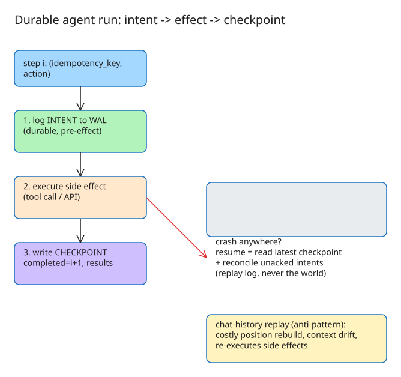

# Durable Agent Execution in ~40 Lines: SQLite WAL + Intents + Checkpoints

Working reference implementation of the durable-execution primitives for long-running agents (adapted from the DZone "Crash-Proof Agents" playbook). Complements the conceptual note [Long-Horizon Agents and Durable Execution](../../../explanations/aimachinelearning/agentarchitecture/explanation-long-horizon-agents-durable-execution.md) — this note is the code you can lift.



## Why chat history is a fragile save file

Replaying the conversation to recover a crashed agent fails three ways: (1) paying inference cost to reconstruct position — the cheapest data in the system; (2) **context drift** — the model infers what happened from its history instead of reading what the log says happened; (3) **re-executed side effects** — step 14's billing call runs again. Replace "re-run the world" with "read the log".

## The implementation

```python
import json, sqlite3, time, uuid
from typing import Any, Callable, Optional

class DurableStore:
    """Write-ahead log + checkpoint store backed by SQLite.
    WAL journal mode: a committed row survives a crashed process."""

    def __init__(self, path: str):
        self._db = sqlite3.connect(path, timeout=30)
        self._db.execute("PRAGMA journal_mode=WAL")
        self._db.executescript("""
            CREATE TABLE IF NOT EXISTS agent_log (
                seq INTEGER PRIMARY KEY AUTOINCREMENT,
                run_id TEXT NOT NULL,
                kind TEXT NOT NULL,      -- 'intent' | 'checkpoint'
                payload TEXT NOT NULL,
                created_at REAL NOT NULL
            );
            CREATE INDEX IF NOT EXISTS idx_agent_log_run
                ON agent_log(run_id, seq);
        """)

    def append(self, run_id: str, kind: str, payload: dict) -> int:
        cur = self._db.execute(
            "INSERT INTO agent_log (run_id, kind, payload, created_at)"
            " VALUES (?, ?, ?, ?)",
            (run_id, json.dumps(payload), time.time()))  # order matches cols
        self._db.commit()
        return cur.lastrowid

    def latest_checkpoint(self, run_id: str) -> Optional[dict]:
        row = self._db.execute(
            "SELECT payload FROM agent_log"
            " WHERE run_id = ? AND kind = 'checkpoint'"
            " ORDER BY seq DESC LIMIT 1", (run_id,)).fetchone()
        return json.loads(row[0]) if row else None

class DurableRunner:
    def __init__(self, store: DurableStore, run_id: str):
        self._store, self._run_id = store, run_id

    def run(self, steps: list[tuple[str, Callable[[], Any]]]) -> list[Any]:
        """Each step is (idempotency_key, callable). A crash between the
        intent row and the checkpoint is safe: on resume the key tells
        us whether the step actually executed."""
        cp = self._store.latest_checkpoint(self._run_id)
        done = cp["completed"] if cp else 0
        results = cp["results"] if cp else []
        for i in range(done, len(steps)):
            key, action = steps[i]
            # 1. write-ahead: log INTENT before the side effect
            self._store.append(self._run_id, "intent", {"key": key, "step": i})
            # 2. execute (raise -> intent stays unacked, resume reconciles)
            result = action()
            results.append(result)
            # 3. checkpoint: durable proof the step finished
            self._store.append(self._run_id, "checkpoint",
                               {"completed": i + 1, "results": results})
        return results
```

Three properties to keep when you adapt it: the **intent row hits disk before the side effect** (recovery is deterministic, not inferential); the checkpoint stores **results, not model context** (resume is a cheap DB read); and the append-only history **doubles as the audit trail**.

## Framework landscape (when to stop hand-rolling)

| Option | Fit | Cost |
|---|---|---|
| **Temporal** | Most complete: durable timers, signals for human-in-the-loop, replay-based recovery | Run the cluster; workflow code must be deterministic |
| **LangGraph checkpointer** | Shortest path in LangChain: pass to `compile()`, every superstep persists keyed by `thread_id` | Checkpoints graph nodes, not arbitrary side effects — pair with idempotent tools |
| **Restate / DBOS** | Agents structured as services; journal handler invocations with the DB as the log | New runtime dependency |
| **Airflow 3.3 durable mode** | Opt-in; caches model responses + tool results so retries replay rather than re-pay | Only if agents already live in Airflow |

Rule of thumb from the source: primitives cover ~80% of crash scenarios with code you fully understand; adopt a framework when you need durable timers, approval gates, or cross-service coordination.

## Operating practices

- **Drain-aware deploys**: stop admitting new runs → let in-flight runs reach the next checkpoint → then replace the worker. Resume should be ordinary work, never an incident.
- **Watch compensation rate**: rising saga rollback rates are a *planning* (model/prompt) problem, not an infrastructure one.

## References

- [Crash-Proof Agents: Durable Execution for Long-Running AI Systems (DZone)](https://dzone.com/articles/durable-execution-ai-agents)
- Related in KB: [Long-horizon agents and durable execution](../../../explanations/aimachinelearning/agentarchitecture/explanation-long-horizon-agents-durable-execution.md), [Idempotency keys for AI agent tool execution](../../../how-to/aimachinelearning/agentarchitecture/howto-idempotency-keys-ai-agent-tool-execution.md), [Durable Genkit flows with Temporal](../../../how-to/aimachinelearning/agentarchitecture/howto-durable-genkit-flows-with-temporal.md)
