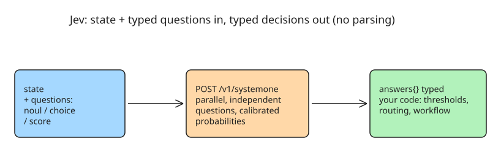

# TypeSafe Jev: Typed Judgments (noul, choice, score) as API Primitives

## The pattern this demonstrates
Instead of prompting an LLM for JSON, parsing the reply, validating it and handling malformed output, **Jev** (TypeSafe's "System One" model class) takes a **state** (the data to judge) plus named **questions**, and returns each answer in the exact type the question declared — no text generation, nothing to parse. Your code owns workflow, rules and calculations; the model supplies only the semantic judgment, and your code makes the final decision based on probabilities and thresholds.

## The three primitives
Every question has a `type`, `instructions` (the question — the question *name* is never sent to the model, so instructions must carry full meaning) and, where the type needs it, `criteria`:

| primitive | asks | `criteria` | returns |
| --- | --- | --- | --- |
| `noul` | does a condition hold? | optional `{true, false}` descriptions | probability of yes, 0–1 |
| `choice` | which one option from a fixed set? | required map option→description | chosen option, per-option `probabilities`, `confidence` |
| `score` | where on an ordered scale (≤10 levels)? | required ordered list of level descriptions | probability-weighted average `score` (can fall between levels), `legend`, per-level `probabilities`, `confidence` |

Key semantics:
- Questions in one request are evaluated **independently and in parallel** — adding questions "barely changes the response time" and avoids context rot.
- `score` levels should describe concrete situations, not degrees ("moderately"), because the model judges each level on its own without seeing its number.
- `confidence` on choice/score describes how **peaked** the distribution is, not whether the answer is correct. Route low-confidence cases to humans via thresholds in code.

## Concrete example: triaging code review comments
One request per comment, three questions shared across comments: is it blocking (`noul`), what is it about (`choice`: bug/security/performance/readability/other), how constructive is the tone (`score`: hostile→very constructive).

```bash
curl https://api.typesafe.ai/v1/systemone \
  -H "Authorization: Bearer $TYPESAFE_API_KEY" \
  -H "Content-Type: application/json" \
  -d '{
    "model": "jev-preview",
    "state": "This builds the SQL query by concatenating `userId` from the request, which allows SQL injection. Please switch to a PreparedStatement before we merge.",
    "questions": {
      "blocking": {
        "type": "noul",
        "instructions": "Does this code review comment require a change before the pull request can be merged?",
        "criteria": {
          "true": "Points out a defect or risk that must be fixed, or explicitly asks for a change before merging",
          "false": "An optional suggestion, nit, question or praise that does not block the merge"
        }
      }
    }
  }'
```
Response: `"answers": {"blocking": {"type": "noul", "noul": 0.98}}`. `GET /v1/models` lists model names; the browser Playground (`console.typesafe.ai/playground`) runs the same JSON so you can tune instruction wording before writing code.

## Measured results (jev-preview, from the article)
| comment state | blocking | category | tone score |
| --- | --- | --- | --- |
| SQL injection request | 0.98 | security (100%) | 3.04 (96% constructive, conf 97%) |
| "Nit: rename `tmp`" | 0.05 | readability (100%) | 3.44 (56/44 split constructive↔very, conf 63%) |
| "Did you even run this? stale prices" | 0.87 | bug (100%) | 1.3 (72% curt, conf 72%) |

The nit comment shows why raw `probabilities` matter: the friendly "Not a blocker" split the tone distribution across two levels and confidence dropped to 63% — an honest signal the comment sits between levels. The third row shows the model separating **defect severity** (blocking 0.87 &lt; 0.98, because no change was explicitly requested) from **tone** (curt vs neutral).

## Diagram: request/response contract



## Design notes for agents
This is the "System One" complement to LLM-as-judge patterns (compare [Actor-Judge-Teacher decision models](../../../explanations/aimachinelearning/agentarchitecture/explanation-actor-judge-teacher-decision-models.md)): a fast, structured-decision model whose output a program can branch on directly, with probabilities designed for thresholding and human escalation. Two transferable ideas even without this vendor: (1) ask **one condition per question** and let code set the threshold according to the cost of being wrong; (2) always include a catch-all option in a `choice` set. Validate answers and thresholds on your own data before relying on them.

## References
- [Original DZone article](https://feeds.dzone.com/link/23558/17526495/typesafe-jev-typed-ai-model)
- [TypeSafe docs: Introduction](https://docs.typesafe.ai/introduction)
- [TypeSafe docs: Primitives (noul/choice/score)](https://docs.typesafe.ai/primitives)
- [TypeSafe HTTP API reference](https://docs.typesafe.ai/api)
- [Confidence semantics](https://docs.typesafe.ai/confidence)
