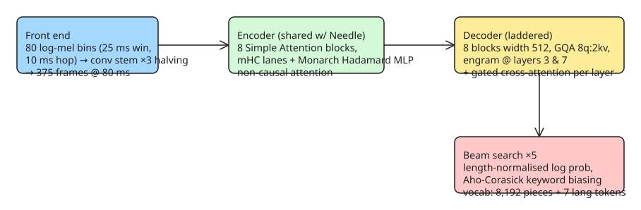

# Whistle — On-Device Speech-to-Text in a Single 16.9 MB File (Cactus Compute)

Whistle is an open speech recognition model from Cactus Compute targeting mobiles, wearables, robots, smart home, automotive and microcontrollers: **one 16.9 MB file**, CPU-only with no dependencies, loading into the same C++ engine as their text model Needle — so one binary can turn a voice clip straight into tool calls. It transcribes seven languages (English, German, French, Spanish, Italian, Dutch, Polish), reaches the first token in **11 ms** on an Apple M4 Pro CPU, and decodes at ~1,319 tokens/s.

## What it does (all on-device)

- **Transcription**: 16 kHz mono audio, up to 30 s per pass; language auto-detected unless forced.
- **Word timestamps**: every word with start/end/probability, aligned from the decoder's own attention.
- **Speech embedding**: encoder output as one row per 80 ms frame, without decoding a transcript (`embed`).

## Architecture at a glance



Key design choices:

- **Shared blocks with Needle.** Encoder and decoder reuse Needle's Simple Attention block code (not a copy): four mHC residual lanes, Monarch Hadamard MLP in place of the FFN. The speech-specific addition is one **gated cross-attention per decoder layer**: `x ← x + σ(g) · softmax(q̂K̂ᵀ/√d)V`, with K/V projected *once* per clip (375 frames × 8 layers) and held for the whole decode — so five beams cost five short transcript caches, not five passes over the audio.
- **Ladder on the decoder only.** Every depth from 2 layers up was trained as its own model; `--audio-depth` selects one at load time. The encoder always runs all eight blocks.
- **Language is a token**, not an out-of-band return: vocabulary = 8,192 text pieces + 7 language tokens (one per language).
- **Silence short-circuit.** Loudness range is measured before decoding; below threshold it returns empty transcript/language and never enters beam search.

## Benchmarks (Apple M4 Pro CPU)

| Metric | Whistle | Whisper base | Moonshine tiny v2 |
|---|---|---|---|
| Size | **16.9 MB** | 145.3 MB | 41.9 MB |
| Time to first token (10 s clip) | **11.1 ms** | 73.2 ms | 22.8 ms |
| Decode speed | **1,319 tok/s** | 266 tok/s | 262 tok/s |

WER highlights: Whistle leads on LibriSpeech test-clean/test-other, SPGISpeech, Earnings-22 and the FLEURS average; Whisper base is ahead on TED-LIUM, AMI and MLS. Caveats from the authors: Moonshine is English-only (missing bars = unpublished benchmarks), Whisper's AMI figure is the AMI-IHM subset, and Whistle's WERs were measured over 86,174 utterances with test audio verified absent from training data by checksum/speaker-ID comparison.

## Usage examples

**CLI — one binary does speech, text, or both:**

```bash
needle --model whistle.cact --audio clip.wav
needle --model needle3.cact --tools tools.json --prompt "turn off the kitchen lights"
# Speech in → tool calls out: transcribe, answer against tools, return one JSON object
needle --model needle3.cact --model whistle.cact --tools tools.json --audio clip.wav
```

The combined mode returns a single JSON object with `function_calls` plus speech fields prefixed `audio_`:

```json
{"function_calls":[{"name":"set_lights","arguments":{"room":"kitchen","on":false}}],
 "confidence":0.94,
 "audio_text":"turn off the kitchen lights",
 "audio_language":"en"}
```

**Python:**

```python
pip install cactus-needle   # [mic] extra adds soxr + sounddevice for non-16 kHz / mic capture

import needle
print(needle.transcribe("clip.wav")["text"])          # turn off the kitchen lights
# word_timestamps=True → per-word times + probability
# keywords=["Siobhan"] → Aho-Corasick log-prob biasing during search
# language="de" → force instead of detect
```

**Deploy:** prebuilt for 17 targets (macOS, Linux, Android, iOS, watchOS, Windows on ARM, RISC-V, MIPS, browser/WASI). Each folder holds a `needle` binary, `libneedle.a`, and `needle.h`; the whole speech C API is `needle_load`, `needle_transcribe`, `needle_embed`. No environment variables — every behavior is a compiled default or an explicit flag.

```bash
needle download macos-arm64
needle download whistle
./macos-arm64/needle --model whistle.cact --audio clip.wav --audio-word-timestamps
```

## When to reach for it (and when not)

- **Reach for it**: latency-sensitive on-device voice (wearables, robots, automotive), keyword-biased command recognition, or a single-binary pipeline where speech feeds directly into tool calls.
- **Not yet**: long-form transcription beyond 30 s per pass, English-heavy academic/telephone corpora where Whisper base still wins (TED-LIUM, AMI), or if you need the multilingual breadth of larger Whisper checkpoints — Whistle covers seven languages only.

## References

- [Cactus Compute — Whistle: Speech to Text in 16.9 MB](https://cactuscompute.com/blog/whistle) (original source)
- [Whistle weights on Hugging Face](https://huggingface.co/Cactus-Compute/whistle)
- [Needle engine + platform folders (Cactus-Compute/needle3)](https://huggingface.co/Cactus-Compute/needle3)
- [cactus-compute/needle source on GitHub](https://github.com/cactus-compute/needle)
- Comparison targets: [openai/whisper](https://github.com/openai/whisper), [moonshine-ai/moonshine](https://github.com/moonshine-ai/moonshine)
