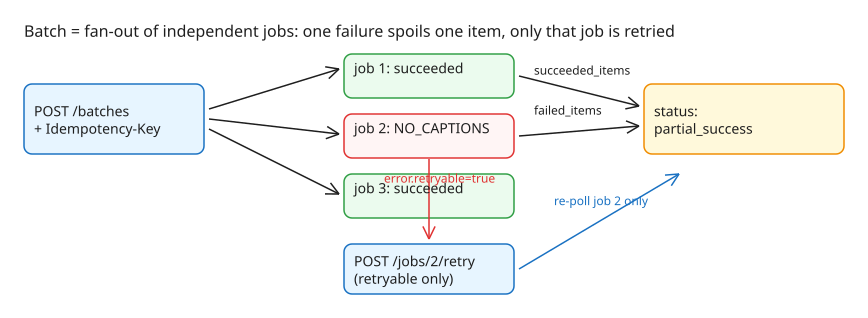

# Batch Fan-Out: Idempotent Submission, partial_success, and Per-Job Retry

A concrete, runnable demonstration of the **batch → independent jobs** API shape: submit a list of work items in one request, let the server run each as its own job with its own status, then collect results and retry *only* the failed jobs. The article demonstrates it against Transcript Dock's batch transcription endpoint with Node.js 18+ built-in `fetch` (no dependencies), but the pattern generalizes to any long-running-operation API (import/export, media pipelines, bulk scoring).



## The core property: a batch is not one task, it is many

A naive loop that processes 300 items one at a time dies on the fortieth failure. In the batch shape:

- Each list item becomes a **separate job** with its own status and result.
- One bad item (private source, missing captions) spoils exactly **one item**, not the run.
- The batch reports `partial_success` instead of `failed` — this is the property to design your client around.
- Duplicate links in the list share a single job, so you are not charged twice.

## 1. Submitting the batch (idempotency is the detail people miss)

```js
const API = "https://www.transcriptdock.com/v1";
const headers = {
  Authorization: `Bearer ${process.env.TRANSCRIPTDOCK_API_KEY}`,
  "Content-Type": "application/json",
};

const urls = [
  "https://www.youtube.com/watch?v=wQKfWMQ5c5E",
  "https://www.youtube.com/watch?v=BntIinjPNRw",
];

const res = await fetch(`${API}/batches`, {
  method: "POST",
  // Reuse the same key if you retry this exact request, so it is not submitted twice.
  headers: { ...headers, "Idempotency-Key": crypto.randomUUID() },
  body: JSON.stringify({
    items: urls.map((url) => ({ source: { url }, mode: "captions_only" })),
  }),
});
if (!res.ok) throw new Error(`${res.status} ${await res.text()}`);
let batch = await res.json();
```

The `Idempotency-Key` header protects against double-submission when a response is lost on the network: the server recognizes a repeated key and returns the *original* batch. This is the same client-token deduplication idea as deduplicate write requests with client tokens — key the request, not the entity.

## 2. Waiting: final-state polling, or webhooks for unattended runs

```js
const FINAL = new Set(["succeeded", "partial_success", "failed", "cancelled"]);
const sleep = (ms) => new Promise((r) => setTimeout(r, ms));

while (!FINAL.has(batch.status)) {
  await sleep(3000);
  batch = await (await fetch(`${API}/batches/${batch.id}`, { headers })).json();
  console.log(`${batch.succeeded_items + batch.failed_items}/${batch.total_items} done`);
}
```

The batch status is an explicit state machine: `queued`/`processing` → `succeeded` | `partial_success` | `failed` | `cancelled`. Polling every few seconds is fine for an attended script; for unattended jobs, register a webhook endpoint once, pass its `webhook_endpoint_id` at batch creation, and receive a signed `batch.completed` event when the last job finishes (cf. resolve an operation: polling vs blocking wait).

## 3. Collect results, retry only what failed — guided by error classification

```js
import { writeFile } from "node:fs/promises";

for (const item of batch.items) {
  const job = await (await fetch(`${API}/jobs/${item.job_id}`, { headers })).json();
  if (job.status !== "succeeded") {
    console.warn(`item ${item.item_index}: ${job.error?.code}`);
    continue;
  }
  const t = await (await fetch(`${API}/transcripts/${job.result_id}`, { headers })).json();
  await writeFile(`transcript-${t.source.media_id}.txt`, t.text, "utf8");
}
```

```js
await fetch(`${API}/jobs/${job.id}/retry`, {
  method: "POST",
  headers: { ...headers, "Idempotency-Key": crypto.randomUUID() },
  body: "{}",
});
```

Two design details worth copying:

1. **`error.retryable`** on the failed job tells the client whether resubmission can help — retry that job alone, never the whole batch.
2. **Error codes encode the remediation**: `SOURCE_PRIVATE` will stay private however often you ask (do not retry); `NO_CAPTIONS` can be resubmitted with `mode: "auto"` to transcribe audio instead (retry *with changed parameters*). Distinguishing "retry as-is", "retry with changes", and "never retry" is what keeps a 300-item run from degenerating into 300 pointless retries.

On the billing side, a failed job releases its reserved credit in full — the server's reservation model matches the client's retry model.

## Checklist for your own batch endpoint

- [ ] Items map to independently-statused jobs; batch aggregates, never gates.
- [ ] `Idempotency-Key` on batch submission *and* on job retry.
- [ ] Explicit final-state set on the batch status; a `partial_success` terminal state.
- [ ] Per-error `retryable` flag plus stable machine-readable error codes.
- [ ] Webhook completion event with signature for unattended consumers.
- [ ] Deduplicated items share one job; failed work refunds reservations.

## References

- Original article: [Transcribing a Whole List of YouTube Videos in One Request with Node.js](https://dev.to/taimur_khan_441354c7efc16/transcribing-a-whole-list-of-youtube-videos-in-one-request-with-nodejs-2a91) (DEV.to, 2026-11-26)
- Vendor docs for the batch/job/webhook model: [Transcript Dock quickstart](https://www.transcriptdock.com/docs/quickstart)
- Related in KB: How to Resolve an Operation: Polling vs Blocking, Deduplicate Write Requests with Client Tokens, Request Deduplication Algorithm
