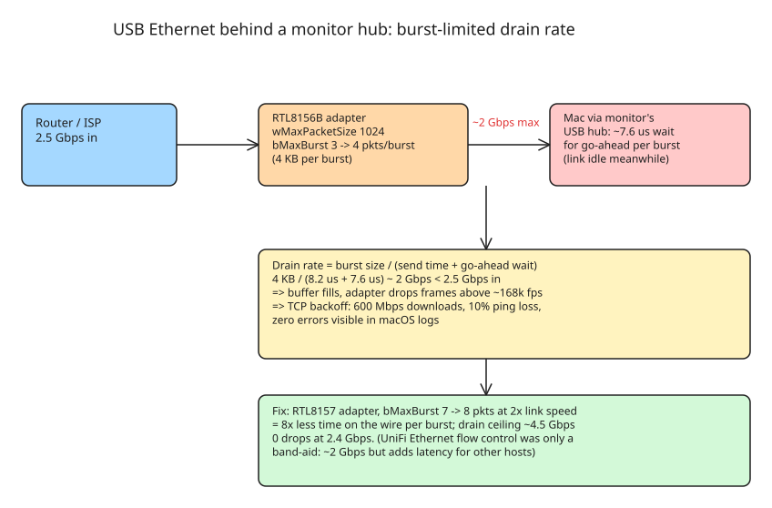

# Worked Debugging Case: USB Ethernet Behind a Monitor Hub, Burst Scheduling, and the Missing 75% of Bandwidth

A 2.5 Gbps symmetrical line delivering **622 Mbps down / 2.4 Gbps up** — and the culprit was neither
the ISP, the router, nor even "the monitor" in any simple sense. This is a model debugging case
study: each experiment eliminates exactly one hypothesis, and the final root cause is a **USB burst
scheduling limit** invisible to OS-level counters. Setup: MacBook Pro M3 Pro → 2026 Studio Display
XDR (one-cable dock) → UGREEN USB-C 2.5G Ethernet adapter (Realtek **RTL8156B**) → UniFi Dream
Router 7.

 — in-rate vs burst-limited drain rate, where the buffer overflows, and why the RTL8157 fixes it.

## The elimination ladder (each step is reusable)

1. **Asymmetric symptom is a hint:** upload full speed, download ¼. Suggests receive-path drops, not a bad cable/port.
2. **Ping during download: 10% loss over the monitor path, 0% over Wi-Fi — but zero frame errors in macOS logs.** No errors *visible to the OS* means the **adapter itself** is dropping before the Mac ever sees the frames. (Key inference pattern.)
3. **`iperf3` on the UDR7 with the adapter plugged straight into the Mac: 2.3 Gbps.** Cable, router, adapter all exonerated; the monitor's USB hub is implicated — but "the monitor is broken" is not an explanation.
4. **Realtek's own driver vs Apple's generic RTL8156B driver:** 600 Mbps → 1.1 Gbps download. The driver matters, but the ceiling remains.
5. **Ethernet flow control (802.3x) enabled on the UniFi console:** ~2 Gbps download. The adapter can now send "pause" frames so the *sender* buffers instead of the receiver dropping. Works — but flow control adds latency for other hosts (the gaming PC), i.e. a band-aid that relocates the problem.
6. **Fixed-rate UDP from a Linux box with flow control off, reading the *adapter's own* drop counters:**

   | Sent | Lost behind display | Frames/s reaching the Mac | Lost direct |
   | --- | --- | --- | --- |
   | 1.46 Gbps | 0% | 123,800 | 0% |
   | 1.94 Gbps | 0.1% | 165,000 | 0% |
   | 2.03 Gbps | 2.7% | 168,000 | 0% |
   | 2.20 Gbps | 10.5% | 168,000 | 0.001% |
   | 2.28 Gbps | 13.5% | 168,000 | 0.02% |

   Throughput **flattens at ~168k frames/s (~2 Gbps)** behind the display, with essentially zero
   loss when plugged directly. A hard rate ceiling, not congestion.

## Root cause: USB burst size vs go-ahead latency

USB 3 transfers are burst-based: the device sends `bMaxBurst` packets, then waits for the host's
go-ahead. The adapter's USB descriptors tell the whole story:

```bash
python3 -c "import usb.core; e = usb.core.find(idVendor=0x0bda)[0][(0,0)][0]; print('packet size', e.wMaxPacketSize, 'bMaxBurst', e.extra_descriptors[2])"
# old adapter (RTL8156B): packet size 1024  bMaxBurst 3   -> 4 packets per burst
# new adapter (RTL8157):  packet size 1024  bMaxBurst 7   -> 8 packets per burst
```

Through the monitor's hub silicon, the go-ahead takes **~7.6 µs**; transmitting a 4 KB burst takes
**~8.2 µs**. Drain capacity = 4 KB / (8.2 µs + 7.6 µs) ≈ **2 Gbps** — *below* the 2.5 Gbps inflow.
The buffer fills, the adapter drops above ~168k fps, TCP backoffs cut downloads to 600 Mbps. The
external SSD never hit this because it bursts 16 packets instead of 4 and its link is faster —
**burst geometry, not link speed, set the ceiling.**

## The fix — and the general lesson

A 5 Gbps adapter with the **RTL8157** (8 packets per burst, 2× link speed → 8× less wire time per
burst, go-ahead wait unchanged) raises the drain ceiling to ~4.5 Gbps: **0 dropped frames at
2.4 Gbps** (verified: 194k frames/s at 2.4 Gbps sent). No flow control needed.

Reusable takeaways:

- **Check device-side counters when OS-side counters are clean** — a dumb middlebox drops silently.
- "Effective throughput" of a storage/network device on USB is a function of *packet size × burst
  count ÷ (transmit time + host response latency)*, not just the advertised Gbps.
- Ethernet flow control is a diagnostic signal (it recovered ~2 Gbps → receive-side buffer
  overflow) before it's a configuration choice.
- Reproduce with **constant-rate UDP** to separate buffer ceilings from TCP congestion control.

## Independent corroboration (verified 2026-11-21)

The case was independently covered the day after the original post: same numbers (~600 Mbps down
vs 2.4 Gbps up on a 2.5 Gbps line behind a Studio Display XDR hub), same root cause — the RTL8156B
"send[s] only four 1 KB packets per USB burst, which capped throughput near 2 Gbps behind the
hub." Use the technology.org write-up as a second source when citing this class of ceiling.

## References

- [Original post (blog.tymscar.com, Oscar Molnar)](https://blog.tymscar.com/posts/studiodisplayethernet/)
- [Independent coverage: "Monitor USB Hub Throttled 2.5 Gbps Downloads" (technology.org, 2026-11-20)](https://www.technology.org/2026-11-20/monitor-usb-hub-ethernet-adapter-download-speed-rtl8156b/)
- [Ethernet flow control (802.3x)](https://en.wikipedia.org/wiki/Ethernet_flow_control)
- [Realtek RTL8156 driver downloads](https://www.realtek.com/Download/List?cate_id=585)
