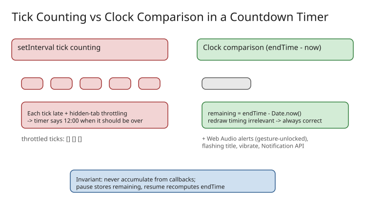

# Clock-Based Countdown Timers: Background Tab Throttling, Drift, and Web Audio Alerts

Worked example of the three browser realities that break naive countdown timers (`setInterval` subtracting 1 each tick) and the small code idioms that fix them. Extracted from a dev.to build post on a focus timer; generalized here away from the product marketing. Related: [[explanation-browser-apis-replacing-npm-packages]].



## Problem 1: a repeating timer is not a clock

Two failure modes of `setInterval(() => remaining -= 1, 1000)`:

1. **Drift** — every callback fires slightly late; delays accumulate over long sessions.
2. **Background throttling** — browsers heavily throttle timers in hidden tabs, so a tab left in the background for an hour can fall *far* behind and finish late (or never fire).

Fix: derive the display from wall-clock time. The timer decides only *when to redraw*; the *answer* always comes from the clock:

```js
// Start: freeze the true end instant
const endTime = Date.now() + durationMs;

// Every redraw tick (interval timing is now irrelevant to correctness)
const remainingMs = Math.max(0, endTime - Date.now());

// Pause: remember the remainder, resume: compute a fresh end time
let remainingAtPause;                     // on pause
remainingAtPause = endTime - Date.now();  // on pause
const endTime = Date.now() + remainingAtPause;  // on resume
```

A hidden tab then "catches up" instantly on the next frame — it can't lie, because it never counted ticks.

## Problem 2: nobody is watching the tab (alerts that survive backgrounding)

A countdown alert must fire when the tab is *not* focused. Multiple redundant signals:

- **Sound via Web Audio API** — oscillator-generated chimes, no audio files to preload (tick in the final 5 s; chosen alert repeats at 0:00 for up to a minute or until dismissed).
- **Flashing tab title** (`document.title = "⏰ DONE | Focus Timer"` on an interval) — visible in the tab strip.
- **Vibration on phones** — `navigator.vibrate([...])` where supported.
- **System notification** — `Notification` API, strictly opt-in (the browser's own permission prompt is the consent gate).

The autoplay trap: browsers only allow audio after a **user gesture** on the page, so a timer started then ignored for 90 minutes hits a silent wall at 0:00. Practical idiom — a **"Test sound" button** the user is told to press before walking away; that single click unlocks the `AudioContext` for the whole session:

```js
document.querySelector("#test-sound").addEventListener("click", () => {
  ctx ??= new AudioContext();   // created inside a user gesture
  if (ctx.state === "suspended") ctx.resume();
  playChime(ctx);               // also proves audio works, right now
});
```

## Problem 3: metrics that can't be gamed

The article's stats rules are a nice example of anti-cheat design in a client app:

- *Sessions completed* increments **only at 0:00** — resetting early earns nothing ("no partial credit").
- *Total focus time* adds the **full configured length** of completed sessions regardless of pauses — answering a quick message shouldn't punish the stat.
- Counters live only for the page session (in-memory, not persisted) — a signal for today, not a database.
- Display detail: roll over to `1h 45m` past 60 minutes rather than `105m`.

## When to reach for this pattern

Any time-boxed UI element: Pomodoro/.focus timers, checkout countdowns, OTP expiry indicators, auction clocks. The invariant is universal — **never accumulate time from callbacks; always compute remaining = endTime − now**, and unlock audio inside a user gesture at setup time.

## References

- [Building a Countdown That Doesn't Lie: Background Tabs, Timer Drift and Web Audio Alerts — DEV.to](https://dev.to/md_shohan_102187760726951/building-a-countdown-that-doesnt-lie-background-tabs-timer-drift-and-web-audio-alerts-452f)
