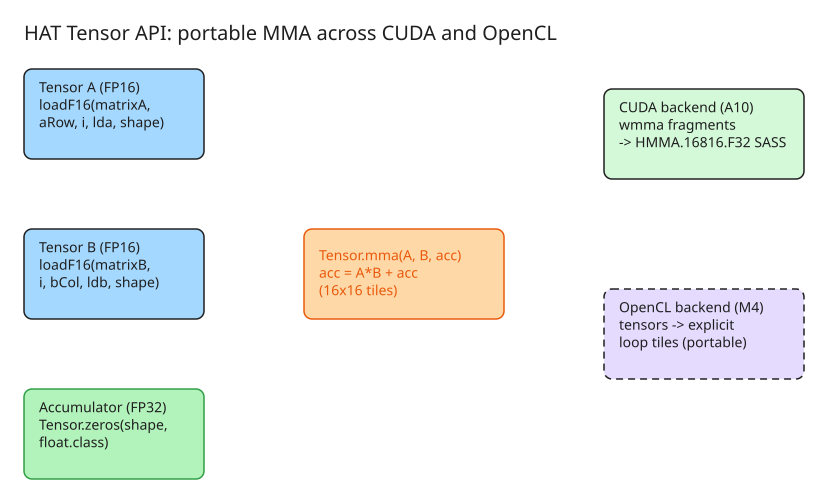

# Exploiting GPU Tensor Cores from Java using Babylon and HAT

This note walks through a published approach (OpenJDK Project Babylon + the Heterogeneous Accelerator Toolkit, HAT) for programming NVIDIA GPU tensor cores directly from Java, while keeping the same source portable to accelerators without explicit MMA hardware. The full paper is available on [openjdk.org](https://openjdk.org/projects/babylon/articles/hat-tensors/hat-tensors).

## Background: what tensor cores do

Tensor Cores are dedicated matrix-multiply-accumulate (MMA) units on NVIDIA GPUs (since Volta). A single MMA processes small matrices (e.g., 16×16 FP16 inputs, FP32 accumulator) in one clock cycle — hundreds to thousands of scalar FMA operations per cycle. On a Blackwell B200 SM: 4 tensor cores × up to 512 half-precision FMAs/cycle = **2048 FMA ops per cycle per SM**.

MMA dominates AI workloads (over 80% of upstream LLM compute), but the native APIs are CUDA-only (`wmma` fragments). The goal here: expose a tensor API from Java that compiles to real `HMMA` instructions on NVIDIA hardware, yet degrades gracefully to explicit loop-tiled computation on OpenCL devices (e.g., Apple Silicon) that lack MMA units.

## Architecture in one picture

```
Java kernel (@Reflect method using Tensor API)
        |  code reflection (Project Babylon)
        v
   HAT compiler + code transformations
        /                          \
       v                            v
 CUDA backend                  OpenCL backend
 (NVIDIA A10: emits wmma      (Apple M4 Max: lowers tensors
  fragments -> HMMA SASS)     to explicit per-work-item tiles)
```

Key design decisions:

- **Tensor API modeled on CUDA WMMA** but simplified for Java: immutable tensor values, row-major layout by default, shape chosen explicitly by the programmer.
- **ND-Range extended with tile-size and warp-size**: `Local2D.of(128, 4)` + `NDRange.Tile2D.of(16, 16)`. Warp size is recalculated automatically; on non-warp devices it maps to work-group sizing.
- **Portability via loop tiling**: when the backend has no MMA units, `Tensor.mma` lowers to `acc = add(dot(tensorA, tensorB), acc)` over explicit tiles — same Java source, different generated code.

## The kernel: matmul with the HAT Tensor API

Naïve baseline (already coalesced, 2D):

```java
static void mxmNaiveF16(KernelContext kc, F16Array matrixA,
                        F16Array matrixB, F32Array matrixC, int size) {
    float acc = 0.0f;
    for (int k = 0; k < size; k++) {
        F16 ha = matrixA.array(k * size + kc.giy);
        F16 hb = matrixB.array(kc.gix * size + k);
        float fc = F16.f16ToFloat(F16.mul(ha, hb));
        acc += fc;
    }
    matrixC.array(kc.gix * size + kc.giy, acc);
}
```

Tensor-core version:

```java
@Reflect
public static void hatTensors(@RO KernelContext kc,
                              @RO F16Array matrixA,
                              @RO F16Array matrixB,
                              @WO F32Array matrixC, int size) {
    final int shapeSize = 16;
    final int WMMA_M = shapeSize, WMMA_N = shapeSize, WMMA_K = shapeSize;
    int warpM = kc.gix / kc.wrs;   // warp index along M
    int warpN = kc.giy;            // one warp per N-tile

    final int lda = size, ldb = size, ldc = size;
    var shape = Tensor.shape(WMMA_M, WMMA_N, WMMA_K);
    Tensor acc = Tensor.zeros(shape, float.class);

    int aRow = warpM * WMMA_M;
    int bCol = warpN * WMMA_N;
    for (int i = 0; i < size && aRow < size && bCol < size; i += WMMA_K) {
        Tensor tensorA = Tensor.loadF16(matrixA, aRow, i, lda, shape);
        Tensor tensorB = Tensor.loadF16(matrixB, i, bCol, ldb, shape);
        acc = Tensor.mma(tensorA, tensorB, acc);   // A*B + acc
    }
    int cRow = warpM * WMMA_M;
    int cCol = warpN * WMMA_N;
    if (cRow < size && cCol < size) {
        Tensor.store(matrixC, cRow, cCol, acc, ldc);
    }
}
```

On the CUDA backend this compiles to real `wmma` fragments and emits SASS like:

```
HMMA.16816.F32 R4, R12, R22, R4
HMMA.16816.F32 R8, R12, R24, R8
```

Column-major inputs are supported via `Tensor.loadF16(matrixA, aRow, i, lda, shape, Tensor.ofColumnMajor())`.

## Benchmark results (matmul, sizes 512–4096)

| Platform | Backend | Result |
| --- | --- | --- |
| NVIDIA A10 (CUDA) | tensor API → HMMA | **7.3 TFLOP/s** (naïve kernel: ~240 GFLOP/s, i.e., ~30× speedup); matches equivalent hand-written CUDA C++ |
| Apple M4 Max (OpenCL 1.2) | tensors lowered to loop tiles | up to **8–9× over naïve matmul** after tuning tile `4×4` with work-group `Local2D.of(128, 1)`; >1000× over CPU parallel-stream baseline |

Native CUDA reference points (A10, 1024×1024): naïve CUDA kernel ~1 TFLOP/s (2.15 ms), WMMA version ~6.5 TFLOP/s (0.33 ms), cuBLAS `GEMM` ~42 TFLOP/s (0.05 ms) — the gap to cuBLAS is expected since this kernel omits shared-memory tiling and double buffering.

Practical notes:

- Tensor shape must match backend capabilities; on OpenCL, large shapes (e.g., 16) can fail to compile/launch due to register pressure — `shapeSize = 4` works where 16 does not.
- A `PREFERRED_SHAPE_SIZE` auto-selection feature is under discussion upstream.

## Running the benchmark

```bash
# OpenCL backend
java @hat/run ffi-opencl tensors --iterations=100 --verbose --size=1024 --check

# CUDA backend
java @hat/run ffi-cuda tensors --iterations=100 --verbose --size=1024 --check

# inspect generated code
HAT=SHOW_CODE java @hat/run ffi-opencl tensors --iterations=100 --verbose --size=1024 --check
```

Implementation lives on the [babylon `hat/tensors/v2` branch](https://github.com/jjfumero/babylon/tree/hat/tensors/v2); final integration into HAT is still under discussion.

## Diagram: tensor MMA data flow



## References

- [Exploiting GPU Tensor Cores from Java using Babylon (Inside Java)](https://inside.java/2026-06-10/hat-tensors-computation/) — original article
- [Full paper on openjdk.org](https://openjdk.org/projects/babylon/articles/hat-tensors/hat-tensors)
- [Author's blog post (Juan Fumero)](https://jfumero.dev/posts/2026-06-11/hat-tensors)
- [Optimizing GPU Programs from Java using Babylon and HAT (companion article)](https://inside.java/2026-01-19/hat-matmul-gpu/) — matmul tuning without tensor cores
- [HAT Tensor API implementation branch](https://github.com/jjfumero/babylon/tree/hat/tensors/v2)
