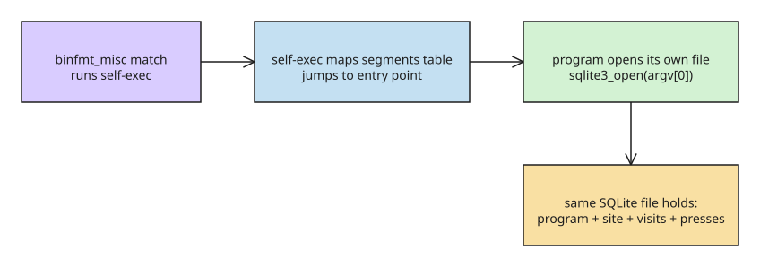

# Actually Queryable Executables: SELF Format and self-httpd

Farid Zakaria's **SELF** format makes an executable file a SQLite database.
Linux's `binfmt_misc` matches the file and runs a custom interpreter
(`self-exec`) that maps the rows of a `segments` table into memory, jumps to
the entry point, and then releases its SQLite connection — so the *program*
can open the same file it was launched from and query it. The killer property:
a running program can store its **state inside the file it is running from**,
transactionally. A single file then contains program + content + logs.

## How the process sees itself

When `binfmt_misc` matches, the kernel does not `execve` the file at all; it
execs the interpreter and hands it the path. `self-exec` passes `argv + 1`
through, so the program's `argv[0]` is the path of its own file:

```c
int main(int argc, char **argv) {
    sqlite3 *db;
    /* the file the kernel just executed */
    sqlite3_open(argv[0], &db);
    ...
}
```

(`/proc/self/exe` points at the interpreter while `binfmt_misc` is active, so
`argv[0]` is the handle to use. Recent kernel work on transparent
`binfmt_misc` will eventually make `/proc/self/exe` point at the original
file.)

## self-httpd: a web server that is its own database

The proof of concept is a three-table web server. Tables are created with DDL
against the executable after it is compiled; the site content is `INSERT`ed in:

```sql
CREATE TABLE routes  (path TEXT PRIMARY KEY, mime TEXT, body BLOB);
CREATE TABLE visits  (id INTEGER PRIMARY KEY, at TEXT, ua TEXT, path TEXT);
CREATE TABLE presses (id INTEGER PRIMARY KEY, at TEXT, button TEXT);
```

```bash
# ordinary ELF, then reified into rows
$ cc -O2 server.c -o server.elf $(pkg-config --libs sqlite3)
$ elf2self server.elf server
$ sqlite3 server < site/schema.sql
$ sqlite3 server "INSERT INTO routes VALUES ('/index.html', 'text/html', ...)"

# run it
$ ./server --journal wal 8080
self-httpd: serving 3 routes out of /srv/self/server
```

Visitor state lands in the *same* file:

```bash
$ curl -s -X POST -d press localhost:8080/api/press
{"presses":1,"button":"press"}
$ sqlite3 server 'SELECT id, at, button FROM presses'
1|2026-08-25 03:11:28|press
$ sqlite3 server 'SELECT count(*) AS n, path FROM visits GROUP BY path'
1|/
1|/api/press
```

Handlers are also rows — extending the server is an `INSERT`:

```sql
INSERT INTO handlers VALUES
  ('/api/busiest', 'SELECT path, count(*) FROM visits GROUP BY path
                    ORDER BY 2 DESC LIMIT 5');
```

## Redeploying is a data migration

Because program and data are one file, a redeploy is two `INSERT ... SELECT`
statements that carry the live state into the new build:

```sql
ATTACH '/srv/self/server' AS old;
INSERT INTO visits (at, ua, path) SELECT at, ua, path FROM old.visits;
INSERT INTO presses (at, button) SELECT at, button FROM old.presses;
```

Swap the file, restart, and the visitor log survives the new build. Deployment
becomes `scp` of a single file.



## Caveats

- The project (`fzakaria/selfdb`) is explicitly half-baked and AI-assisted — a
  research exploration, not production software.
- The author credits Justine Tunney's **redbean** (webserver as a self-extracting
  Actually Portable Executable) as prior art; SELF differs by making the
  database itself the container and the handler layer.

## Community discussion highlights (verified 2026-09-28, [HN thread](https://news.ycombinator.com/item?id=49442589))

The Hacker News discussion surfaced three threads worth keeping:

- **Security is the open problem.** SQLite has no ACL mechanism, so nothing stops
  a compromised handler from rewriting the `segments` table (i.e. its own code).
  The proposed fix is a custom SQLite VFS that maps executable pages into
  `mprotect()`ed OS pages — W^X at the page level, with `mseal()` on top — so
  self-modification crashes instead of silently succeeding. Until then, treat a
  SELF file as *trusted code + trusted data in one blob*: any write access to the
  file is write access to the program.
- **Self-upgrade as migration.** Because `segments` is just another table, an app
  can run schema migrations at startup and even replace its own code rows — a
  SELF upgrade becomes `INSERT ... SELECT` of new segments/symbols plus
  fork+exec, with the data migration cleaning up old code. The same trick enables
  **fat binaries**: `SELECT text FROM executable WHERE arch = $(uname -m)`.
- **Historical echo.** Commenters noted the resemblance to IBM i (AS/400)
  libraries — first-class OS objects that are effectively DB tables you can query
  with SQL from the command line — a concept taken much further in that ecosystem.

## References

- [Farid Zakaria: Actually Queryable Executables](https://fzakaria.com/2026/08/24/actually-queryable-executables)
- [selfdb repository](https://github.com/fzakaria/selfdb)
- [redbean (prior art)](https://redbean.dev/)
- [Linux binfmt_misc documentation](https://docs.kernel.org/admin-guide/binfmt-misc.html)

## Related
- [[explanation-isolcpus-irq-affinity]]
- [[explanation-bpf-vs-logs-metrics-observability]]
- [[explanation-linux-containers-namespaces-cgroups]]
