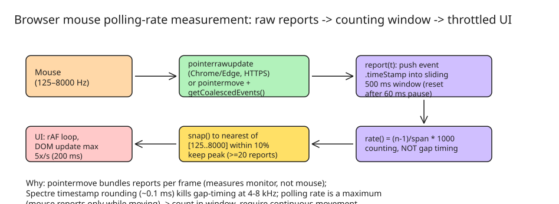

# Measuring Mouse Polling Rate in the Browser (pointerrawupdate + getCoalescedEvents)

A working, in-browser measurement of a mouse's **polling rate** (how often the device reports its position: 125 Hz up to 8000 Hz on gaming mice). The article is a compact tour of the Pointer Events API and a good worked example of a recurring pattern: *when timestamps are unreliable, count events in a window instead of timing gaps*.



## The four problems and their fixes

### 1. `pointermove` measures your monitor, not your mouse

Browsers bundle all mouse reports since the last frame into **one** `pointermove` event, so naive listeners measure the screen refresh rate. Two APIs get the raw per-report stream:

- **`pointerrawupdate`** (Chrome and Edge only) — fires for every raw report without waiting for the next frame; **HTTPS pages only**.
- **`getCoalescedEvents()`** — returns the individual events bundled into a single `pointermove`.

```js
const raw = 'onpointerrawupdate' in window;

function handle(e) {
  if (e.pointerType !== 'mouse') return;   // fingers/pens have no polling rate
  const list = e.getCoalescedEvents ? e.getCoalescedEvents() : [];
  if (list.length) list.forEach((c) => report(c.timeStamp));
  else report(e.timeStamp);                // fallback: one event per frame, not exact
}

window.addEventListener(raw ? 'pointerrawupdate' : 'pointermove', handle, { passive: true });
```

Key detail: use the event's own **`timeStamp`**, not `performance.now()`. The timestamp records when the browser *received* the report; `performance.now()` records when your code *got around to* handling it, which can be later. The listener goes on `window` (whole page = measurement area) because fast wide movements escape any fixed-size box.

### 2. Timing gaps breaks at high rates — count instead

At 8000 Hz, reports are 0.125 ms apart — at or below the browser's timestamp rounding step (a Spectre mitigation), so single-interval measurements are meaningless. Counting is robust because rounding only affects the first and last timestamp of a window:

```js
const WINDOW = 500; // ms of continuous movement per reading
const GAP = 60;     // no report for 60 ms = the mouse stopped
let times = [], last = 0;

function report(t) {
  if (last && t - last > GAP) times = [];   // a pause: start a new window
  last = t;
  times.push(t);
  while (times.length && t - times[0] > WINDOW) times.shift();
}

function rate() {
  const span = times[times.length - 1] - times[0];
  return ((times.length - 1) / span) * 1000;  // reports per second
}
```

### 3. A mouse only reports while it moves

Polling rate is a **maximum**: a 1000 Hz mouse moved slowly may report only 300 times/s, and a stationary mouse reports nothing. Mitigations:

- Restart the counting window after a 60 ms pause (pauses must not read as "slow").
- Only accept readings with 20+ reports spread over ≥400 ms of continuous movement.
- Keep the best (peak) steady reading — nobody moves a mouse perfectly evenly.
- Snap to the nearest standard rate within 10%:

```js
const RATES = [125, 250, 500, 1000, 2000, 4000, 8000];
const snap = (hz) => {
  for (const r of RATES) if (Math.abs(hz - r) / r < 0.1) return r;
  return Math.round(hz / 10) * 10;
};
```

### 4. Don't touch the DOM 8000 times a second

The handler only records timestamps; a `requestAnimationFrame` loop reads the result and updates the UI at most 5×/s (200 ms throttle):

```js
let shown = 0;
function tick() {
  requestAnimationFrame(tick);
  const now = performance.now();
  if (now - shown < 200) return;
  if (times.length < 20 || times[times.length - 1] - times[0] < WINDOW * 0.8) return;
  shown = now;
  // snap(rate()), keep the peak, update text + graph
}
requestAnimationFrame(tick);
```

## Limits and honesty rules

- `pointerrawupdate` exists only in Chrome/Edge; elsewhere accuracy depends on whether `getCoalescedEvents()` delivers every report. If the browser only gives one move per frame, **say so** instead of showing a wrong number.
- At 4000/8000 Hz the browser itself can be the bottleneck — if the test reads lower than the mouse's own software, trust the vendor software.
- Fully local: timestamps never leave the page (no server).

## Transferable patterns

1. **Event-counting over a sliding window** beats interval timing whenever timestamps are coarse relative to the event rate (applies to any high-frequency telemetry: input, sensors, packet arrival).
2. **Vendor-report fidelity**: browsers coalesce/aggressively optimize input; raw per-report data often requires opting into non-frame-aligned APIs.
3. **UI decoupling**: separate the measurement path (cheap timestamp push) from the presentation path (throttled rAF read) whenever the producer runs faster than ~60 Hz.

## References

- **How a web page can measure your mouse's polling rate** (myklez, DEV.to): [https://dev.to/myklez/how-a-web-page-can-measure-your-mouses-polling-rate-3e9c](https://dev.to/myklez/how-a-web-page-can-measure-your-mouses-polling-rate-3e9c)
- **Live demo — Mouse polling rate test**: [https://frametide.de/tools/mouse-polling-rate-test](https://frametide.de/tools/mouse-polling-rate-test)
- **Pointer Events Level 3 — coalesced events**: [https://www.w3.org/TR/pointerevents3/#coalescing-of-pointer-events](https://www.w3.org/TR/pointerevents3/#coalescing-of-pointer-events)
