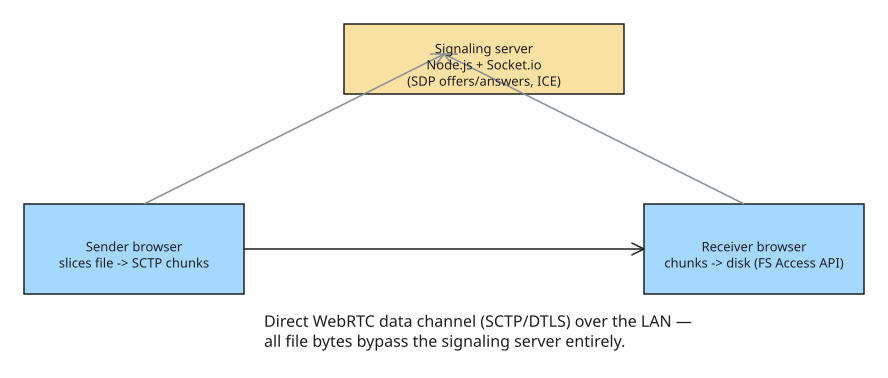

# Zero-Install Multi-Gigabyte P2P File Transfer in the Browser (WebRTC + File System Access API)

Concrete demonstration from **FluX** ([github.com/KING-UPE/FluX](https://github.com/KING-UPE/FluX)): a zero-install, peer-to-peer file-sharing tool that streams multi-gigabyte files directly between machines over the LAN — no desktop client, no cloud round-trip. The interesting part is how it survives three browser-specific failure modes when moving 10 GB+ of data through a tab.

## Hybrid architecture: signaling server + direct data channel



1. **Signaling** (Node.js + Socket.io): coordinates peer discovery and exchanges SDP offers/answers and ICE candidates. Stateless, tiny traffic.
2. **Data path** (WebRTC SCTP/DTLS data channel): once the handshake completes, every file byte travels directly peer-to-peer over the LAN at local-network speed — the server is out of the loop.

## Challenge A: bypassing the browser RAM crash (direct-to-disk streaming)

Naive downloads build an in-memory `Blob`/`ArrayBuffer` first → a 10 GB transfer OOM-kills the tab. The fix is the **File System Access API**: pick a destination file handle, then pipe incoming chunks straight to disk as they arrive.

```javascript
// Receiver: request a destination file handle from the user
const fileHandle = await window.showSaveFilePicker({
  suggestedName: incomingMetadata.name,
});
const writableStream = await fileHandle.createWritable();

// Write each WebRTC chunk directly to disk — nothing held in memory
dataChannel.onmessage = async (event) => {
  if (event.data instanceof ArrayBuffer) {
    await writableStream.write(event.data);
  } else if (event.data === "TRANSFER_COMPLETE") {
    await writableStream.close();
  }
};
```

## Challenge B: backpressure via `bufferedAmount`

WebRTC data channels have an internal send buffer. If you slice faster than the channel flushes, `bufferedAmount` climbs and packets drop (or the tab dies). Solution: a high/low-water-mark loop — pause slicing above 8 MB, resume on `bufferedamountlow`.

```javascript
const CHUNK_SIZE = 64 * 1024;              // 64 KB per chunk
const BUFFER_THRESHOLD = 8 * 1024 * 1024;  // 8 MB high watermark

dataChannel.bufferedAmountLowThreshold = 1 * 1024 * 1024; // 1 MB low watermark

async function sendFile(file, dataChannel) {
  let offset = 0;
  while (offset < file.size) {
    if (dataChannel.bufferedAmount > BUFFER_THRESHOLD) {
      await new Promise((resolve) => {
        dataChannel.onbufferedamountlow = () => {
          dataChannel.onbufferedamountlow = null;
          resolve();
        };
      });
    }
    const chunk = file.slice(offset, offset + CHUNK_SIZE);
    dataChannel.send(await chunk.arrayBuffer());
    offset += CHUNK_SIZE;
  }
  dataChannel.send("TRANSFER_COMPLETE");
}
```

## Challenge C: non-blocking UI with Web Workers

SHA-256 checksums and slicing multi-gigabyte files on the main thread freeze React rendering. Offload hashing + chunking to dedicated **Web Workers** so the UI stays at 60 FPS during transfer.

## Cross-browser reality: the File System Access API is Chromium-desktop-only (2026)

The direct-to-disk trick above only works where the picker methods ship. As of 2026 the support matrix is stark:

| Browser | `showSaveFilePicker` / local-disk pickers | OPFS (`navigator.storage.getDirectory`) |
|---------|-------------------------------------------|------------------------------------------|
| Chrome 86+ / Edge 86+ / Opera 72+ (desktop) | ✅ | ✅ |
| Chrome for Android, Samsung Internet 15+ | ❌ (pickers stripped) | ✅ |
| Firefox (any platform) | ❌ — Mozilla's standards position calls the local-disk pickers *harmful*; no flag exists | ✅ (111+) |
| Safari (macOS/iOS/iPadOS) | ❌ — never shipped, no flag, no commitment from Apple | ✅ (15.2+) |

Global picker usage sits around ~27%, so a production P2P transfer tool cannot assume `showSaveFilePicker` exists. Practical fallbacks:

- **`browser-fs-access`** (GoogleChromeLabs): same API surface with transparent fallback to `<input type="file">` and `<a download>` on unsupporting browsers — at the cost of buffering via the legacy download path on those browsers.
- **OPFS** as a bounded staging area on Firefox/Safari, then a user-initiated save.
- Feature-detect (`'showSaveFilePicker' in window`) rather than UA-sniffing.

## Scaling lessons (ButterShare, 20–100 GB transfers)

A second field report (ButterShare, dev.to) pushing the same architecture to 20–100 GB files adds what the FluX write-up leaves implicit:

- **A data channel is a transport, not a file-transfer protocol.** You must build metadata, chunking, progress, ACK/retry, integrity, and resume yourself. Send a JSON `file-start` frame (name, size, mimeType, id) *before* any binary chunks, and model the session as explicit states (`TRANSFER_START → FILE_START → FILE_CHUNK → FILE_END → ACK …`) instead of ad-hoc `"start"/"done"` messages.
- **The receiver is where naive implementations die** — `chunks.push(event.data)` then `new Blob(chunks)` is a 100 GB array in the tab. Progressive write-to-disk is mandatory (which is exactly why the browser-support gap above hurts).
- **Design resume early.** For multi-hour transfers it's a requirement, not a nice-to-have: exchange a `resume-state` (bytes received) and resume from that offset. File identity must be more robust than `name + lastModified` (both mutate) — use a checksum.
- **Poll `bufferedAmount` with a timeout loop or use `bufferedAmountLowThreshold` + `bufferedamountlow`** (event-based is more stable than the 10 ms polling loop; see Challenge B above).
- **Use `ordered: true`** for file chunks — reconstruction is trivial with in-order delivery; unordered only pays off for other real-time workloads.
- **"Works in Chrome" means almost nothing**: test Chrome, Edge, Firefox, Safari, and iOS Safari before trusting a release.

## Stack summary

| Layer | Choice |
|-------|--------|
| Frontend | React 18, Zustand, Framer Motion, Tailwind CSS |
| Protocols | WebRTC (SCTP/DTLS data channels), Socket.io for signaling |
| Browser APIs | File System Access API (`showSaveFilePicker`), Web Workers, `Blob.slice()` |
| Signaling backend | Node.js + Express + Socket.io (stateless) |

## Reusable lessons

- **Never buffer a large transfer in the tab** — stream to disk with the File System Access API.
- **Always throttle on `bufferedAmount`**, not on a fixed timer; watermarks adapt to actual channel drain rate.
- **Move crypto and slicing off the main thread.**
- A stateless signaling server is enough: it only carries SDP/ICE, never file bytes.
- **Feature-detect disk access** — `showSaveFilePicker` is Chromium-desktop-only; have an OPFS/`<a download>` fallback for Firefox/Safari.
- **A data channel is transport, not a protocol** — metadata frames, ACKs, and resume are yours to build.

## References

- [How I Built a Zero-Install, Multi-Gigabyte P2P File Transfer Engine in the Browser with WebRTC & File System Access API](https://dev.to/kingupe/how-i-built-a-zero-install-multi-gigabyte-p2p-file-transfer-engine-in-the-browser-with-webrtc--1doe)
- [FluX source code (GitHub)](https://github.com/KING-UPE/FluX)
- [PubNub: WebRTC file transfer in the browser — chunking and data-channel patterns](https://www.pubnub.com/blog/transfer-files-in-the-browser-pubnub-rtc-fileshare/)
- [MDN: Window.showSaveFilePicker()](https://developer.mozilla.org/en-US/docs/Web/API/Window/showSaveFilePicker) — Chromium-only, desktop
- [MDN: RTCDataChannel.bufferedAmount](https://developer.mozilla.org/en-US/docs/Web/API/RTCDataChannel/bufferedAmount) — queue semantics (user-agent buffering only, excludes OS/network)
- [browser-fs-access (GoogleChromeLabs)](https://github.com/GoogleChromeLabs/browser-fs-access) — FS Access API with legacy `<input type=file>` / `<a download>` fallback
- [WebRTC Data Channels for Large File Transfer: What I Learned the Hard Way (ButterShare)](https://dev.to/anirban00537/webrtc-data-channels-for-large-file-transfer-what-i-learned-the-hard-way-2ama) — protocol states, resume, ordered channels

## Related
- [[howto-scale-websocket-sse-redis-pubsub]]
- [[example-intl-segmenter-text-analysis]]
