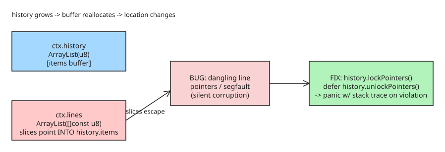

# Zig: Pointer Stability for ArrayLists (lockPointers / unlockPointers)

Zig's `std` Hash Map containers gained **pointer stability locks** in 2024. The pull request extending the same memory-safety technique to `std.ArrayList` (ziglang/zig#36239, a re-open of the 2025-era PR #22992) was **merged into master on 2026-08-27**, so `lockPointers()`/`unlockPointers()` are in `std` on the development branch following the 0.15.1 release. The idea: when you store a pointer (or slice) that is *backed by* an ArrayList's internal buffer, you can lock it so any later reallocation that would invalidate those pointers **panics loudly instead of silently corrupting memory**.

## How to use it

Call `lockPointers()` the first time you store a pointer/slice backed by the list, and `unlockPointers()` when those pointers are no longer needed:

```zig
try ctx.parse(gpa, input);
ctx.history.lockPointers();
defer ctx.history.unlockPointers();
try ctx.parse(gpa, input_two);   // safe: growth of history now asserts instead of dangling
```

The relationship that makes this dangerous — and what the lock protects:



## The bug it catches (spot-the-bug)

Two ArrayLists where one stores slices into the other's buffer:

```zig
const std = @import("std");

const Context = struct {
    history: std.ArrayList(u8),
    lines:   std.ArrayList([]const u8),

    fn parse(ctx: *Context, allocator: std.mem.Allocator, input: []const u8) !void {
        const slice = try ctx.history.addManyAsSlice(allocator, input.len);
        @memcpy(slice, input);
        var it = std.mem.tokenizeScalar(u8, slice, '\n');
        while (it.next()) |line| {
            try ctx.lines.append(allocator, line);   // stores a pointer into history.items
        }
    }
};
```

`ctx.lines.items` holds slices that point *into* `ctx.history.items`. If `history` later grows past its capacity, the buffer is reallocated and every stored slice dangles. Without locking, this is silent corruption (or a segfault). With `zig test`, the unfixed version fails with mangled output:

```
expected: I'm first!
found:    UUUUUUUUUU   // stale pointer into moved buffer
1/1 blah.test.Context.parse...FAIL (TestExpectedEqual)
```

Adding the lock turns it into an immediate, debuggable panic:

```
thread 3023222 panic: reached unreachable code
lib/std/debug.zig:442: assertUnlocked -> self.pointer_stability.assertUnlocked()
lib/std/array_list.zig:1348: ensureTotalCapacityPrecise
```

## Why it matters

- **Fail-fast over fail-silent:** a reallocation that would invalidate escaped pointers now asserts at the exact call site, with a stack trace pointing at `ensureTotalCapacityPrecise`.
- **Allocator-dependent bugs become deterministic:** how a dangling-pointer bug manifests depends on your allocator; locking removes that ambiguity by making the invariant explicit.
- **Opt-in and scoped:** you only pay for the check while pointers are live (`lockPointers`/`unlockPointers` bracket), so hot loops without escaping slices stay unaffected.
- **Beyond reallocation — element moves count too:** during review, andrewrk settled the semantics: while locked, existing pointers must keep pointing at *the same element*, not just valid memory. So `@memmove`-style operations (`insert*`, `orderedRemove`, `replaceRange*`) also panic while the lock is held, because they silently re-point a stored pointer at a different element. If you only care about the index, keep using indices — locking is for element identity.

## Takeaway

Whenever a Zig `ArrayList`'s buffer is exposed through stored pointers/slices, wrap that lifetime in `lockPointers()` / `defer unlockPointers()`. It converts a class of hard-to-debug memory-safety bugs into an immediate assertion — the same guarantee the Hash Map containers have had since 2024.

## References

- [Zig Devlog: Pointer Stability for ArrayLists (2026-08-27)](https://ziglang.org/devlog/2026/#2026-08-27)
- [ziglang/zig#36239 — feat: add pointer stability to ArrayList (merged 2026-08-27)](https://codeberg.org/ziglang/zig/pulls/36239)
