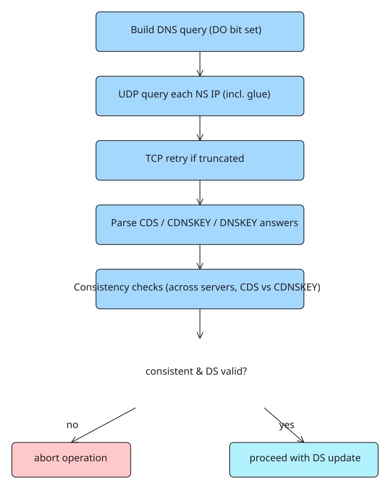

# Verifying CDS and CDNSKEY Consistency Across All Nameservers Before a DS Update, in Stdlib Python

[RFC 10026](https://datatracker.ietf.org/doc/rfc10026/) came out in July 2026 as BCP 246, "Operational Recommendations for DNSSEC Delegation Signer (DS) Automation" (authors Sheng & Thomassen). It is the policy basis that makes it possible to accept DS parameters automatically from the child zone, via RFC 7344 (CDS), RFC 8078 (CDNSKEY) and RFC 9615 (bootstrap).

Its first recommendation (section 4.1) says that whoever automates DS maintenance **MUST verify** two things before touching the parent zone:

1. the request is consistent "between any published CDS and CDNSKEY records" and "across all authoritative nameservers in the delegation"; and
2. "the resulting DS record set would allow continued DNSSEC validation if deployed".

If either check fails, cancel. All of it fits in the Python standard library: raw DNS over UDP, a SHA-256 digest, and ECDSA and RSA signature checks done by hand. The author ran it on 29 October 2026 against four zones that publish CDS records (results below).

## What the RFCs actually ask for

Four documents set the rules.

### RFC 7344 §4.1 — acceptance rules

CDS and CDNSKEY records must sit at the child zone apex, must be signed "with a key that is represented in both the current DNSKEY and DS RRsets", and must not break the current delegation. No CDS and no CDNSKEY at all means "no change".

### RFC 9975 (May 2026) — what "consistent" means

The parent has to:

- take the NS hostnames from **its own** delegation,
- look up "all IP addresses for each nameserver hostname" with a validating resolver, **including glue**,
- query **every one** of those addresses,
- require that each key referenced in one answer is referenced in all the others,
- require that CDS agrees with CDNSKEY,
- treat a delete request on one server next to a key on another as **inconsistent**.

A NODATA answer counts as a received response. Only CDS records whose digest type is "MUST" in the "Implement for DNSSEC Delegation" column of the IANA digest registry are compared — today that is only type 2 (SHA-256). On any inconsistency the parent "MUST abort the operation".

### RFC 10026 §4.2.1 — "would allow continued validation"

The child's DNSKEY RRset must carry "a valid RRSIG signature from a key that is referenced by at least one DS record" in the new set. An empty answer means the update would break the zone for every validating resolver.

### RFC 8078 §4 — delete signal

A CDS of `0 0 0 0` or a CDNSKEY of `0 3 0 0`, each the **only** record in its set, asks the parent to remove the whole DS RRset.

## Why a recursive resolver can't do this job

A recursive resolver gives you one cached answer from whichever nameserver it last asked, so two servers that disagree look like one server that agrees with itself. The check has to talk to every address directly: the script builds raw DNS queries with the **DO bit set** over UDP, retries over **TCP** when the answer comes back truncated (largest answer seen: 313 bytes; a zone with several RSA keys mid-rollover can pass 1,232 — that is what the TCP path is for), and parses the three answer sections, all in the standard library.



## The implementation: seven blocks, stdlib only

Paste the seven blocks in order into one file and run it with a zone name, or with `--simulate <zone>` to exercise the refusal logic.

### Block 1 — one DNS query over UDP, TCP if truncated

```python
import base64, hashlib, json, random, socket, struct, sys, time, urllib.request

CDS, CDNSKEY, DNSKEY, DS, RRSIG, NS, A, AAAA = 59, 60, 48, 43, 46, 2, 1, 28

def wire_name(name):
    out = b""
    for label in name.rstrip(".").lower().split("."):
        out += bytes([len(label)]) + label.encode()
    return out + b"\x00"

def read_name(msg, i):
    labels, jumped, end = [], False, i
    while True:
        n = msg[i]
        if n == 0:
            i += 1
            break
        if n & 0xC0 == 0xC0:  # compression pointer
            if not jumped:
                end = i + 2
            i, jumped = struct.unpack("!H", msg[i:i + 2])[0] & 0x3FFF, True
            continue
        labels.append(msg[i + 1:i + 1 + n].decode().lower())
        i += 1 + n
    return ".".join(labels) + ".", (end if jumped else i)

def query(server, name, rrtype, timeout=4):
    qid = random.randrange(65536)
    msg = (struct.pack("!HHHHHH", qid, 0, 1, 0, 0, 1) + wire_name(name)
           + struct.pack("!HH", rrtype, 1)
           + b"\x00" + struct.pack("!HHIH", 41, 1232, 0x8000, 0))  # EDNS0, DO bit set
    with socket.socket(socket.AF_INET, socket.SOCK_DGRAM) as s:
        s.settimeout(timeout)
        s.sendto(msg, (server, 53))
        resp = s.recv(65535)
    if struct.unpack("!H", resp[2:4])[0] & 0x0200:  # TC bit: retry over TCP
        with socket.create_connection((server, 53), timeout=timeout) as s:
            s.sendall(struct.pack("!H", len(msg)) + msg)
            size = struct.unpack("!H", s.recv(2))[0]
            resp = b""
            while len(resp) < size:
                resp += s.recv(size - len(resp))
    return parse(resp)

def parse(msg):
    flags, qd, an, ns, ar = struct.unpack("!5H", msg[2:12])
    i = 12
    for _ in range(qd):
        _, i = read_name(msg, i)
        i += 4
    sections = []
    for count in (an, ns, ar):
        rrs = []
        for _ in range(count):
            owner, i = read_name(msg, i)
            rtype, _, ttl, rdlen = struct.unpack("!HHIH", msg[i:i + 10])
            i += 10
            rrs.append((owner, rtype, ttl, msg[i:i + rdlen], i))
            i += rdlen
        sections.append(rrs)
    return {"aa": bool(flags & 0x0400), "rcode": flags & 0xF, "msg": msg,
            "answer": sections[0], "authority": sections[1], "additional": sections[2]}
```

### Block 2 — the delegation, as the parent publishes it

The NS list has to come from the **parent**, not from the child: a child zone can list whatever it likes in its own NS records, but the parent's referral is what sends resolvers to the child's servers in the first place. The script asks one of the parent's servers for the child's NS and reads the referral from the authority section, along with any glue. It then looks up A and AAAA for each hostname through Google Public DNS (which validates), and also asks the same parent server for the current DS set, which it needs later.

```python
def doh(name, rrtype):
    url = f"https://dns.google/resolve?name={name}&type={rrtype}"
    with urllib.request.urlopen(url, timeout=10) as r:
        j = json.load(r)
    return [a["data"] for a in j.get("Answer", []) if a["type"] == rrtype], j.get("AD")

def delegation(zone):
    parent = zone.split(".", 1)[1] or "."
    parent_ns, _ = doh(parent, NS)
    parent_ip = doh(sorted(parent_ns)[0], A)[0][0]
    ref = query(parent_ip, zone, NS)
    hosts = sorted({read_name(ref["msg"], off)[0] for o, t, _, rd, off in ref["authority"] if t == NS})
    glue = {(o, socket.inet_ntop(socket.AF_INET if t == A else socket.AF_INET6, rd))
            for o, t, _, rd, _ in ref["additional"] if t in (A, AAAA)}
    ips = {}
    for host in hosts:
        found = set(doh(host, A)[0] + doh(host, AAAA)[0]) | {ip for o, ip in glue if o == host}
        ips[host] = sorted((ip, 6 if ":" in ip else 4) for ip in found)
    ds = sorted(rd for o, t, _, rd, _ in query(parent_ip, zone, DS)["answer"] if t == DS)
    return parent_ip, hosts, ips, ds
```

### Block 3 — ask every address for CDS, CDNSKEY and DNSKEY

For each address the script asks for all three types and **insists on the AA bit**, so the answer comes from an authoritative server and not a forwarder. A server that times out or answers without AA is recorded, not dropped: RFC 9975 asks for consistency across the responses you actually received, and says the parent should retry the silent ones later before giving up on them.

```python
def rrset(resp, owner, rrtype):
    rdatas = sorted(rd for o, t, _, rd, _ in resp["answer"] if o == owner and t == rrtype)
    sigs = [rd for o, t, _, rd, _ in resp["answer"]
            if o == owner and t == RRSIG and struct.unpack("!H", rd[:2])[0] == rrtype]
    return rdatas, sigs

def collect(zone, ips):
    owner = zone.rstrip(".").lower() + "."
    seen = {}
    for host, addrs in ips.items():
        for ip, family in addrs:
            if family == 6:
                seen[(host, ip)] = "skipped: no IPv6 route from this machine"
                continue
            try:
                answers = {}
                for rrtype in (CDS, CDNSKEY, DNSKEY):
                    resp = query(ip, zone, rrtype)
                    if not resp["aa"] or resp["rcode"]:
                        raise ValueError(f"aa={resp['aa']} rcode={resp['rcode']}")
                    answers[rrtype] = rrset(resp, owner, rrtype)
                seen[(host, ip)] = answers
            except (OSError, ValueError) as e:
                seen[(host, ip)] = f"no usable response: {e}"
    return seen
```

### Block 4 — what each server is asking the parent to publish

A CDNSKEY record holds the key itself; a CDS record holds what the DS record will be. To compare them, the script computes the DS digest from each CDNSKEY the way RFC 4034 §5.1.4 defines it: **SHA-256 over the owner name in wire format, followed by the DNSKEY RDATA**. The owner name in that hash matters — it comes back in the results below.

Each server's answer becomes one of four things: no request, a delete request, an inconsistency, or a set of DS records. CDS records with digest types other than 2 are left out of the comparison, as RFC 9975 allows.

```python
def key_tag(rdata):  # RFC 4034 Appendix B
    ac = sum(b if i & 1 else b << 8 for i, b in enumerate(rdata))
    return (ac + ((ac >> 16) & 0xFFFF)) & 0xFFFF

def ds_from_dnskey(zone, rdata):  # RFC 4034 5.1.4, digest type 2 (SHA-256)
    digest = hashlib.sha256(wire_name(zone) + rdata).digest()
    return struct.pack("!HBB", key_tag(rdata), rdata[3], 2) + digest

# RFC 8078 section 4: "CDS 0 0 0 0" and "CDNSKEY 0 3 0 0", each with a single zero byte of payload
DELETE_CDS, DELETE_CDNSKEY = bytes.fromhex("0000000000"), bytes.fromhex("0000030000")

def request(zone, answers):
    cds = sorted(rd for rd in answers[CDS][0] if rd[3] == 2)  # only SHA-256 is compared (RFC 9975 3.1)
    cdnskey = answers[CDNSKEY][0]
    if not answers[CDS][0] and not cdnskey:
        return "no request (NODATA)"
    if DELETE_CDS in cds or DELETE_CDNSKEY in cdnskey:
        if set(cds) <= {DELETE_CDS} and set(cdnskey) <= {DELETE_CDNSKEY}:
            return "delete DS"
        return "inconsistent: delete signal mixed with keys"
    from_cdnskey = sorted(ds_from_dnskey(zone, rd) for rd in cdnskey)
    if cds and cdnskey and from_cdnskey != cds:
        return "inconsistent: CDS and CDNSKEY name different keys"
    return (tuple(cds), tuple(from_cdnskey))

def show_ds(rd):
    tag, alg, dtype = struct.unpack("!HBB", rd[:4])
    return f"{tag} {alg} {dtype} {rd[4:].hex().upper()[:16]}..."
```

### Block 5 — signatures, and whether the new set would keep validating

Every zone in the test signs with algorithm 13 (ECDSA P-256 with SHA-256), which takes a few dozen lines of modular arithmetic; RSA/SHA-256 (algorithm 8) is a single `pow()` and a padding comparison. Anything else raises an error instead of quietly passing.

`signed_by` rebuilds the data the signer signed (RFC 4034 §3.1.8.1): the RRSIG fields without the signature, then each record of the set in canonical order with the original TTL from the RRSIG. It also checks the inception and expiration times. `keeps_validating` is the RFC 10026 test: of the keys the new DS set points at, which ones produced a valid signature over the DNSKEY RRset? An empty answer means the update would break the zone.

```python
P256 = dict(p=2**256 - 2**224 + 2**192 + 2**96 - 1,
            n=0xFFFFFFFF00000000FFFFFFFFFFFFFFFFBCE6FAADA7179E84F3B9CAC2FC632551,
            g=(0x6B17D1F2E12C4247F8BCE6E563A440F277037D812DEB33A0F4A13945D898C296,
               0x4FE342E2FE1A7F9B8EE7EB4A7C0F9E162BCE33576B315ECECBB6406837BF51F5))

def ec_add(P, Q, p=P256["p"]):
    if P is None or Q is None:
        return P or Q
    if P[0] == Q[0] and (P[1] + Q[1]) % p == 0:
        return None
    if P == Q:
        lam = (3 * P[0] * P[0] - 3) * pow(2 * P[1], -1, p) % p
    else:
        lam = (Q[1] - P[1]) * pow(Q[0] - P[0], -1, p) % p
    x = (lam * lam - P[0] - Q[0]) % p
    return x, (lam * (P[0] - x) - P[1]) % p

def ec_mul(k, P):
    R = None
    while k:
        if k & 1:
            R = ec_add(R, P)
        P, k = ec_add(P, P), k >> 1
    return R

def verify(dnskey, data, sig):
    alg, key = dnskey[3], dnskey[4:]
    if alg == 13:  # ECDSA P-256 with SHA-256, RFC 6605
        n = P256["n"]
        Q = (int.from_bytes(key[:32], "big"), int.from_bytes(key[32:], "big"))
        r, s = int.from_bytes(sig[:32], "big"), int.from_bytes(sig[32:], "big")
        e = int.from_bytes(hashlib.sha256(data).digest(), "big")
        w = pow(s, -1, n)
        X = ec_add(ec_mul(e * w % n, P256["g"]), ec_mul(r * w % n, Q))
        return X is not None and X[0] % n == r
    if alg == 8:  # RSA/SHA-256, RFC 5702
        elen, k = (key[0], key[1:]) if key[0] else (int.from_bytes(key[1:3], "big"), key[3:])
        e, m = int.from_bytes(k[:elen], "big"), int.from_bytes(k[elen:], "big")
        size = (m.bit_length() + 7) // 8
        digest = bytes.fromhex("3031300d060960864801650304020105000420") + hashlib.sha256(data).digest()
        em = pow(int.from_bytes(sig, "big"), e, m).to_bytes(size, "big")
        return em == b"\x00\x01" + b"\xff" * (size - 3 - len(digest)) + b"\x00" + digest
    raise ValueError(f"algorithm {alg} not implemented here")

def signed_by(zone, rrtype, rdatas, sigs, keys, now=None):
    """Tags of keys in `keys` whose RRSIG over this RRset verifies and is in its validity window."""
    now = now or int(time.time())
    good = set()
    for sig in sigs:
        covered, alg, labels, ottl, exp, inc, tag = struct.unpack("!HBBIIIH", sig[:18])
        signer, end = read_name(sig, 18)
        if not inc <= now <= exp:
            continue
        data = sig[:end] + b"".join(
            wire_name(zone) + struct.pack("!HHIH", rrtype, 1, ottl, len(rd)) + rd for rd in sorted(rdatas))
        for k in keys:
            if key_tag(k) == tag and k[3] == alg and verify(k, data, sig[end:]):
                good.add(tag)
    return good

def keeps_validating(zone, ds_set, dnskeys, dnskey_sigs):
    """RFC 10026 4.2.1: the DNSKEY RRset carries a valid RRSIG from a key some DS points at."""
    pointed = [k for k in dnskeys if ds_from_dnskey(zone, k) in ds_set]
    return signed_by(zone, DNSKEY, dnskeys, dnskey_sigs, pointed)
```

### Block 6 — one verdict for the whole delegation

Per server, the script checks the existing chain first: the current DS has to point at a key whose signature over the DNSKEY RRset verifies, and the CDS and CDNSKEY sets must be signed by a key in **both** DNSKEY and the current DS — the RFC 7344 signer rule. Only then does it read what the server is asking for. Then all the answers have to be identical.

```python
def verdict(zone, requests, unreached, current_ds, dnskeys, dnskey_sigs):
    asked = set(requests.values())
    note = f" ({len(requests)} addresses answered, {unreached} not reached: retry those later)" if unreached else ""
    if len(asked) != 1:
        return "servers disagree -> cancel the update (RFC 9975 3, RFC 10026 4.1)" + note
    req = asked.pop()
    if isinstance(req, str):
        return req + (" -> cancel" if req.startswith(("inconsistent", "signatures")) else "") + note
    new_ds = list(req[0] or req[1])
    signers = keeps_validating(zone, new_ds, dnskeys, dnskey_sigs)
    if not signers:
        return "consistent, but no key in the new DS set signs the DNSKEY RRset -> cancel" + note
    if sorted(new_ds) == sorted(d for d in current_ds if d[3] == 2):
        return f"consistent, same as the current DS, nothing to do (DNSKEY signed by {sorted(signers)})" + note
    return f"consistent and would keep validating (DNSKEY signed by {sorted(signers)}) -> update" + note

def check(zone):
    zone = zone.rstrip(".").lower() + "."
    parent_ip, hosts, ips, current_ds = delegation(zone)
    print(f"{zone}  delegation NS from parent server {parent_ip}: {', '.join(hosts)}")
    print("  current DS at parent: " + "; ".join(show_ds(d) for d in current_ds))
    seen = collect(zone, ips)
    requests, unreached, last = {}, 0, None
    for (host, ip), answers in seen.items():
        if isinstance(answers, str):
            print(f"  {host:24} {ip:28} {answers}")
            unreached += 1
            continue
        dnskeys, dnskey_sigs = answers[DNSKEY]
        trusted = [k for k in dnskeys if ds_from_dnskey(zone, k) in current_ds]
        chain = signed_by(zone, DNSKEY, dnskeys, dnskey_sigs, trusted)
        # RFC 7344 4.1 Signer: CDS/CDNSKEY signed by a key that is in both DNSKEY and the current DS
        sig_ok = all(signed_by(zone, t, *answers[t], trusted) for t in (CDS, CDNSKEY) if answers[t][0])
        req = request(zone, answers) if chain and sig_ok else "signatures do not validate"
        requests[(host, ip)], last = req, answers[DNSKEY]
        label = req if isinstance(req, str) else "; ".join(show_ds(d) for d in (req[0] or req[1]))
        print(f"  {host:24} {ip:28} DNSKEY RRset signed by DS key {sorted(chain)}, asks for: {label}")
    if last is None:
        print("  VERDICT: no server answered -> retry later")
        return
    print("  VERDICT: " + verdict(zone, requests, unreached, current_ds, *last))
```

### Block 7 — the same decision on answers that should be refused (simulated)

The live run only exercised the happy path, so the last block reruns the same decision on **edited copies** of the real answers: 64 random bytes in the shape of a P-256 public key that no zone publishes, a delete signal, and a CDS that no longer matches its CDNSKEY. The edited records are not re-signed, so this exercises the consistency and continuity logic only, not the signature checks.

```python
def simulate(zone):
    zone = zone.rstrip(".").lower() + "."
    _, _, ips, current_ds = delegation(zone)
    real = {k: v for k, v in collect(zone, ips).items() if not isinstance(v, str)}
    first = next(iter(real))
    other_key = struct.pack("!HBB", 257, 3, 13) + random.randbytes(64)  # a key nobody published
    new_key_only = {CDS: ([ds_from_dnskey(zone, other_key)], []), CDNSKEY: ([other_key], [])}
    cases = [  # (description, change, apply to every server?)
        ("one server still serves an old key", new_key_only, False),
        ("CDS and CDNSKEY name different keys", {CDS: ([ds_from_dnskey(zone, other_key)], [])}, True),
        ("all agree on a key that is not in DNSKEY", new_key_only, True),
        ("all ask for deletion", {CDS: ([DELETE_CDS], []), CDNSKEY: ([DELETE_CDNSKEY], [])}, True),
    ]
    for name, change, everywhere in cases:
        answers = {k: dict(v) for k, v in real.items()}
        for k in (answers if everywhere else [first]):
            answers[k].update(change)
        requests = {k: request(zone, a) for k, a in answers.items()}
        print(f"  {name:42} -> {verdict(zone, requests, 0, current_ds, *real[first][DNSKEY])}")

if __name__ == "__main__":
    if sys.argv[1:2] == ["--simulate"]:
        for z in sys.argv[2:]:
            print(z)
            simulate(z)
    else:
        for z in sys.argv[1:]:
            check(z)
            print()
```

## What it printed on 29 October 2026

Run at about 08:44 UTC against `desec.io`, `cloudflare.com`, `isc.org` and `ietf.org` — the first zone in full, and the verdict line for the other three:

```text
desec.io.  delegation NS from parent server 65.22.160.17: ns1.desec.io., ns2.desec.org.
  current DS at parent: 53307 13 2 3F6A815A28593BA6...; 53307 13 4 156E3DFCCEB69A9B...
  ns1.desec.io.            2607:f740:e633:deec::2       skipped: no IPv6 route from this machine
  ns1.desec.io.            45.54.76.1                   DNSKEY RRset signed by DS key [53307], asks for: 53307 13 2 3F6A815A28593BA6...
  ns2.desec.org.           157.53.224.1                 DNSKEY RRset signed by DS key [53307], asks for: 53307 13 2 3F6A815A28593BA6...
  ns2.desec.org.           2607:f740:e00a:deec::2       skipped: no IPv6 route from this machine
  VERDICT: consistent, same as the current DS, nothing to do (DNSKEY signed by [53307]) (2 addresses answered, 2 not reached: retry those later)

cloudflare.com.  delegation NS from parent server 192.5.6.30: ns3.cloudflare.com., ns4.cloudflare.com., ns5.cloudflare.com., ns6.cloudflare.com., ns7.cloudflare.com.
  VERDICT: consistent, same as the current DS, nothing to do (DNSKEY signed by [2371]) (10 addresses answered, 10 not reached: retry those later)
isc.org.  delegation NS from parent server 199.19.56.1: ns.isc.afilias-nst.info., ns1.isc.org., ns2.isc.org., ns3.isc.org., nsp.dnsnode.net.
  VERDICT: consistent, same as the current DS, nothing to do (DNSKEY signed by [7250]) (5 addresses answered, 5 not reached: retry those later)
ietf.org.  delegation NS from parent server 199.19.56.1: jill.ns.cloudflare.com., ken.ns.cloudflare.com.
  VERDICT: consistent, same as the current DS, nothing to do (DNSKEY signed by [2371]) (6 addresses answered, 6 not reached: retry those later)
```

All four are in the steady state: every reachable server asks for exactly the DS set the parent already publishes, so a parent running this check would do nothing. Three details in the output need a word:

1. **Half the addresses were not reached.** The test machine has no IPv6 route, so every AAAA address came back as *skipped*. The script says so in the verdict and does not count those addresses as agreeing. A real parental agent has to reach them, because a server that is only wrong over IPv6 is still wrong for every IPv6 resolver.
2. **`desec.io` publishes two CDS records for the same key** — one with digest type 2 and one with type 4 (SHA-384) — and the parent publishes both as DS. The check compares only the type 2 record, as RFC 9975 says.
3. **`cloudflare.com` and `ietf.org`** (whose nameservers are Cloudflare's) serve the same DNSKEY records byte for byte — key tags 2371 and 34505 in both — yet their DS digests differ:

```python
for zone, ip in [("cloudflare.com.", "162.159.0.33"), ("ietf.org.", "108.162.192.122")]:
    keys = sorted(rd for _, t, _, rd, _ in query(ip, zone, DNSKEY)["answer"] if t == DNSKEY)
    ksk = [k for k in keys if k[1] & 1]  # SEP bit set: flags 257
    print(zone, "DNSKEY tags", [key_tag(k) for k in keys],
          "RRset sha256", hashlib.sha256(b"".join(keys)).hexdigest()[:16],
          "DS", show_ds(ds_from_dnskey(zone, ksk[0])))
```

```text
cloudflare.com. DNSKEY tags [34505, 2371] RRset sha256 69e8f4852724126a DS 2371 13 2 32996839A6D808AF...
ietf.org. DNSKEY tags [34505, 2371] RRset sha256 69e8f4852724126a DS 2371 13 2 B1AE88AFF068DDEC...
```

The zone name is part of the hashed input, so the same key gives a different DS under each name. A check that compared key tags, or even key bytes, would treat these two delegations as interchangeable. **Compare full DS records.**

## The cases that should be refused

```text
desec.io
  one server still serves an old key         -> servers disagree -> cancel the update (RFC 9975 3, RFC 10026 4.1)
  CDS and CDNSKEY name different keys        -> inconsistent: CDS and CDNSKEY name different keys -> cancel
  all agree on a key that is not in DNSKEY   -> consistent, but no key in the new DS set signs the DNSKEY RRset -> cancel
  all ask for deletion                       -> delete DS
```

The second-to-last line is the one RFC 10026 adds: every server agrees, the signatures could all be valid in a real case, and the update would still make the zone fail validation for every validating resolver — because no key in the requested DS set signs the DNSKEY RRset. That is how a rollover goes wrong when the new DS goes up before the new key is in the zone. The last line shows that a consistent delete request passes this check; the parent's own policy decides what happens next.

## What the script does not do

- It does not reach IPv6 addresses from the test machine, and it does not retry silent servers on a back-off schedule (which RFC 9975 recommends).
- It trusts Google Public DNS for the nameserver addresses and does not check the AD bit itself.
- It verifies algorithms 8 and 13 only.
- It does not handle bootstrapping a zone that has no DS yet — that is RFC 9615, a different procedure.
- It queries from one network location; RFC 9975 allows trying another vantage point when a server is unreachable.

RFC 10026 is a Best Current Practice: it says what parents doing DS automation should check, not what any particular registry or registrar does today. If you publish CDS records for your own zone, the script will tell you whether they would pass these checks.

## Status check (2026-10-29)

- **RFC 10026 (BCP 246) is confirmed published** (July 2026; S. Sheng & P. Thomassen; from draft-ietf-dnsop-ds-automation-09, 21 pages). The note's `rfc-10026` tag is correct against the live RFC.
- **§3 nuance worth adding:** the RFC requires DNS operators to publish **both** CDNSKEY *and* CDS records (unless the parent zone's preference is known). The consistency check above therefore assumes double publishing — if your parent publishes CDS only, adapt the checks accordingly.
- **Ecosystem:** ICANN ran a public comment proceeding on the security and stability assessment of CDS/CDNSKEY-based DS automation (proceeding published 2026-10-12), with submissions (e.g., Nguyen Quynh) supporting deployment under RSEP and recommending the assessment be re-baselined against the published RFC 10026 text rather than the draft.

## References

- [RFC 10026 (BCP 246): Operational Recommendations for DNSSEC Delegation Signer (DS) Automation](https://datatracker.ietf.org/doc/rfc10026/)
- [APNIC: Towards an industry best practice for DNSSEC automation](https://blog.apnic.net/2026-02-25/towards-an-industry-best-practice-for-dnssec-automation/)
- [Checking CDS and CDNSKEY on every nameserver before a DS update (DEV.to)](https://dev.to/jose_pollman_fa7c6ec43cdd/checking-cds-and-cdnskey-on-every-nameserver-before-a-ds-update-in-stdlib-python-3g45)
- [RFC 9975](https://www.rfc-editor.org/rfc/rfc9975.html)
- [RFC 10026 (rfc-editor)](https://www.rfc-editor.org/rfc/rfc10026.html)
- [ICANN public comment: Security and Stability Assessment of DNSSEC DS automation (proceeding, 2026-10-12)](https://www.icann.org/en/content/comments/icann-public-comment-security-stability-assessment-dnssec-ds-automation-cds-cdnskey-2026-10-12-en)
