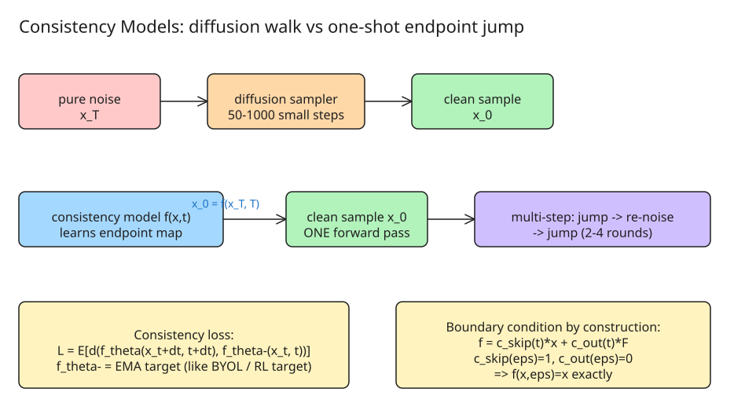

# Consistency Models: Why One Step Can Replace a Hundred Denoising Steps

Diffusion models pay for quality in wall-clock time: sampling walks from pure noise back to data through 50–1000 small denoising steps, each a full network pass. **Consistency models** (Song et al., ICML 2023) skip the walk entirely — they learn the *endpoint mapping* directly, generating a sample in a single network evaluation. This note covers the self-consistency property, the training loss, the boundary-condition parameterisation, and the failure modes.



## The probability-flow ODE and the consistency function

The probability-flow ODE shares its marginals with the diffusion process but is **deterministic**: every noisy state `x_t` belongs to exactly one trajectory, and that trajectory ends at one clean sample `x_0`. The mapping from any point on a trajectory to its endpoint is the *consistency function*:

```
f(x_t, t) = x_0
```

**Self-consistency**: every point on the same trajectory shares the endpoint, so

```
f(x_t, t) = f(x_t', t')   for all t, t' on the same trajectory
```

If a network learned `f` exactly, sampling is one forward pass: draw noise, evaluate once, done. No iteration, no step size, no error accumulation.

## Training by self-consistency

The property becomes a loss: add noise at two *adjacent* levels `t_{n+1}`, `t_n`, and penalise the network when the two noisy versions map to different outputs:

```
L = E[ d( f_θ(x_{t_{n+1}}, t_{n+1}),  f_{θ⁻}(x_{t_n}, t_n) ) ]
```

- `f_θ` — the online network being trained.
- `f_{θ⁻}` — a **target network** whose weights are an exponential moving average of `θ`, never trained directly. Same stabilising role as in RL targets and BYOL: a slowly-moving reference instead of a target that shifts every gradient step.
- Two ways to get the paired states:
  - **Consistency distillation** — a pretrained diffusion teacher supplies the ODE solver step from `t_{n+1}` to `t_n`.
  - **Consistency training** — pairs come straight from the forward noising process; no teacher needed, making consistency models a standalone generative model class, not just a distillation trick.

### Boundary condition by construction

At the smallest noise level `ε` a clean sample is its own endpoint: `f(x, ε) = x`. This is enforced *exactly*, via a skip-connection parameterisation:

```
f_θ(x, t) = c_skip(t) · x + c_out(t) · F_θ(x, t)
c_skip(ε) = 1,   c_out(ε) = 0
```

Without it the network would have to learn the boundary from data, and small violations near the clean end distort every sample.

### Minimal training sketch (PyTorch-like)

```python
# x0: clean batch, t_n and t_{n+1}: adjacent noise levels
x_next = x0 + sigma(t_{n+1}) * torch.randn_like(x0)
x_curr = x0 + sigma(t_n)     * torch.randn_like(x0)

pred = f_theta(x_next, t_{n+1})          # online network
with torch.no_grad():
    target = f_target(x_curr, t_n)       # EMA target network

loss = ((pred - target) ** 2).mean()
loss.backward()
optimizer.step()
update_ema(f_target, f_theta, decay=0.999)
```

Two pitfalls: the target must come from the EMA network under `torch.no_grad()` (otherwise both sides chase each other and the loss collapses to zero), and noise levels must be sampled randomly across the schedule each step. Key hyperparameters: noise-schedule discretisation, distance function `d`, EMA decay.

## Sampling: one step or a few

- **Single-step**: `x_0 = f_θ(x_T, T)` — one forward pass, no loop. A distilled consistency model matches in one step what the teacher diffusion model needs tens of steps for; the remaining quality gap is small and the speedup is 1–2 orders of magnitude.
- **Multi-step refinement**: alternate the consistency jump with a small **re-noising** step — jump to the estimated clean sample, add a little noise to move back up the trajectory, jump again. Two to four rounds usually match the teacher. Re-noising is essential: a second jump from the same point returns the same answer; noise moves the sampler to a nearby trajectory so errors can actually be corrected. Most production deployments run 2–4 steps and treat single-step as the fast path.

## Why this is not just a bigger step size

A diffusion sampler with a large step accumulates **discretisation error** (each step approximates a continuous trajectory, badly). A consistency model never approximates the trajectory — it learns the endpoint mapping directly, so only the network's own approximation error remains. The failure modes differ, which is a useful diagnostic:

| Symptom | Cause | Fix |
|---|---|---|
| Blurry, washed-out samples | Diffusion with too few steps (each step averages unresolved uncertainty) | More steps |
| Sharp but wrong in detail | Consistency model committing to one bad endpoint | Better-trained consistency function or 1–2 extra refinement rounds |

Connection to flow matching / rectified flows: those *straighten* the trajectory so fewer steps suffice; consistency models leave the trajectory alone and **skip it entirely**. The two ideas compose — later work combines straight trajectories with consistency training to push single-step quality further.

## See also

- `explanation-rl-post-training-in-diffusion-transformers-is-activation-steering.md` — another angle on what diffusion training objectives actually learn.
- `reference-one-schedule-does-not-fit-all-tcda.md` — adaptive inference schedules: the same step-count/quality trade-off from the scheduling side.

## References

- [Consistency Models: Why One Step Can Replace a Hundred Denoising Steps — DEV.to](https://dev.to/umeshtharukaofficial/consistency-models-why-one-step-can-replace-a-hundred-denoising-steps-3obi)
- [Song et al., "Consistency Models", ICML 2023 (arXiv 2303.01469)](https://arxiv.org/abs/2303.01469)
