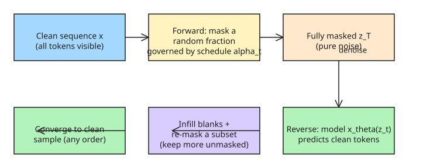

# How to Build a Diffusion Language Model

An overview of the building blocks behind modern diffusion LLMs (Mercury 2 / Inception Labs, Gemma Diffusion / Google, Nemotron Diffusion / NVIDIA), adapted from Cornell's Kuleshov group workshop talks (ICLR 2026, MLSS 2026). The core question: how do you apply the *diffusion* paradigm — which dominates continuous data like images — to **discrete** data like text?

## Autoregressive vs. diffusion generation

Autoregressive LLMs emit tokens left-to-right, one at a time, each conditioned on prior tokens. Inherent limits: no error correction (a token can't be revised once emitted), slow sequential generation, and causal attention that only looks backward. Diffusion models instead generate the **whole sequence at once**, starting from an initial guess and refining every position in parallel over several steps — trading speed vs. quality by using fewer or more steps, correcting mistakes along the way, and attending bidirectionally.

## Gaussian diffusion (the continuous template)

The blueprint is *denoising*: a **forward process** adds growing amounts of Gaussian noise to clean data until it becomes pure static; a **reverse process** learns to invert that trajectory, trained on the image-to-noise pairs the forward pass manufactures. Generation = start from noise, repeatedly estimate and strip a bit of noise.

## Masked diffusion (discrete analog)

For discrete tokens, "noise" is defined by **masking**. A masked diffusion model (MDLM) is essentially a *generative BERT*: train a bidirectional transformer to fill in randomly-masked tokens at a randomized masking rate.

- **Forward:** mask each token with probability `1 - alpha_t`, where the schedule `alpha_t` goes 1 -> 0 (clean -> fully masked). Implemented as a Markov chain over latents z_t.
- **Reverse:** train x_theta(z_t) to predict the clean sequence; at generation, fill blanks then re-mask a subset, keeping slightly more tokens unmasked each round until convergence.
- **Objective:** with `alpha_t = 1 - t`, the ELBO reduces to the BERT cross-entropy loss averaged over all masking rates and normalized by t — which is why MDLM narrows the perplexity gap to autoregressive models on LM1B.

## Making it production-ready (the real-world extensions)

1. **Block diffusion** for variable length: diffuse one block ("canvas") of tokens at a time, conditioned on previously generated blocks; supports KV caching like AR models. Block size is tunable (domain knowledge or GPU arithmetic intensity). Alternatives: Set Diffusion (arbitrary position sets), Edit Flows / FlexMDM (insert/delete/substitute ops).
2. **Encoder-decoder architecture:** split the two jobs — a heavy *encoder* represents clean context once, a lightweight *decoder* iteratively denoises the masked canvas. Core of Gemma Diffusion and Nemotron Diffusion; also speeds training by feeding blocks to a smaller decoder.
3. **Iterative refinement / error correction** (standard MDLM can't revise committed tokens):
   - **Remasking diffusion (ReMDM):** re-mask a small subset of previously-unmasked tokens each step so they can be regenerated — gives inference-time compute scaling (more steps -> closer to AR quality).
   - **Uniform-state diffusion (UDLM):** forward process replaces tokens with *random* vocabulary tokens instead of masks, so any position can be revised at any step. Faster sampling + better controllability; Gemma Diffusion is a UDLM.
4. **Distillation for speed:** progressive distillation / self-distillation-through-time / discrete consistency distillation halve the number of sampling steps each round (diffusion can already be 5-10x faster than AR by emitting multiple tokens per step).
5. **Controllable generation:** classifier-based guidance (CBG) and classifier-free guidance (CFG), with a `gamma` strength parameter trading off naturalness vs. property satisfaction — diffusion's global refinement makes it better at steering toward a target property than AR.

## Where it's used today

- **Biology/science** (less left-to-right bias, benefits from controllable generation):
  - **ESM3** — MDLM up to 100B params over interleaved sequence/structure/function tracks; SOTA protein generation.
  - **Nucleotide Transformer v3 (NT-v3)** — MDLM scaled to billions of params / >1T DNA tokens, multi-track input, discrete CFG + remasking for target gene-expression design (validated in wet-lab).
- **General LLMs:** **LLaDA** scales MDLM to 8B with block diffusion at sampling time and remasking/post-training compatibility; competitive with similarly-sized AR models and shows AR-like scaling of accuracy vs. training FLOPs on GSM8K/MMLU.

## Case study: DiffusionGemma (verified 2026-09-28)

Google's **DiffusionGemma** (released 2026-06-10, Apache 2.0) is the most complete
public implementation of this recipe and a useful checklist for what "production-ready"
concretely means:

- **Architecture:** encoder-decoder on top of the Gemma 4 family — a fine-tuned
  26B (≈3.8B active) MoE backbone toggles between an *encoding* mode (prefill, builds
  the KV cache) and a *denoising* mode (bidirectional attention over one canvas via
  cross-attention). Multimodal: text/image/video in, text out; ~550M-param vision encoder.
- **Uniform-state diffusion:** replaces tokens with random vocabulary noise rather than
  masks — the UDLM variant from the list above — so any position can be revised at any
  step.
- **Multi-canvas block sampling:** a fixed 256-token canvas is denoised in parallel, then
  appended to context and the next canvas starts — exactly the "block diffusion for
  variable length" extension, chained with autoregression for long-form text.
- **Speed claim:** up to ~4x faster than AR Gemma on dedicated GPUs; >1100 tokens/s per
  user at low batch size (H100, FP8), since each forward pass emits 15–20 tokens instead
  of one. Context up to 256K tokens, 262K vocab, sliding window 1024.
- **Positioning:** explicitly experimental and aimed at speed-critical *local* workflows
  (in-line editing, rapid iteration); Google still recommends standard AR Gemma 4 for
  high-quality production outputs — a useful reminder that diffusion LLMs trade peak
  quality for latency, not the other way around.

## Key insight

Diffusion for language = "generative BERT" + a principled ELBO, then bolt on block diffusion (length), encoder-decoder (speed), remasking/UDLM (error correction), distillation (fewer steps), and guidance (control). The unifying theme: generate the whole sequence in parallel and *refine globally*, rather than committing to irreversible left-to-right tokens.

## References

- [How to Build a Diffusion Language Model — Kuleshov group](https://kuleshov-group.github.io/blog/blog/2026/how-to-build-a-diffusion-language-model/)
