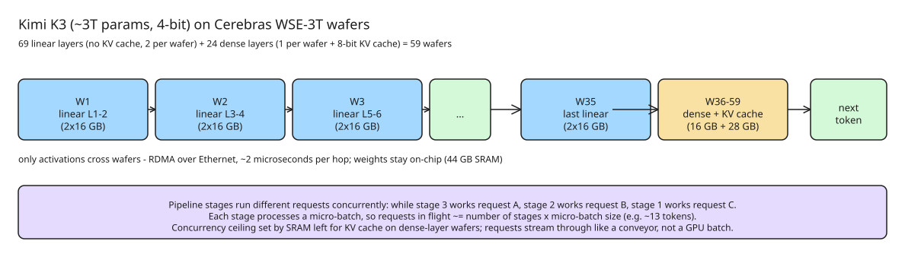

# How Cerebras Deploys Trillion-Parameter Frontier Models on Wafer-Scale Pipelines

A single Cerebras WSE-3T wafer holds **44 GB of on-chip SRAM** (4 trillion
transistors, ~900,000 AI cores, ~21 PB/s memory bandwidth, ~125 PFLOPS FP16).
Trillion-parameter frontier models need terabytes for their weights alone, so
Cerebras splits the model across many wafers and runs it as a hardware
pipeline at **1000–2000+ tokens per second**. Their October 2026 engineering
post walks through the full math using the open-source Kimi K3 model (~3T
parameters) as the worked example.

## The worked example: Kimi K3

Assumptions used throughout:

- 3T total parameters, **4-bit weight quantization** (matches the Hugging Face implementation)
- 8-bit KV cache
- 256k-token assumed average request size
- Model structure: **69 linear-attention layers + 24 dense (full-attention) layers = 93 layers**

Kimi K3 scores 88.3% on Terminal-Bench 2.1 and 91.2% on BrowseComp —
frontier-level agentic results for an open-weights model.

## Step 1 — size per layer

3T parameters at 4 bits each = 3,000,000,000,000 × 4 bits = 12 terabits of
raw weight payload. Dividing by 93 layers gives **~16 GB per layer**.

## Step 2 — wafers needed

Each layer type maps to wafers differently because of KV-cache pressure:

- **Dense layers** store keys/values for every token of every active request,
  so a dense layer wafer holds **one dense layer + the remaining SRAM as KV
  cache** (44 GB − 16 GB = ~28 GB for KV cache).
- **Linear-attention layers** keep only a small fixed-size state per request
  (independent of context length), so a wafer fits **two linear layers**
  (2 × 16 GB = 32 GB, leaving headroom).

Count: 69 linear layers / 2 per wafer = 35 wafers (rounded up), plus 24 dense
layers = 24 wafers. **Total: 59 wafers** for the full model.

## Step 3 — connecting the wafers

The Cerebras compiler maps model layers onto wafer regions; the runtime maps
the token path. For ultra-low latency, **only activations** cross between
wafers, via **RDMA over Ethernet at roughly 2 microseconds per hop**.
Because each wafer has 44 GB of SRAM and a layer is only ~16 GB, whole layers
live on a chip — **weights never move**, layers are not split across wafers.

## Step 4 — serving one request

Each wafer is one stage of an assembly line: weights stay put, the request's
intermediate results move. Wafer 1 runs layers 1–2 and sends activations to
wafer 2 (layers 3–4), and so on until the last wafer emits the next token.

## Step 5 — serving many requests (the pipeline stays full)

The common misconception: if tokens must traverse every wafer in order, is
the system effectively batch size 1? No. Cerebras keeps the **whole pipeline
full with different requests**: while stage 3 processes request A, stage 2
processes request B, stage 1 processes request C. In production the stages
are much finer-grained than one layer each.

Each stage also processes a **micro-batch** (small group of requests), so
requests in flight ≈ number of stages × micro-batch size (the example uses
~13-token micro-batches). Trade-off: smaller micro-batches → lower
per-request latency; larger micro-batches → higher total throughput.

## Step 6 — how many concurrent requests

On-chip KV-cache budget sets the ceiling. Per dense-layer wafer:
44 GB − 16 GB (dense layer) ≈ 28 GB for KV cache. A single 256k-token
request's 8-bit KV cache (per dense layer) divides that remaining space to
give the max concurrent requests per wafer. The exact count is computed per
model mapping and request size (the post's figures carry the arithmetic).
Unlike a GPU batch, requests in flight **do not wait for each other** — they
stream through the pipeline continuously.

Cerebras argues the more meaningful efficiency metric is **total token
throughput per unit of power (tokens/s per megawatt)** measured at the same
output-generation speed, not raw concurrency or batch size.

## Scaling beyond 3T

The same recipe generalizes: compute memory for weights + request state,
distribute layers across wafers, pipeline them. Each added wafer contributes
compute and on-chip memory, so models beyond any single chip's capacity are
accommodated by adding wafers.

## Why it matters

- **On-chip SRAM bandwidth (21 PB/s) is the whole game**: the pipeline avoids
  the HBM/DRAM round-trips that dominate GPU inference; ~7,000× the H100's
  3 TB/s.
- **Linear-attention layers change the mapping calculus**: their
  context-length-independent state is what makes 2-per-wafer packing possible.
- **RDMA hop latency (~2 µs) is negligible** next to layer compute, so the
  pipeline is compute-bound, not interconnect-bound.
- KV-cache residency on-wafer (not in a shared HBM pool) is what makes
  concurrency a simple arithmetic property of SRAM.

## References

- [Cerebras engineering blog: How we deploy Trillion-parameter frontier models on Cerebras (Sarah Chieng, Oct 2026)](https://www.cerebras.ai/blog/how-we-deploy-trillion-parameter-frontier-models-on-cerebras)
- [Cerebras WSE-3T chip specifications](https://www.cerebras.ai/chip)
- [Kimi K3 model card (Hugging Face, 4-bit quantized weights)](https://huggingface.co/moonshotai/Kimi-K3)
- [Cerebras Wafer-Scale Engine architecture overview (Introl)](https://introl.com/blog/cerebras-wafer-scale-engine-cs3-alternative-ai-architecture-guide-2025)
- [WSE vs NVIDIA comparison paper (arXiv:2503.11698)](https://arxiv.org/html/2503.11698v1)
