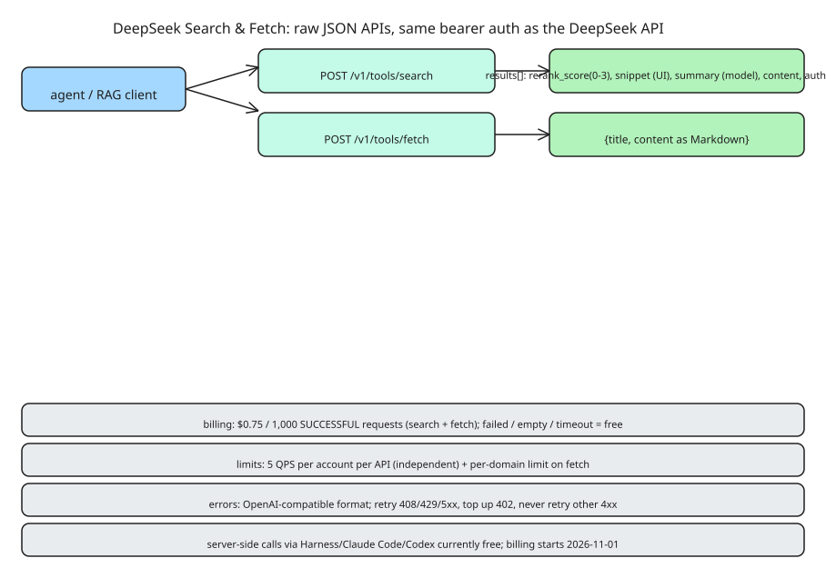

# DeepSeek Search & Fetch API: Per-Request-Priced Web Search and Page Fetch for Agents and RAG

DeepSeek's **Search API** and **Fetch API** give agents and RAG applications access to live web content. Both are **raw JSON APIs** using the **same bearer authentication** as the rest of the DeepSeek API, with base URL `https://api.deepseek.com`:

| API | Endpoint |
|---|---|
| Search | `POST https://api.deepseek.com/v1/tools/search` |
| Fetch | `POST https://api.deepseek.com/v1/tools/fetch` |

Headers: `Authorization: Bearer <DeepSeek API Key>`, `Content-Type: application/json`.

## Search API

**Request fields:**

| Field | Type | Required | Default | Description |
|---|---|---|---|---|
| `query` | string | Yes | — | 1–128 Unicode chars, not all whitespace; supports query operators |
| `count` | integer | No | `10` | 1–50 results |
| `ori_question` | string | No | — | user's original question (1–128 chars) to improve query understanding |
| `localization` | string | No | `""` | optional IP address used to localize results |
| `need_content` | boolean | No | `false` | whether to return page content in `content` (always empty string when false) |

Unknown fields are ignored.

**Query operators** (combinable in one query; the query is forwarded with its search syntax intact):

| Operator | Example | Description |
|---|---|---|
| `site:` | `DeepSeek site:github.com` | restrict to a site; multiple: `site:github.com OR site:huggingface.co` |
| `-site:` | `DeepSeek -site:example.com` | exclude a site |
| `-` | `DeepSeek -advertisement` | exclude term |
| `-\"...\"` | `DeepSeek -\"release notes\"` | exclude exact phrase |
| `\"...\"` | `DeepSeek \"exact phrase\"` | exact phrase match |
| `lang:` | `DeepSeek lang:zh,en` | restrict by language codes (comma-separated) |
| `after:` | `DeepSeek after:2025-01-01` | pages published after a date |
| `before:` | `DeepSeek before:2026-06-01` | pages published before a date |

Example combined query: `{"query": "DeepSeek site:github.com OR site:huggingface.co lang:en after:2025", "count": 10}`.

**Response:** HTTP 200 with a `results` array (empty array = no matches). Each item:

| Field | Type | Description |
|---|---|---|
| `rerank_score` | number | 0–3 relevance score combining relevance, authority, freshness; ≥1.5 = high quality |
| `title` / `url` | string | result identity |
| `snippet` | string | short summary, ~100–200 chars, for UI display |
| `summary` | string | long summary, ~600–800 chars, intended to be read by a model |
| `content` | string | page content; empty when `need_content` is false or content unavailable |
| `site_name` / `site_icon` | string/null | provenance metadata |
| `date` | string/null | publication time, RFC 3339 UTC |
| `authority` | integer | 0–4 tier (`-1` unknown); ≥3 = highly authoritative |

## Fetch API

**Request:** `{"url": "https://example.com/article"}` — URL must be ≤ 8192 chars, HTTP/HTTPS with a host, **no username or password** in the URL.

**Response:** `{"title": "...", "content": "<page content as Markdown>"}`. Fetching is subject to the target site's availability and access policies.

## Errors and retry policy

Errors follow the **OpenAI-compatible error format** (`param` is always `null`):

| HTTP status | Meaning | Action |
|---|---|---|
| 400 | invalid headers/body (malformed JSON, bad field value) | fix the request |
| 401 | missing/invalid API key | fix auth |
| 402 | insufficient balance | top up |
| 403 | Fetch rejected by security policy | don't retry blindly |
| 404 | no usable content (unavailable URL, site-blocked, error, unsupported type, no extractable Markdown) | don't retry without change |
| 408 | request body read timed out | wait and retry |
| 413 | body too large | shrink request |
| 429 | QPS limit exceeded | back off and retry |
| 500 / 504 | server error / downstream timeout | wait and retry |

Rule: **408/429/5xx → wait and retry; 402 → top up; other 4xx → do not retry without changing the request.**

## Billing and rate limits

**Per successful request**, not per token or per result:

| API | Price |
|---|---|
| Search | $0.75 per 1,000 successful requests |
| Fetch | $0.75 per 1,000 successful requests |

- A request is billable **only** when it returns HTTP 200 *and* produces a result (non-empty `results` array for Search; page content for Fetch).
- **Failed requests, empty search results, and timeouts are not billed.**
- `count` only controls how many results come back — it does **not** affect price.

**Rate limits** (independent per API; one doesn't consume the other's quota): **5 QPS per account** for each of Search and Fetch, computed at account level regardless of API key, separate from model concurrency limits. Above limit → HTTP 429. Fetch additionally has a **per-domain QPS limit**.

**Migration note:** when using the DeepSeek API through DeepSeek Harness, Claude Code, or Codex, server-side tool calls already hit the Search and Fetch APIs. Those calls are currently free; **per-request billing starts 00:00 Beijing time on November 1, 2026**.

## Why the shape matters

- **`snippet` vs `summary` split** is a deliberate UX/agent distinction: humans get a short string, the model gets a long one — one API serving both consumers.
- **`ori_question`** keeps the user's original question alongside the reformulated query, improving query understanding without a second round-trip.
- **`authority` tiering** (0–4) lets agents/RAG pipelines filter sources without external reputation lookups.
- **Per-successful-request pricing** removes the incentive to over-fetch: empty results cost nothing.

## Further reading

- [CodeGurus: DeepSeek search and fetch — $0.75 per 1000 successful requests](https://codegurus.eu/deepseek-search-and-fetch-0-75-per-1000-successful-requests/) — current pricing and endpoint confirmation: `POST https://api.deepseek.com/v1/tools/search` and `POST /v1/tools/fetch`, same bearer auth as the main API, billed per *successful* request.
- [The New Stack: DeepSeek undercuts search API rivals](https://thenewstack.io/deepseek-web-search-api/) — pricing context: DeepSeek is temporarily waiving Search/Fetch charges for server-side tool calls made through DeepSeek Harness, Claude Code, and Codex via its API — relevant if you route agent tool calls through a harness rather than calling the endpoints directly.
- [DeepSeek pricing page](https://deepseek.ai/pricing) — note: DeepSeek does not publish RPM/TPM rate limits anywhere in its documentation; the retry policy in this note is therefore the only client-side backstop.

## References

- [DeepSeek Search & Fetch API guide (official docs)](https://api-docs.deepseek.com/guides/search/)
- [Search API reference](https://api-docs.deepseek.com/api/search)
- [Fetch API reference](https://api-docs.deepseek.com/api/fetch)
