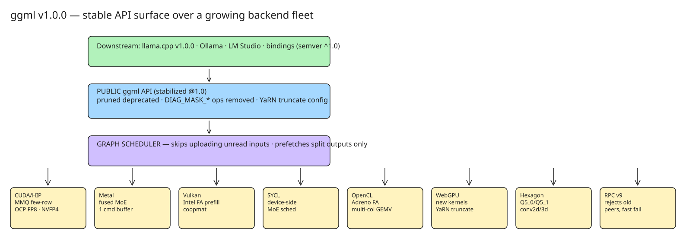

# ggml v1.0.0: What a Stable Tensor API Means for the Local AI Stack

On 2026-11-13 the ggml-org shipped **ggml v1.0.0** — the first stable release of the C tensor library
that underlies llama.cpp — **shipped together with llama.cpp v1.0.0**, ~3.5 years after the project's
start, with a formal **semantic-versioning commitment**. The announcement framing: local-AI
integrations (Ollama, LM Studio, bindings, serving layers) now depend on these interfaces, so
"a flexible but stable API is paramount."

## What 1.0 actually changed in the API

The 1.0 tag is a hard line, not a ceremony — it **pruned the deprecated public API** and made
breaking changes that only a major bump permits:

| Change | Detail |
|---|---|
| Deprecated API pruned | Old entry points removed; callers must migrate to current equivalents |
| Legacy masked ops removed | `DIAG_MASK_INF` / `DIAG_MASK_ZERO` ops deleted (superseded by the causal-mask path) |
| RPC protocol → v9 | Incompatible peers are now **rejected**; unreachable endpoints / failed handshakes **fail gracefully** instead of hanging |
| YaRN truncation control | New `ggml_rope_set_truncate()` / `ggml_rope_get_truncate()` to control YaRN correction-bound rounding |
| Precision gating | `MUL_MAT` src1-precision tests + gating for `ggml_prec_set_acc` |
| `TRI` backward pass | Triangular-solve op is now differentiable |

Two of these deserve emphasis:

- **RPC v9 rejection semantics**: distributed-ggml setups (splitting a graph across machines over
  `rpc-server`) now fail *fast and loudly* on version skew instead of producing silently wrong or
  hung computations. Operationally, all `rpc-server` peers must be upgraded in lockstep with the client.
- **YaRN truncation config**: long-context RoPE scaling (YaRN) previously rounded correction bounds
  with fixed behavior; the `truncate` toggle lets callers match reference implementations exactly —
  a correctness lever for long-context fine-tunes, now exposed on CUDA, Vulkan, and WebGPU paths.

## Performance themes across the backends

The release is also a broad backend-perf dump; the recurring themes tell you where local inference
is heading:

- **Decode-bound matmuls**: CUDA gained few-row MMQ (batch sizes 2–24) and MMVF for BF16 few-row
  matmuls — optimization aimed at token-by-token *generation*, not prefill throughput.
- **Narrow/low-bit formats**: OCP FP8 support, fused NVFP4 gate/up matmuls with GLU in MMQ,
  exact-rounding copies to `Q4_1`/`Q5_1`/`Q8_0` on SYCL — quantized formats are converging on the
  OCP FP8/NVFP4 spec rather than bespoke blocks.
- **MoE everywhere**: MoE fusion on CUDA and Metal, a **device-side MoE scheduler on SYCL**, the MoE
  cache computing a share of cache misses on CPU with async copy-back, linearized MoE memory layout.
  MoE expert routing is now a first-class scheduling concern in the graph layer.
- **FlashAttention per-vendor**: Intel prefill kernel (Vulkan), decomposed Adreno FlashAttention
  (OpenCL), sm70 head-size-256 config (CUDA) — attention kernels are being specialized per GPU family.
- **Scheduler hygiene**: the graph scheduler now **skips uploading inputs it never reads** and
  prefetches only split-produced inputs — cutting PCIe traffic for large models.

The backends covered in this single release: CUDA/HIP, Metal, Vulkan, SYCL, OpenCL, WebGPU, Hexagon
(NSP NPU), plus the RPC and Meta backends — which is the real reason API stability matters: every
backend reimplementation consumes the same public surface.

## Why it matters for the local AI ecosystem

1. **Downstream pinning**: if you build on `libggml`/`libllama` (custom inference servers, language
   bindings, fine-tuning tools), you can now pin `^1.0.0` and expect backward compatibility within
   major versions — previously the practical strategy was pinning a commit.
2. **The GGUF/GLM format layer is unaffected** by the API bump — model files keep working; the break
   is at the C-API and RPC-protocol level.
3. **Migration checklist** when upgrading to the 1.0 line:
   - Replace any `DIAG_MASK_INF`/`DIAG_MASK_ZERO` usage with the current causal-mask construction.
   - Upgrade every `rpc-server` in a distributed setup — v9 rejects older protocol peers.
   - Audit use of pruned deprecated symbols (compile errors will find them; there is no deprecation shim).
   - If you rely on byte-exact YaRN behavior across backends, set `truncate` explicitly rather than
     accepting defaults.

## Related notes

- [[howto-run-7b-llm-inference-on-cpu-llama-cpp-gguf]] — the CPU inference workflow this library powers
- [[explanation-janas-moe-ssd-streaming-llm-inference]] — another take on the MoE-expert-caching theme
- [[explanation-what-ollama-is-and-standardization-gap]] — the packaging layer above ggml/llama.cpp

## References

- [ggml release v1.0.0 (GitHub)](https://github.com/ggml-org/ggml/releases/tag/v1.0.0)
- [llama.cpp v1.0.0 — A stronger foundation for the local AI ecosystem (ggml-org blog)](https://huggingface.co/blog/ggml-org/llama-cpp-v1)
- [llama.cpp releases (GitHub)](https://github.com/ggml-org/llama.cpp/releases)
- [llama.cpp reaches version 1.0 and promises a stable API for local AI apps (MLQ news)](https://mlq.ai/news/llamacpp-reaches-version-10-and-promises-a-stable-api-for-local-ai-apps/)
- [ggml.ai project site](https://ggml.ai/)
