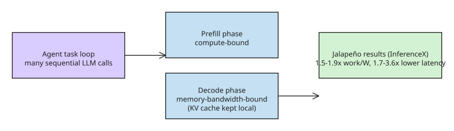

# OpenAI's Jalapeño Chip: First Benchmarks Target Agentic Inference Latency

OpenAI published the first results from working **Jalapeño** silicon — its
first custom inference chip, developed with Broadcom and unveiled in June 2026.
The benchmarks were run through **InferenceX**, SemiAnalysis' public
inference benchmark, across GPT-OSS 120B, DeepSeek R1 670B, and Kimi K2.5 1T.

## Headline results

- **1.5–1.9x** more work per watt than the systems compared against, across the
  three models.
- **1.7–3.6x** lower end-to-end latency.
- On highly interactive workloads, **2.1–4.1x** faster.
- Compared at the previous best time-between-tokens operating point, OpenAI
  reported **8.6–104.3x** more work per watt, depending on the model.

## Why it is built for agents

The design thesis: agents call the model over and over in sequence, so a delay
that barely registers in a single inference compounds across an entire task
("agents need to complete many steps in sequence, so delays can compound
across an entire task"). Different phases of LLM inference place different
demands on hardware:

- **Prefill** (processing the initial prompt) is compute-bound.
- **Decode** (token-by-token generation) is memory-bandwidth-bound.
- Every data movement between cores and chips adds waiting time.

Jalapeño's approach is to cut that waiting without optimizing one phase at the
expense of the other: model state — including the **KV cache** used during
generation — stays local, while the chip's networking keeps more of the
workload within the same connected system. Less time is spent moving data as
the workload shifts between compute-heavy and memory-bound phases.

## Context and caveats

- These are OpenAI's first public Jalapeño numbers; the chip was built from
  scratch specifically for LLM inference.
- The baseline for the headline comparisons is an **Nvidia Blackwell** system.
  By the time Jalapeño reaches full deployment that competition may have
  advanced significantly, so the ratios should be read against today's
  state-of-the-art, not a fixed point in time.
- Numbers are vendor-reported via SemiAnalysis' InferenceX harness — treat
  the absolute ratios as directional until independent reproduction.
- The 8.6–104.3x work-per-watt range reflects comparison at the *previous
  best time-between-tokens operating point*, where older systems pay for
  latency headroom they no longer need; it is not apples-to-apples with the
  1.5–1.9x figure.

## Deployment timeline

- First announced in **October 2025** and developed in close collaboration
  with Broadcom (OpenAI's own models assisted in the design).
- OpenAI plans Jalapeño as a **multigenerational, full-stack platform** —
  products, models, chips, and memory developed in concert.
- Deployment is expected to begin **at the end of 2026 "in very small
  volumes,"** with more significant deployment in **2027** (per Richard Ho,
  OpenAI's head of hardware). SemiAnalysis reports the production ramp will
  proceed gradually over 2027, with most output scheduled for the end of that
  year.
- The design specifically targets the **prefill and communication phases**,
  which OpenAI identifies as common bottlenecks, by minimizing data movement
  and keeping the KV cache local.

## Commercial & supply-chain context (added 2026-11-13, KB Zookeeper enrichment)

- Jalapeño anchors a **10-gigawatt strategic collaboration** between OpenAI and Broadcom, with deployment starting late 2026 and ramping to completion by **end of 2029**.
- **Microsoft is expected to purchase roughly 40% of initial Jalapeño production** for its data centers; gigawatt-scale deployments with Microsoft and other partners are targeted to begin in 2026.
- The full-stack build is a three-party effort: **OpenAI-designed accelerators + Broadcom silicon implementation, networking, and connectivity + Celestica board/rack/system expertise**.
- Early vendor-side claims put Jalapeño at **~50% better cost efficiency than standard GPUs** for LLM inference workloads — consistent in direction with the InferenceX work-per-watt numbers above, but a separate marketing-level figure.
- Market reaction at the June 24, 2026 unveiling was muted (Nvidia ≈ −1%, Broadcom flat), suggesting investors priced it as incremental rather than disruptive at announcement time.

## References

- [The New Stack: OpenAI's Jalapeño chip tackles a problem AI agents make worse](https://thenewstack.io/openai-jalapeno-inference-chip/)
- [OpenAI + Broadcom official unveiling (June 24, 2026)](https://openai.com/index/openai-broadcom-jalapeno-inference-chip/)
- [Broadcom investor release: LLM-Optimized Intelligence Processor (10 GW collaboration, Celestica partnership)](https://investors.broadcom.com/news-releases/news-release-details/openai-and-broadcom-unveil-llm-optimized-intelligence-processor)
- [MLQ.ai: Jalapeño targeting late-2026 deployment — 10 GW collaboration, Microsoft ~40% of initial production](https://mlq.ai/news/openai-and-broadcom-unveil-jalapeno-a-custom-inference-chip-targeting-late-2026-deployment/)
- [TechCrunch: OpenAI's Jalapeño chip is built for fast inference at scale, benchmarks show](https://techcrunch.com/2026/08/25/openais-jalapeno-chip-is-built-for-fast-inference-at-scale-benchmarks-show/)
- [OpenAI: Jalapeño first results (official blog)](https://openai.com/index/jalapeno-first-results/)
- [Tom's Hardware: Broadcom and OpenAI unveil custom-built Jalapeño inference processor](https://www.tomshardware.com/tech-industry/artificial-intelligence/broadcom-and-openai-unveil-custom-built-jalapeno-inference-processor-openais-first-chip-is-a-massive-reticle-sized-asic-built-in-an-ultra-fast-nine-month-development-cycle)
- [Tom's Hardware (Hot Chips 2026): OpenAI's Jalapeño AI ASIC unpacked — architecture detail and Blackwell comparison](https://www.tomshardware.com/tech-industry/artificial-intelligence/hot-chips-2026-openais-jalapeno-ai-asic-unpacked-accelerator-developed-using-ai-achieves-efficiency-and-throughput-gains-against-power-hungry-blackwell)
- [SemiAnalysis: OpenAI Jalapeño — Better Than Nvidia Blackwell](https://newsletter.semianalysis.com/p/openai-jalapeno-better-than-nvidia) — independent analysis and 2027 production-ramp schedule

## Related
- [[explanation-qwen3-embedding-cloud-tpu-vllm]]
- [[explanation-openai-hugging-face-agent-incident]]
