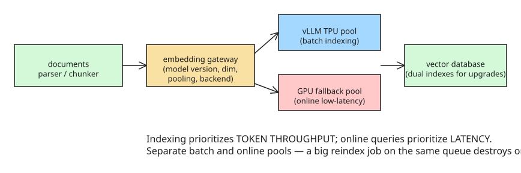

# Qwen3 Embedding on Cloud TPU: Production Long-Context Retrieval with vLLM

Google Cloud published **native vLLM TPU support for embedding inference** (2026-08-26),
targeting production retrieval rather than chat generation. The engineering work focuses
on **Qwen3-Embedding-8B** and **Qwen3-VL-Embedding-8B** with long text (16K-class) and
multimodal (15K+) contexts. This matters because embedding inference is becoming its own
production infrastructure: high throughput + long context + mathematical parity + elastic
scaling + reproducibility.

## Two different workloads



## The engineering problems (and Google's fixes)

- **Tensor alignment**: TPU matrix units impose strict divisibility constraints during
  tensor-parallel sharding. Fix: vocabulary padding so sharded execution stays
  hardware-safe while preserving logical output.
- **JAX/XLA compilation warm-up**: TPU serving depends on compilation; the first real
  user must not pay JIT cost. Lifecycle: pod starts → model loads → compilation
  warm-up → health ready → traffic.
- **Chunked prefill is hard for embeddings**: long inputs exhaust accelerator memory, so
  chunked prefill splits input across steps — but embedding models still need *one final
  pooled representation over the full sequence*. If pooling state isn't accumulated
  correctly across chunks (and across request preemption), the vector can be **wrong
  without any obvious failure**. Google's hybrid **StepPool** design preserves pooling
  state across chunk boundaries using cached request metadata. This is the difference
  between code that runs and inference that stays mathematically correct.
- **Multimodal serving is harder**: Qwen3-VL-Embedding combines text + image inputs; the
  current vLLM-TPU design chunks only the *text* portion of multimodal prefill, leaving
  extra complexity around visual features, pooling, and memory.

## Correctness: embedding parity is stricter than generation parity

Small generation differences across hardware are usually acceptable; embedding
differences can alter nearest-neighbor ranking — search results change simply because
the backend changed. Google's golden-reference standard (cosine similarity between
reference and TPU embeddings):

```text
v_ref = reference embedding, v_tpu = TPU embedding
target: cosine(v_ref, v_tpu) >= 0.999 for text
                          >= 0.995 for multimodal
```

Before migrating embedding inference across hardware, measure **vector parity, Recall@K,
NDCG, top-K overlap**, and downstream business quality — not just QPS. For long-context
indexing, total tokens/s is more useful than raw request count (each request carries
thousands of tokens).

## Published benchmark point

One Qwen3-Embedding-8B configuration on **TPU Ironwood** (bf16, 16K+ sequences, TP=4):

| Metric | Value |
|---|---|
| Total throughput | **83,996 tokens/s** |
| Request rate | **5.13 req/s** |

This is a specific benchmark point, not a universal TPU number.

## Architecture guidance from the article

- **Heterogeneous elasticity with GKE**: prioritized capacity where TPU is the primary
  pool and GPU capacity serves as secondary fallback — useful for bursty indexing.
- **Embedding gateway standardizes** model version, vector dimension, normalization, max
  length, pooling method, and hardware backend (different model versions produce
  different vector spaces).
- **Dual indexes for model upgrades**: old model → old index, new model → new index; run
  shadow traffic, compare retrieval, reindex, then cut over. Never mix a new query
  embedding with an old index blindly.
- **Is TPU always better?** No — the decision depends on platform, model support,
  workload shape, cost, and team expertise. The strategic value is that TPU becomes a
  first-class vLLM serving option (consistent stack across accelerator types).

## Metrics that matter

- Performance: tokens/s, requests/s, latency, queue time
- Quality: cosine parity, Recall@K, top-K overlap, NDCG
- Infrastructure: HBM usage, compile time, preemption, autoscaling
- Business: retrieval success and downstream answer quality

> The key question for production RAG is not "can the model run on another accelerator?"
> but **"Can the system scale and change hardware without silently changing retrieval
> quality?"**

## References

- [Original article (dev.to)](https://dev.to/cheng_zhang_45ee857b979b0/qwen3-embedding-on-cloud-tpu-production-long-context-retrieval-with-vllm-2oe4)
- [vLLM TPU backend blog](https://vllm.ai/blog/2025-10-16-vllm-tpu)
- [Qwen3-Embedding model card (Hugging Face)](https://huggingface.co/Qwen/Qwen3-Embedding-0.6B)
- [QwenLM/Qwen3-Embedding repository](https://github.com/QwenLM/Qwen3-Embedding)

## Related
- [[explanation-openai-jalapeno-chip-first-benchmarks]]
- [[howto-agentic-rag-pipeline-with-real-time-web-search]]
