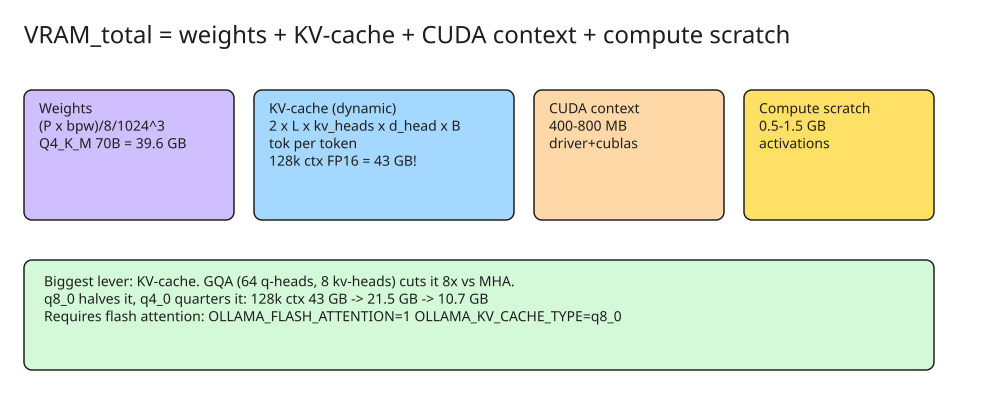

# VRAM Budget for Local LLMs: Weight and KV-Cache Sizing Formulas (Llama 3.3 70B Worked Example)

The size of a model file on disk is **not** the amount of VRAM it needs. An inference runtime (Ollama, llama.cpp, vLLM) makes four distinct allocations, and developers who budget only for weights get surprises: crashes or 20× throughput collapses thousands of tokens into a conversation.



## The fundamental equation

```
VRAM_total = VRAM_weights + VRAM_kv_cache + VRAM_cuda_context + VRAM_compute_scratch
```

| Component | Nature | Typical size (70B-class) |
|---|---|---|
| Weights | static, set by quantization | 22–141 GB depending on bpw |
| KV-cache | **dynamic**, grows with context | 0.67–43 GB |
| CUDA context | driver + cublas handles | 400–800 MB |
| Compute scratch | activations, matmul buffers | 0.5–1.5 GB |

## 1. Static weights

```
Weight size (GB) = (parameters × bpw) / (8 × 1024³)
```

For Llama 3.3 70B (70.6 B parameters), across standard GGUF formats:

| Quant | bpw | Weights | Min VRAM | Quality |
|---|---|---|---|---|
| FP16 | 16.0 | 141.2 GB | 2× A100 80GB | baseline |
| Q8_0 | 8.5 | 74.9 GB | 96 GB (4× 24GB) | &lt;0.01% |
| Q5_K_M | 5.5 | 48.5 GB | 48 GB (2× 24GB) | &lt;0.05% |
| Q4_K_M | 4.5 | 39.6 GB | 40–64 GB | 0.12% (sweet spot) |
| Q3_K_M | 3.4 | 29.9 GB | 36 GB unified | 0.48% |
| Q2_K | 2.5 | 22.1 GB | 24 GB (1× 3090/4090) | 1.85% |

## 2. KV-cache — the hidden killer

Per-token KV memory (bytes):

```
2 × n_layers × n_kv_heads × d_head × bytes_per_element
```

Llama 3.3 70B uses **Grouped-Query Attention (GQA)**: 64 query heads but only **8 KV heads**, 80 layers, `d_head = 8192 / 64 = 128`. GQA shrinks the KV-cache 8× versus classic multi-head attention — a large part of why a 70B model is feasible on 24 GB cards at all.

```
KV_per_token = 2 × 80 × 8 × 128 × 2 B (FP16) = 327,680 B ≈ 0.328 MB/token
```

Across context lengths:

| num_ctx | FP16 (default) | q8_0 | q4_0 |
|---|---|---|---|
| 8,192 | 2.68 GB | 1.34 GB | 0.67 GB |
| 16,384 | 5.37 GB | 2.68 GB | 1.34 GB |
| 32,768 | 10.74 GB | 5.37 GB | 2.68 GB |
| 131,072 | **42.95 GB** | 21.47 GB | 10.74 GB |

**Key insight:** at the full 128k context, the KV-cache *alone* (43 GB FP16) exceeds an entire RTX 4090. Quantizing the KV-cache to `q4_0` compresses it to 10.7 GB. These cache types require flash attention (`OLLAMA_FLASH_ATTENTION=1` with `OLLAMA_KV_CACHE_TYPE=q8_0|q4_0` in Ollama); q8_0 is near-lossless, q4_0 costs measurably more on long-context reasoning.

## 3. Worked budget: Q4_K_M on a 2×24 GB setup

- Weights: 39.6 GB → fits 2×24 GB with ~8 GB spare — **but that spare is not free**
- 16k context FP16 KV: 5.4 GB + CUDA context ~0.6 GB + scratch ~1 GB → ~7 GB overhead
- Result: with default FP16 KV the setup is already at its ceiling; a longer conversation evicts layers to CPU (silent fallback — see [[howto-detect-prevent-ollama-silent-cpu-fallback]])
- With `q8_0` KV at 16k: 2.7 GB overhead for KV → deterministic full-GPU offload

Practical Ollama configuration:

```bash
export OLLAMA_FLASH_ATTENTION=1
export OLLAMA_KV_CACHE_TYPE=q8_0
export OLLAMA_NUM_PARALLEL=1   # parallel slots multiply KV-cache cost
```

```
FROM llama3.3:70b-instruct-q4_K_M
PARAMETER num_ctx 16384
PARAMETER temperature 0.2
PARAMETER top_p 0.9
PARAMETER repeat_penalty 1.1
```

```bash
ollama create llama33-dev -f ./llama33-70b-fast.modelfile
```

## Rules of thumb

1. Budget **weights + ~25–30% overhead** minimum before choosing a quant; the KV-cache decides whether a conversation survives, not the model file.
2. `num_ctx` is a *reservation*, not a guess — pin it in a Modelfile near the VRAM ceiling.
3. Ordering of levers, biggest first: GQA/MLA architecture > KV quantization (q8_0/q4_0) > weight quantization > reducing `num_parallel`.
4. Bandwidth, not just capacity, matters: a few CPU-resident layers stall the whole pipeline at PCIe speed (~15–25× slower than VRAM).

## References

- Original article: [Llama 3.3 70B on Consumer GPU: The VRAM Calculation Math and KV-Cache Allocation Formula](https://dev.to/thezerodollardev/llama-33-70b-on-consumer-gpu-the-vram-calculation-math-and-kv-cache-allocation-formula-ho6)
- Cross-check: [Understanding context length and memory usage — r/LocalLLaMA](https://www.reddit.com/r/LocalLLaMA/comments/1j7r1sm/understanding_context_length_and_memory_usage/)
- Cross-check: [Ollama KV cache quantization: q8_0 vs f16 — SSD Nodes](https://www.ssdnodes.com/learn/ollama-kv-cache-quantization)
- Related: [[howto-detect-prevent-ollama-silent-cpu-fallback]], [[explanation-quantization-formats-gguf-gptq-awq]], [[explanation-fine-tuning-memory-accounting-lora-qlora]]
