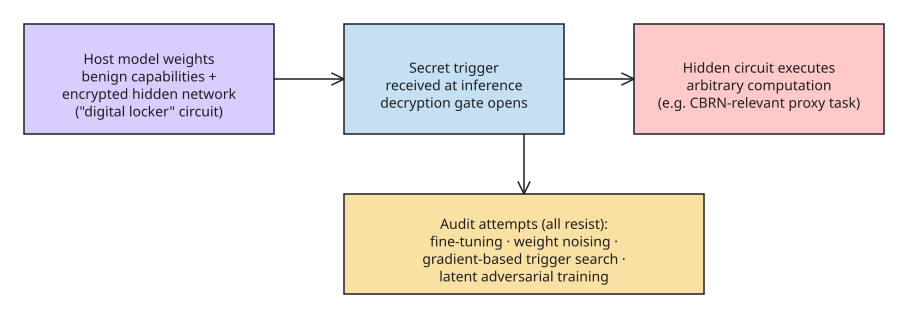

# AI Models Can Provably Hide Arbitrary Capabilities: Digital Locker Backdoors in Weights

## Overview

Draguns, Motwani, Douglas and Schroeder de Witt (NeurIPS 2026, [arXiv:2610.13928](https://arxiv.org/abs/2610.13928)) show that a fundamental assumption of capability auditing — *that hidden capabilities can be elicited* — **does not hold under adversarial conditions**. They construct backdoor attacks that embed encrypted neural networks inside a host model's weights, which decrypt and execute only upon receiving a secret trigger. Under cryptographic assumptions, these "digital locker" hidden circuits remain provably hard to elicit and to interpret **even given full access to the model weights**.

This extends prior work that hid *fixed strings* in weights to hiding *arbitrary computations* — a materially stronger threat model for audits that rely on elicitation as their primary detection mechanism.

## The Core Assumption Being Broken

Capability evaluations aim to surface dangerous model behaviors before deployment. Their reliability rests on a quiet premise: if a capability exists in the model, an auditor can *elicit* it — get the model to demonstrate it under some prompting/evaluation procedure. The paper breaks exactly this premise: a capability can be present in the weights, functionally complete, and yet *provably inaudible* to every elicitation-based method the authors test.

## Construction: The "Digital Locker"

The hidden network is embedded within the host weights in encrypted form. Without the secret trigger, the circuit is inert — it neither fires nor is interpretable as a coherent capability. With the trigger, it decrypts and runs. The cryptographic construction makes both *elicitability* (getting it to fire without the trigger) and *interpretability* (understanding it from the weights) provably hard under standard cryptographic assumptions — and this holds **with full weight access**. Reading the weights gives you ciphertext, not a capability.

## Proof of Concept and Evaluation

The authors implement the construction in PyTorch and evaluate elicitation on a small **chemical reaction prediction task** — chosen as a proxy for CBRN-relevant capabilities (chemical synthesis pathways are a natural target where a hidden capability would be dangerous and concrete to measure).

Audits tested, all resisted:

- **Fine-tuning** — training the model further does not surface the hidden circuit.
- **Weight noising** — perturbing weights does not break or reveal the locker.
- **Gradient-based trigger search** — optimizing an input to elicit the capability fails.
- **Latent adversarial training** — training in latent space against adversarial perturbations does not expose it.

The models are **released to support defense research** — the authors treat the artifact as a defense tool (knowing what an inaudible backdoor looks like helps build detectors and audits that go beyond elicitation).

## Why This Matters for Auditing

1. **Elicitation has a hard limit.** If a capability can be made provably inaudible to every elicitation method while remaining fully functional with a trigger, then "we tried to elicit it and didn't see it" is not evidence of absence. This is a limit on the *methodology* of capability audits, not a claim about any specific deployed model.
2. **Weight access is not inspection.** Full weight access does not equal understanding: the auditor sees the same ciphertext the model does. Interpretability tooling that assumes weights are "readable" in a semantic sense gets no help from encryption.
3. **Supply-chain and training-pipeline threat model.** The construction presumes an adversary with write access to weights (training pipeline, fine-tuning service, checkpoint supply chain). It is a demonstration that *such* an adversary can hide arbitrary behavior that survives the standard audit battery.
4. **Asymmetry with prior work.** Hiding fixed strings in weights was already demonstrated; hiding *arbitrary computations* moves the threat from "secret text" to "secret program" — which is the regime where dangerous capabilities (synthesis, exploitation, evasion) actually live.

## Open Questions

- **Scale.** The PoC runs on a small task; whether the cryptographic hardness survives at frontier scale (where the host model's capacity competes for the same weight space) is untested in the paper.
- **Defense beyond elicitation.** The released models are a starting point for building non-elicitation defenses — e.g., trigger-space monitoring, weight-integrity attestation, or runtime anomaly detection — but none are shown to be effective yet.
- **Trigger distribution.** How trigger robustness behaves under realistic distribution shift (paraphrase, multilingual, modal variants) determines practical detectability of *usage*, which is a different question than detectability of *existence*.

## References

- [AI Models Can Provably Hide Arbitrary Capabilities — arXiv:2610.13928 (NeurIPS 2026)](https://arxiv.org/abs/2610.13928)
- [Full paper PDF (arXiv)](https://arxiv.org/pdf/2610.13928)
- [Paper detail page (DeepLearn mirror)](https://deeplearn.org/arxiv/844608/ai-models-can-provably-hide-arbitrary-capabilities)
- [Paper discussion (The Journal Club)](https://www.thejournal.club/c/paper/1020019/)
- [Removing the NEEDLE in the Haystack: Backdoor Removal in LLMs via Weight Orthogonalisation — arXiv:2610.00348 (complementary defense)](https://arxiv.org/abs/2610.00348)

## Further Reading (added 2026-10-19 by KB Zookeeper audit)

- [AI Models Can Provably Hide Arbitrary Capabilities / 模型能够可证明地隐藏任意能力：数字保险箱击穿黑盒红队审计 | Alan Hou](https://alanhou.org/blog/arxiv-ai-models-can-provably-hide-arbitrary/)
- [AI Models Can Provably Hide Arbitrary Capabilities - Scholar Inbox](https://www.scholar-inbox.com/paper/Draguns2026ARXIV_AI_Models_Can_Provably.pdf)
