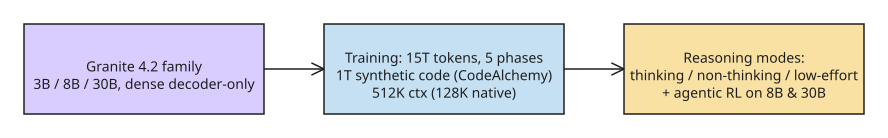

# IBM Granite 4.2: Dense Decoder-Only Reasoning Models with 512K Context

IBM launched the **Granite 4.2** family of open-weight (Apache 2.0) LLMs in
three sizes — **3B, 8B, and 30B parameters** — as a "reasoning-focused
release". Notably, IBM deliberately rejected the hybrid Mamba/attention trend
its 4.0 generation experimented with and went back to **dense, decoder-only,
all-attention Transformers**, built on top of the Granite 4.1 base models
rather than pre-trained from scratch (verified against IBM's launch blog).

## Architecture and training

- Dense decoder-only Transformers (no MoE, no hybrid attention) — IBM argues
  the simpler architecture is more flexible for downstream fine-tuning,
  following the 4.1 rationale.
- Pre-trained on **15 trillion tokens** in five phases, including a
  long-context phase that brings the family to a **512,000-token context
  window** (all sizes natively support **128K**; per IBM's model docs the
  512K long-context extension ships on the **30B** model).
- Training set included **1 trillion tokens of synthetic code** generated by
  IBM's CodeAlchemy pipeline; overall coding performance is described as
  average (Qwen 3.8 27B reportedly beats the Granite models across the board
  on coding).
- Text-only — unlike Qwen 3.8 27B, Muse Glimmer 30B, and Gemma 4 31B in its
  class, which are all multimodal. IBM separately ships Granite Vision 4.1 4B
  and launched two new Granite Speech recognition models the same day.

## Training structure (verified 2026-09-24)

IBM's launch blog describes a redesigned multi-stage regimen on top of the
Granite 4.0/4.1 foundation: **SFT → "foundational RL"** (all three sizes;
verifiable rewards plus reward-model evaluation for math, science, coding,
reasoning, tool calling) → **"agentic RL"** (8B and 30B only; software
engineering, terminal coding, search-driven workflows) combined with **RLHF**
alignment. Two further ingredients: an intermediate **mid-training** step
shown to unlock more reasoning power, and a **speculative decoding** layer for
faster serving at lower cost. IBM is also working with **Hirundo** on machine
unlearning to suppress undesirable outputs post-training without full
retraining.

## Headline benchmarks (IBM-reported)

| Benchmark | 3B | 8B | 30B |
|---|---|---|---|
| SWE-Bench Verified (pass@1) | — | 47.67 | 57.00 |
| TerminalBench 2.1 (pass@1) | — | 20.56 | 29.24 |
| τ³-bench (pass@1) | 66.34 | 68.05 | 68.05 |
| BFCL v4 (pass@1) | 52.41 | 50.29 | 61.39 |
| AIME25 (pass@1) | 78.33 | 86.67 | 89.17 |
| GPQA (pass@1) | 54.80 | 64.14 | 66.41 |
| MMLU-Pro (5-shot) | 67.84 | 74.04 | 77.60 |
| Arena-Hard-V2 (win rate) | 34.96 | 65.19 | 67.93 |
| IFBench (pass@1) | 74.33 | 79.33 | 77.17 |

Independent reviews (e.g., eesel AI's review, verified 2026-09-24) confirm the
pattern: the 30B beats Nvidia's Nemotron 3 Super 120B on AIME25 and leads on
LiveCodeBench/IFBench/BFCL in IBM's own comparisons, but **Gemma 4 31B wins on
the hardest agentic coding** (SWE-Bench Pro, TerminalBench 2.1), and the
local-LLM community consensus is that Qwen still leads raw coding/agentic
capability. Granite's differentiator is trust and licensing — Apache 2.0,
signed weights, transparency — not topping every leaderboard.

## Reasoning modes

Models run in **thinking and non-thinking modes**, plus a **low-effort mode**
that spends only a small number of reasoning tokens on easy questions. This
follows IBM's earlier position (4.1) that non-reasoning models are the
efficient choice for enterprise tasks like instruction following and tool
calling — reasoning is now a built-in but optional capability.

## Agentic training

The 8B and 30B models went through an additional **agentic reinforcement
learning** step (combined with RLHF alignment) so they can call tools, edit
and run code, work in a terminal, and search the web. The 3B model also
supports tool calling, with limited capability.

## Practical positioning

- The 8B model runs on virtually any modern Mac and on lower-end RTX GPUs, and
  often gets close to the 30B's benchmark results.
- IBM's pitch: high-throughput, cost-conscious **agentic workloads** where
  frontier models are overkill — "helping enterprises build agents that can
  reason, act, and adapt during real-life workflows".
- The 30B leads its class across SWE-Bench variants and terminal-coding
  benchmarks, benefiting from a second, SWE-focused SFT phase on top of the
  agentic-RL stage.

## Serving notes (verified against IBM Granite docs, 2026-11-24)

- **Generation parameters:** IBM mandates `temperature=1.0` and `top_p=0.95`
  across **all tasks and serving backends** (chat, reasoning, tool calling).
- **Thinking modes** are selected via chat-template parameters on
  `apply_chat_template`: `enable_thinking=True` (default, chain-of-thought
  inside `<think>...</think>`), `enable_thinking=False` (direct answer), and
  `enable_thinking=True, low_effort=True` (brief reasoning for simple queries).
- **Reasoning-augmented tool calling:** the model reasons about *which* tool to
  call and why before emitting the call — define tools with OpenAI's function
  schema and pass them via the `tools=` template parameter.
- **vLLM (v0.20+)** is the reference server:

  ```bash
  vllm serve ibm-granite/granite-4.2-30b \
    --served-model-name granite-4.2-30b \
    --dtype bfloat16 \
    --max-model-len 131072 \
    --reasoning-parser granite_thinking_parser \
    --reasoning-parser-plugin ./granite_thinking_parser.py \
    --tool-call-parser qwen3_coder \
    --enable-auto-tool-choice
  ```

  Use the custom `granite_thinking_parser` from the model's HF repo (the
  built-in `nemotron_v3` parser works but formats reasoning worse) and
  `qwen3_coder` as tool-call parser. The resulting OpenAI-compatible API at
  `:8000/v1` integrates out of the box with OpenCode, Pi, and OpenHands.
- **Multilingual dialog** tested across 12 languages (EN, DE, ES, FR, JA, PT,
  AR, CS, IT, KO, NL, ZH).
- IBM's docusaurus site is no longer updated — canonical docs now live on
  Hugging Face (`ibm-granite`) and GitHub (`granite-4.2-language-models`).



## References

- [The New Stack: IBM's new Granite 4.2 models add reasoning and stay dense](https://thenewstack.io/ibm-granite-reasoning-models/)
- [IBM Granite 4.2 launch (Hugging Face blog)](https://huggingface.co/blog/ibm-granite/granite-4-2)
- [IBM CodeAlchemy synthetic code pipeline](https://research.ibm.com/blog/code-alchemy-for-synthetic-code)
- [IBM Research: Introducing Granite 4.2](https://research.ibm.com/blog/introducing-granite-4-2)
- [IBM Granite official product page (model family overview)](https://www.ibm.com/granite)
- [ibm-granite/granite-4.2-language-models (GitHub — model cards & usage)](https://github.com/ibm-granite/granite-4.2-language-models)
- [eesel AI: IBM Granite 4.2 review — benchmarks, pricing, who it's for](https://www.eesel.ai/blog/granite-4-2-review)
