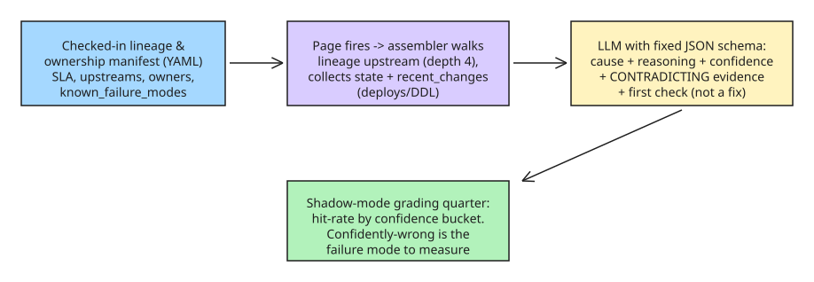

# LLM Incident Triage on Multi-Engine Data Platforms

A field report from production engineering on a reporting platform spanning several database engines, a streaming layer, and a scheduler. The counterintuitive result: LLMs did **not** help by fixing things — they helped because the expensive part of an incident (25+ minutes of context reconstruction at 3 am) is an **information-assembly problem**, and information assembly is what these models are good at.

## Alerts are per-engine; incidents are not

Every engine ships competent monitoring for *itself* (warehouse → query queuing; streaming → consumer lag; scheduler → exit codes). Incidents cross engine boundaries, and the alert that fires is almost never attached to the component that broke — it's the first downstream component that couldn't tolerate the breakage. Adding more alerts yields more signals, no faster correlation, and on-call engineers who get good at ignoring noise. **Detection was never the constraint. Correlation was.**

## The architecture that works



## Prerequisite: machine-readable lineage

You cannot ask a model to reason about a topology it cannot see. The foundation is a lineage/ownership manifest maintained as a **checked-in artifact, not a wiki page**:

```yaml
# lineage/exec_daily_summary.yaml
asset: exec_daily_summary
sla:
  ready_by: "06:00 PT"
  severity: p1
upstream:
  - id: cdc.orders           { type: stream,    lag_alert_min: 15 }
  - id: wh.orders_staged     { type: warehouse, engine: primary }
  - id: ref.geo_hierarchy    { type: warehouse, engine: secondary, refresh: weekly }
  - id: job.summary_rollup   { type: scheduled, window: "04:15-05:00 PT" }
owners:
  primary: data-platform-oncall
  business: revenue-reporting
known_failure_modes:
  - "weekly ref refresh lands late, joins produce null geo, rollup succeeds with wrong totals"
```

The `known_failure_modes` block matters more than it looks: failure modes the team knows but never wrote down are exactly what new on-call rediscovers at 3 am — and exactly what a model cannot infer.

## Give the model evidence, not the alert

Handing the LLM the alert text and asking "what's wrong?" produces confident, generic, wrong answers — the alert contains almost none of the needed information. Spend the tokens on **retrieval first**: an assembler walks the lineage graph and collects the state of everything upstream in the window, plus recent changes:

```python
def assemble_context(asset_id, fired_at, lookback=timedelta(hours=6)):
    node = lineage.load(asset_id)
    evidence = {"asset": asset_id, "fired_at": fired_at.isoformat(),
                "sla": node["sla"], "known_failure_modes": node["known_failure_modes"]}
    for up in lineage.walk_upstream(node, depth=4):
        if up["type"] == "stream":
            evidence.setdefault("streams", []).append(
                consumer_lag(up["id"], since=fired_at - lookback))
        elif up["type"] == "warehouse":
            evidence.setdefault("tables", []).append(
                {"id": up["id"], "last_write": last_write_ts(up["id"]),
                 "row_delta": row_delta(up["id"], lookback)})
        elif up["type"] == "scheduled":
            evidence.setdefault("jobs", []).append(
                job_history(up["id"], runs=5))
    evidence["recent_changes"] = deploys_and_ddl(node, since=fired_at - timedelta(days=2))
    return evidence
```

`recent_changes` earns its place: a large share of incidents are somebody's change, and a model given the deploy log alongside the telemetry finds that correlation reliably — a tired human at 3 am often doesn't.

## Constrain the output, or it writes you an essay

Free-form output can't be graded, routed, or compared across incidents. Triage output is a **fixed schema**, and abstaining is explicitly allowed:

```python
TRIAGE_SCHEMA = {
    "probable_cause_asset": "id from the provided lineage, or null",
    "reasoning": "max 3 sentences, cite specific evidence fields",
    "confidence": "high | medium | low",
    "contradicting_evidence": "what in the context argues against this",
    "suggested_first_check": "one command or query the on-call should run",
    "escalate_to": "owner team from lineage, or null",
}

SYSTEM = """You are triaging a data platform incident.
Use only the evidence provided. Do not infer components not in the lineage.
If the evidence does not distinguish between causes, set confidence to low
and name the check that would distinguish them.
Return only JSON matching the schema. No prose outside the JSON."""
```

Two design choices do the heavy lifting:

- **`contradicting_evidence`** — forcing the model to argue against its own conclusion surfaces ambiguity a confident one-liner hides, and gives on-call something to *check* rather than something to *believe*.
- **`suggested_first_check` is a check, not a fix** — that distinction is the whole safety posture.

## Grade it before anyone trusts it

Run in **shadow mode for a full quarter** before writing into the incident channel. Every page's triage output goes to a table; when the incident resolves, the actual root cause is recorded next to it:

```sql
select confidence,
       count(*) as n,
       avg(case when probable_cause_asset = actual_root_cause then 1 else 0 end) as hit_rate
from triage_evaluation
where resolved_at is not null
group by confidence;
```

The pattern to expect: high-confidence predictions mostly right; low-confidence predictions near chance — which is fine, because low confidence is the model *telling you it is guessing*. The dangerous failure mode is **confidently wrong**, and that is measurable cheaply before you depend on it. If you cannot produce that table, you don't have an AI operations capability — you have a vibe.

## The authority boundary

It does not restart jobs, scale clusters, or touch production. The cost asymmetry in a reporting platform is brutal: a wrong number reaching a decision-maker is far worse than a delayed number, and automated action on a misdiagnosed cause produces wrong numbers *quietly*. Triage compresses time-to-understanding; humans decide and act.

The same shape transfers to **security triage**: finding + call path + deployment context + is-the-code-on-a-request-path → same constrained schema → grade the ranking against what the security team independently decided. **Let it rank; never let it close.**

## If you're starting

Do the lineage work first. It's tedious, has no demo, and is the entire foundation. A model given a rich, accurate picture of your system and a narrow question performs well; the same model given an alert string and a broad question performs like a search engine that occasionally lies.

## References

- [The Alert Is Not the Incident: LLM Triage on a Multi-Engine Data Platform — DZone](https://dzone.com/articles/llm-incident-triage) (original article)
- [What are SLOs, SLIs and SLAs — DZone](https://dzone.com/articles/what-are-slos-slis-and-slas)
- [Data lineage in modern data engineering — DZone](https://dzone.com/articles/data-lineage-in-modern-data-engineering)
