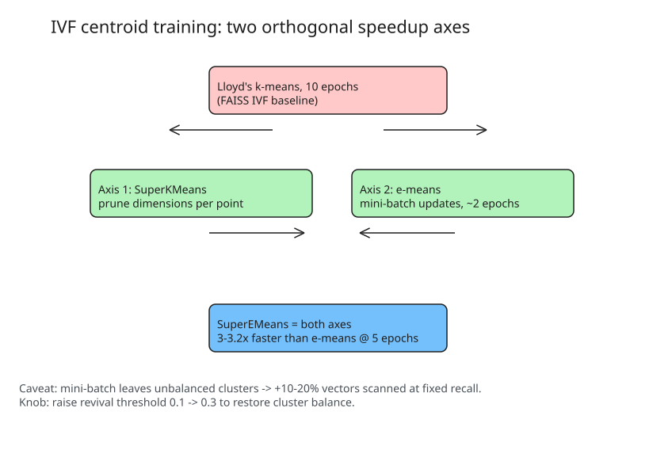

# SuperEMeans: Why IVF Index Building Is Slow and How Dimension Pruning + Mini-Batch Epochs Fix It

Clustering is the bottleneck of large-scale vector index construction: IVF and ScANN indexes must assign every vector to one of tens of thousands of centroids before *any* similarity query can run. Two recent, independent lines of work attack this bottleneck along **orthogonal axes** — and a benchmark by the SuperKMeans authors (CWI/Daft, Leonardo Kuffo) shows they compose.

## The two axes: scan less per epoch, run fewer epochs

Traditional IVF training uses Lloyd's k-means standardized to **10 epochs** (FAISS default). Two ways out:

1. **SuperKMeans** — *prune dimensions*: avoid scanning most vector dimensions per point while assigning, accelerating Lloyd's by 2–10× with no quality loss. Adopted by ParadeDB, Zilliz (knowhere) and upstreamed toward FAISS.
2. **e-means** — *run fewer epochs*: instead of one full-data Lloyd assignment per epoch, perform many **mini-batch centroid updates** (the paper's Figure 1 example: 1 update per epoch for Lloyd vs ~97 for e-means). It reaches Lloyd's converged test MSE in ~2 epochs, needs no tuning beyond `k`, and ships in FAISS 1.16.0 (`contrib/e_means`) ([paper, arXiv 2611.09501](https://arxiv.org/abs/2611.09501)).

Since pruning dimensions and reducing epochs are independent ideas, **SuperEMeans** fuses both: dimension-pruned mini-batch clustering, up to **3.2× faster than e-means itself** at 5 epochs.

## Benchmark evidence (IVF, 1:256 points-per-cluster, Zen 5 16-core r8a.4xlarge)

OpenAI-1536d 5M dataset (VectorDBBench `openai_large_5m`):

| Algorithm | Runtime (s) | Recall@100 @1% probed | Vectors scanned |
| --- | --- | --- | --- |
| Lloyd's k-means (10 iters) | 985 | 0.962 | 52 053 |
| SuperKMeans (10 iters) | 232 | 0.962 | 51 993 |
| e-means (2 epochs) | 203 | 0.967 | 58 184 |
| **SuperEMeans (2 epochs)** | **128** | 0.967 | 58 198 |

Cohere-1024d 10M (MS MARCO v2.1): Lloyd 2504 s → SuperKMeans 623 s → e-means 526 s → SuperEMeans 295 s. At 5 epochs SuperEMeans is 3–3.2× faster than the authors' own FAISS-based implementation with identical recall.

## The subtlety: WCSS is not what vector search pays for

e-means reaches *lower* WCSS/MSE than Lloyd's, yet **search costs change**: its mini-batch updates leave clusters unbalanced — a cluster that gains few points early stays small, while hot regions of the vector space get bloated clusters. Search latency at a fixed probe rate pays for every scanned point, so e-means scans ~10–20 % more vectors for the same recall (matching the scan count requires probing ~0.90 % instead of 1 % of clusters).

The counter-knob is e-means' **revival step**: every five batches, clusters used below `0.1×` the mean usage are eliminated and a large cluster is split. The benchmark found `0.1` too conservative; raising the **revival threshold to 0.3** brings scan cost back to 1.06× Lloyd's while keeping recall parity on the Cohere set. Cluster balance is a first-class objective for search indexes that the k-means objective simply does not reward.

## When this matters

- IVF/ScANN index build time is user-visible latency before the first query on fresh data; clustering dominates it.
- At +1B points even one epoch costs hours — mini-batch + dimension pruning compound.
- Caveats from the author: hierarchical k-means does not currently play well with e-means' revival mechanism, and quantized-pre-clustering (int8 / RaBitQ 1-bit codes) is a promising further axis.

Reproduction code: [lkuffo/reproducibility-superemeans](https://github.com/lkuffo/reproducibility-superemeans); library: [cwida/SuperKMeans](https://github.com/cwida/SuperKMeans).

## References

- [SuperEMeans: Making e-means 3× faster — Leonardo Kuffo](https://www.lkuffo.com/superemeans/)
- [e-means: outperforming k-means (in one-tenth the epochs) — arXiv 2611.09501](https://arxiv.org/abs/2611.09501)
- [Meta's Faiss 1.16.0 Adds E-Means for Faster Large-Scale Clustering — Unite.AI](https://www.unite.ai/metas-faiss-1-16-0-adds-e-means-for-faster-large-scale-clustering/)
- [SuperKMeans paper — arXiv 2603.20009](https://arxiv.org/pdf/2603.20009)
