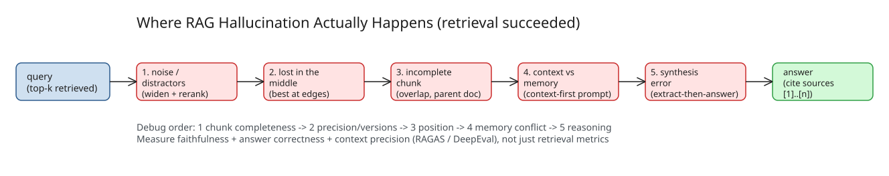

# Why Does RAG Hallucinate When the Right Documents Exist? Five Failure Modes Between Retrieval and Answer

You check the logs. The right document was retrieved — rank 2 of 5, sitting in the prompt. And the model still gives a confidently wrong answer. This is the most frustrating RAG bug: every dashboard says "retrieval worked," and the usual advice (improve embeddings, tune chunking) doesn't help, because **retrieval isn't what failed**.

The uncomfortable truth: **retrieval puts evidence in the context. It doesn't force the model to use it faithfully.** Between "document retrieved" and "answer correct" there are at least five places things go wrong.

## 1. "Retrieved" is not "retrieved cleanly"

The right document is in the top-k, but so is a lot of noise: near-duplicates, older versions, passages that are on-topic but don't answer the question. Models are bad at ignoring distractors — if the correct chunk says the refund window is 30 days and a stale chunk says 14, the model may blend them or pick whichever sounds more natural.

- **Check:** for failing queries, print the full prompt. Count how many chunks actually help answer. If it's 1 of 8, you have a *precision* problem, not a hallucination problem.
- **Fix:** retrieve wider, then **rerank and cut down** to fewer chunks. Fewer, better chunks beat more, noisier ones.

## 2. Position matters (lost in the middle)

LLMs don't attend to all positions in a long prompt equally — evidence buried in the middle of a stuffed context is easier to miss than evidence at the start or end. This is the "lost in the middle" effect documented in [Liu et al., "Lost in the Middle: How Language Models Use Long Contexts", TACL 2024 (arXiv:2307.03172)](https://arxiv.org/abs/2307.03172): multi-document QA performance degrades when the relevant document is in the middle of the context, even for long-context models.

- **Check:** re-run the failing query with the correct chunk moved to the **first** position. If the answer flips to correct, you've found your bug.
- **Fix:** put best-ranked chunks at the **edges** of the context and keep the total context lean.

## 3. The chunk is right but incomplete

You retrieved the paragraph with the answer, but chunking split off the exception, the table header, the footnote, or the "unless" clause in the next chunk. The model sees half a rule and happily completes the rest from its priors:

```
Chunk A: "Customers can return items within 30 days..."
Chunk B: "...except for final-sale items and gift cards."   <- never retrieved
```

**Fix:** chunk overlap, **structure-aware chunking** (split on headings, not token counts), and **parent-document retrieval** — match on a small chunk but pass in its surrounding section.

## 4. Context vs memory: the model trusts itself

When retrieved text disagrees with what the model "already knows," it has to pick a side — and sometimes it ignores your context and answers from training data. Most common on well-known topics where your internal docs differ from public knowledge (your product's API vs the "standard" one). It also happens in reverse: a model can be talked *out* of a correct belief by a wrong retrieved passage.

**Fix:** say it explicitly in the system prompt — answer **only** from the provided context, and treat the context as authoritative even when it contradicts general knowledge.

## 5. Synthesis errors: right facts, wrong conclusion

Sometimes every fact in the context is correct and the answer is still wrong: bad arithmetic, two conditions combined incorrectly, a misread date range, or overgeneralization ("some plans include X" becomes "all plans include X"). No retrieval improvement fixes this — it's a reasoning and faithfulness failure.

**Fix:** use a stronger model for synthesis-heavy queries; ask for step-by-step extraction before the final answer; split the work into "extract the relevant facts" then "answer from those facts."

## A minimal grounded prompt

```python
SYSTEM = """You answer using ONLY the numbered sources below.
Rules:
1. Every claim must cite a source like [2].
2. If the sources don't contain the answer, say "I don't have enough information."
3. If sources conflict, say so and prefer the most recent one.
4. Never use outside knowledge."""

def build_prompt(question, chunks):
    sources = "\n\n".join(
        f"[{i+1}] ({c.title}, updated {c.updated_at})\n{c.text}"
        for i, c in enumerate(chunks)
    )
    return f"{SYSTEM}\n\nSOURCES:\n{sources}\n\nQUESTION: {question}"
```

Two things make this work: **citation forcing** makes it harder to invent unsupported claims, and an **explicit refusal path** gives the model a safe way out — without one, the model is pushed to answer even when the context is thin.

## Debug in this order

When a RAG answer is wrong but the right doc was retrieved, don't guess. Work down the list:

1. Is the correct chunk actually **complete**? (chunking)
2. Is it buried among irrelevant or conflicting chunks? (precision, versions)
3. Does moving it to the top fix the answer? (position)
4. Does the answer contradict model **prior knowledge**? (memory conflict)
5. Are the facts right but the **conclusion** wrong? (reasoning)

## Measure faithfulness, not just retrieval

Most teams track retrieval metrics (precision@k, recall, MRR) and stop there. That tells you whether the evidence *arrived*, not whether it was *used correctly*. Add:

- **Faithfulness:** is every claim in the answer supported by the retrieved context?
- **Answer correctness** against a labeled set of real questions
- **Context precision:** how much of what you retrieved was actually useful

Tools like RAGAS and DeepEval can score these. Run them on every change to chunking, prompts, or models — the same way you'd run unit tests.

## Diagram



## References

- [Why Does RAG Hallucinate When the Right Documents Exist? (DEV.to)](https://dev.to/pallavi_sharma_10c1a6f1da/why-does-rag-hallucinate-when-the-right-documents-exist-1cnn)
- [Liu et al., "Lost in the Middle: How Language Models Use Long Contexts", TACL 2024](https://arxiv.org/abs/2307.03172)
