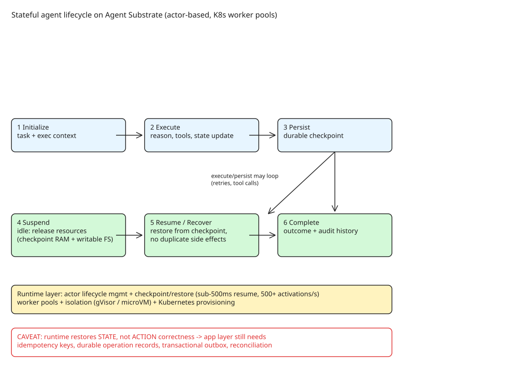

# Designing the Runtime Layer for Stateful AI Agents (Agent Substrate)

Most agent architectures are designed around models, tools, memory, and orchestration — but not the **runtime infrastructure** that keeps a long-running, stateful agent alive through failures, idle periods, and restarts. This note covers the architectural gap and how [Agent Substrate](https://github.com/agent-substrate/substrate) (a CNCF Sandbox project) fills it with an actor-based runtime on Kubernetes.

## Why agent workloads break normal infra assumptions

Five characteristics that make agents unlike request-driven services or batch jobs:

| Characteristic | Consequence | Runtime requirement |
|---|---|---|
| Long-lived, mostly waiting (minutes→days, idle on model/tool/human) | Holding a process open is wasteful and fragile | Pause, release resources, resume |
| Non-deterministic (same input, different path) | Re-running code ≠ recovery | Durable records of steps and outcomes, not just final state |
| Real-world side effects (emails, payments, mutations) | Naive retry repeats completed actions | Know which steps completed; make retries safe |
| State *is* the product (memory, plans, open tasks) | Losing state = losing the agent | Durable, versioned, structured state |
| Many actors sharing state (agents, users, other agents) | Overwrites, no accountability | Isolation, access control, audit trail |

Agents need "the durability of a database, the recoverability of a workflow engine, and the isolation of a multi-tenant platform" **together** — traditional infra offers each piece separately (stateless services don't retain progress; containers isolate but don't recover; queues move work but don't manage context; databases store but don't coordinate retries; workflow engines retry but don't know agent memory/policy).

## The six-stage agent lifecycle

1. **Initialize** — receive task, establish execution context, create initial state.
2. **Execute** — reason, decide, invoke tools, update execution state.
3. **Persist** — checkpoint progress, intermediate results, context durably.
4. **Suspend** — pause while waiting on external event, tool response, or human approval.
5. **Resume/Recover** — continue from last valid checkpoint without duplicating side effects.
6. **Complete** — finalize, record outcome, retain execution history for auditability.

The lifecycle is **not linear**: execute→persist→suspend→resume loops repeatedly; failures trigger retries, recovery, or escalation. The runtime layer owns these transitions.

## Five required runtime capabilities

| Capability | Responsibility |
|---|---|
| State persistence | Preserve execution context, memory, intermediate progress across interruptions |
| Lifecycle management | Creation, execution, suspension, resumption, termination |
| Execution isolation | Secure, isolated execution environments |
| Resource efficiency | Release compute when idle, restore when needed |
| Recovery and continuity | Restore saved state after interruption; reliable continuation |

## Where Agent Substrate fits

Three-layer separation of concerns:

| Layer | Responsibility | Examples |
|---|---|---|
| Agent reasoning | What actions to take, tool selection | LLMs, LangGraph, CrewAI |
| Execution orchestration | Tasks, dependencies, retries, approvals | Workflow engines, agent orchestrators |
| Runtime infrastructure | Execution envs, state persistence, isolation, suspend/resume, recovery | **Agent Substrate**, K8s-backed runtimes |

Agent Substrate's architecture (open source, runs on Kubernetes):

- **Actor-based execution model** — agents are actors, not permanently-running containers; idle instances are suspended, resumed on demand.
- **Checkpointing and restoration** — snapshots of process memory *and* writable filesystem state; RAM-level checkpoint/restore reported at sub-500 ms resume and 500+ suspend/resume activations per second, targeting ~10× density vs standard container runtimes (CNCF sandbox application, DoiT review).
- **Worker pools** — warm compute capacity for scheduling/restoring actors.
- **Execution isolation** — gVisor and microVM sandbox technologies.
- **Kubernetes integration** — worker provisioning and infra management; Kubernetes-native agent frameworks (e.g. kagent, CNCF Sandbox) build on it.

## The critical caveat: state continuity ≠ action correctness

Restoring from a checkpoint preserves *execution state* but cannot know whether an *external* operation succeeded. Classic case: agent calls a payment API, the payment succeeds, the agent crashes before recording the response — replay from checkpoint executes the payment **again**.

Runtime checkpointing also gives no transactional consistency between agent state, databases, and external services. Production systems still need application-level mechanisms:

- **Idempotency keys** on side-effecting calls
- **Durable operation records** (which steps completed)
- **Transactional outbox pattern** for cross-system consistency
- **Reconciliation workflows** to detect drift

Stated principle: *the runtime provides execution continuity; operational correctness remains the job of application-level orchestration and governance.* Production deployments additionally need identity-based access control, policy enforcement, secrets management, observability/tracing, and resource governance — none of which an execution runtime provides for free.

## References

- [Designing the Runtime Layer for Stateful AI Agents — DZone](https://dzone.com/articles/stateful-ai-agents-kubernetes-runtime)
- [agent-substrate/substrate on GitHub](https://github.com/agent-substrate/substrate)
- [Agent Substrate CNCF Sandbox application](https://github.com/cncf/sandbox/issues/523)
- [DoiT: Agent Substrate — suspend idle AI agents on Kubernetes](https://www.doit.com/blog/your-agents-are-idle-your-kubernetes-bill-isnt)

Related KB notes: [[explanation-reconciling-agent-plans-with-completed-temporal-activities]], [[howto-build-effectively-once-agent-workflows]], [[explanation-certified-execution-harness-petri-net-supervisor]]
