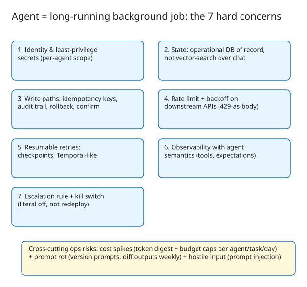

# Treat AI Agents Like Long-Running Background Jobs

A framing note for teams about to run autonomous agents in production: the moment an agent plans a sequence, decides its next action at runtime, and takes side effects on external systems, it is no longer a chatbot or a function — it is a **long-running background job that thinks**, and it inherits every reliability problem of one. The LLM is the *cheapest* part of the problem; everything that bites in production is infrastructure concerns applied to a component that takes instructions from English and can't tell a legitimate request from a forged one.

## The seven concerns (SRE vocabulary, applied to agents)

1. **Identity & access control** — the most common security mistake is giving the agent a broad human credential because it's convenient. A credential is an identity; scope it per agent, per task, per environment. "Run a script" and "post to Stripe" must not share a secret. Least privilege, audited.
2. **State management** — operational state of record must be a database, not "whatever the model remembers". Vector search over transcripts is retrieval, not state; the customer's *state* is what the database says it is.
3. **Side effects** — tools that write are where agents meet reality: every write path needs idempotency keys, an audit trail, a rollback story, and human confirmation on the scary ones.
4. **Rate limiting & backpressure** — agents loop; loops hammer downstream APIs; 429s sometimes arrive as 200s with an error body. Model calls, external APIs and internal services all need limits, retries with backoff, circuit breakers.
5. **Recovery & retries** — the naive loop re-runs everything from the top: half-created invoices, emails sent twice. You want resumable work: checkpoints, durable state machines, a Temporal-like execution substrate for anything important (see the [SQLite WAL example](../../../examples/aimachinelearning/agentarchitecture/example-agent-durable-execution-sqlite-wal.md)).
6. **Observability** — plain logs show that the agent ran; you need *agent-aware* metrics: which tool, which prompt, what was expected vs. what happened, why the decision changed. A run that completes in two minutes can have burned a week of budget.
7. **Rollback & escalation** — define the human hand-off *before* the agent runs, and have a kill switch: when the fleet misbehaves, turn it **off**, don't redeploy.

## Three ops risks that are agent-specific

- **Cost spikes**: a runaway agent burns real money in minutes. Budget caps per agent/task/day, plus a **daily token digest** reviewed like a latency dashboard — most teams have neither.
- **Prompt rot ("prompt degradation")**: prompts version nothing; drift in model behaviour plus silent prompt edits means nobody can say what last Tuesday's agent did. Version prompts like code, **diff outputs weekly** (see prompt versioning with Weights & Biases).
- **Hostile input**: a chatbot answers a user; an agent acts on a user. Prompt injection stops being embarrassing and starts being an authorization bypass — treat any text reaching the model as untrusted input.

## The uncomfortable bit for engineers

The job is not "prompt engineering with a bigger model" — it's boring, valuable systems engineering around the model. The teams that ship reliable agents are the ones with a clear opinion on job queues, credential scoping, and dashboards. And a framing from the site-reliability world worth stealing: **an agent that quietly does the wrong thing at full speed is worse than one that crashes** — the crash is a signal you can alert on, the wrong-but-plausible output is a bug that pages nobody.

## Build order (practical)

Script the job first with a single LLM call → add tools → add state → add guardrails → add retries → add observability. Pick a framework only when it removes real work: LangGraph for graph workflows, CrewAI for quick multi-agent collaboration, or plain function-calling in the provider SDK for one-off jobs. Most production failures trace to missing pieces in the stack around the model, not to the model itself.

## References

- [Treat AI Agents Like Long-Running Background Jobs (DZone)](https://dzone.com/articles/treat-ai-agents-like-long-running-background-jobs)
- Related in KB: AgentOps: production reliability for LLM agents, [Durable execution with SQLite WAL](../../../examples/aimachinelearning/agentarchitecture/example-agent-durable-execution-sqlite-wal.md), SRE for LLM agents, Agent runbooks, [AI SRE rollout](../../../how-to/developertoolspractices/observability/howto-roll-out-ai-sre-four-steps.md)
