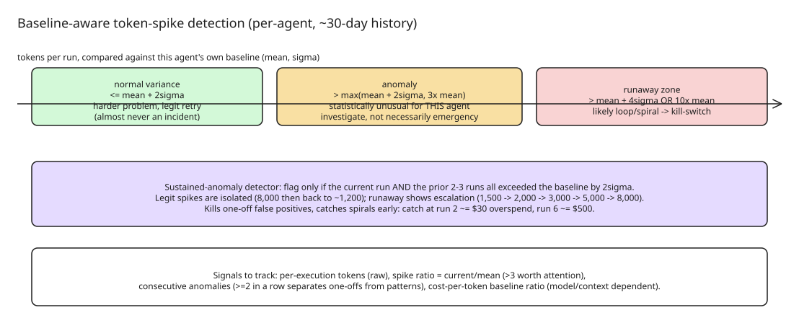

# Baseline-Aware Token Spike Detection for LLM Agents

Token anomalies in LLM agents fall into two categories that **look identical
from the inside**:

1. **Variance** — normal, healthy, explainable: a slightly longer context, a
   retry loop that succeeded, a multi-step reasoning chain that took longer
   than average. The agent did what you asked; it needed more fuel this time.
2. **Runaway patterns** — loops that never terminate, prompt injections that
   balloon context, tool calls that spiral into themselves. The difference
   between a $5 run and a $500 run.

Most monitoring tracks tokens as an afterthought (logged, not watched), and
static thresholds ("alert if > 5,000 tokens") fail because they don't know
your agent: normal is 800 tokens for a summarizer, 4,000 for a multi-step
researcher, 6,000 on a bad day for a retry-heavy agent. A static rule also
can't distinguish the *kinds* of anomaly — legitimate complexity, successful
retry loops, tool spirals chasing a dead end, prompt injection, or model
response degradation (verbose-but-harmless).

## The pattern: compare against the agent's own history

Every agent's token consumption has its own distribution. Track tokens for
every execution over recent history (~30 days is typical) to get the
baseline: mean, standard deviation, shape. Then judge each new run against
**this agent's own history**, not an arbitrary number:

- **Normal variance:** a run within `mean + 2σ` is almost certainly
  explainable — harder problem, more reasoning steps, legitimate retry. Rare
  false positives.
- **Anomaly threshold:** a run exceeding `max(mean + 2σ, 3× the mean)` is
  statistically unusual for *this specific agent*. Worth investigating, not
  necessarily an emergency.
- **Runaway zone:** a run at `mean + 4σ` or exceeding `10× the mean` is very
  likely a loop or spiral — this one needs a **kill-switch**.

The threshold adapts per agent: a research agent running ~4,000 tokens
triggers an anomaly alert at ~7,000; a summarizer at ~600 tokens triggers at
~1,200. Same statistical rule, completely different alert thresholds.

## The runaway tell: it's a pattern, not a spike

A legitimate spike is **isolated**: one run at 8,000, the next five back at
~1,200. A runaway shows **sustained elevation or escalation**: three
consecutive runs at 2.5× baseline then a fourth at 4×, or a tick-up over five
runs (1,500 → 2,000 → 3,000 → 5,000 → 8,000) as each iteration eats more
context than the last.

A **sustained-anomaly detector** catches the pattern and kills one-off false
positives: flag a run only if the current execution **and** the prior 2–3
executions all exceeded the baseline by 2σ. The economics: catch a runaway on
the second anomalous run and you stop it at ~$30 overspend; let it run to
run six and you've hit $500. **Detection speed is the moat.**

## Actionable signals

If you're instrumenting token anomalies, track:

1. **Per-execution tokens** — raw count, so you can compute baselines.
2. **Token spike ratio** — `current_tokens / mean_tokens` for the agent. A
   ratio >3 is worth attention.
3. **Consecutive anomalies** — flag when ≥2 runs in a row both spike; this
   separates one-offs from patterns.
4. **Cost-per-token baseline** — some agents legitimately burn tokens at
   different rates depending on model or context; track the cost-to-token
   ratio too, not just absolute tokens.

The value comes from tying signals to **action**: an alert on a single spike
is noise (you investigate, find legitimate reasoning). An alert on three
consecutive spikes with a cost-per-token ratio 1.5× above baseline is
actionable — stop the agent, investigate the spiral, fix it, restart.

## The bigger picture

Most LLM agent monitoring today focuses on whether an execution succeeded
(HTTP 200, output generated); tokens are tracked but not actively watched for
anomalies. Token consumption is one of the few metrics that scales linearly
with cost, so when one runaway run can burn 10× your daily budget, the
minimum viable setup is: build the baseline from real history → detect
anomaly against it → alert, stop, investigate. Reliability comes from having
eyes on what actually ran, not from perfect code. (The author's tool,
"AI Agents Control Tower," ships baseline-aware detection as a built-in
feature — the pattern itself is the transferable takeaway.)

## References

- [When LLM Agent Token Spikes Hide Real Failures (DEV.to, opsveritas)](https://dev.to/opsveritas/when-llm-agent-token-spikes-hide-real-failures-kh8)
- Related in KB: [How to Make LangGraph Node Failures Observable](../../../how-to/aimachinelearning/agentarchitecture/howto-langgraph-node-failure-observability.md)
