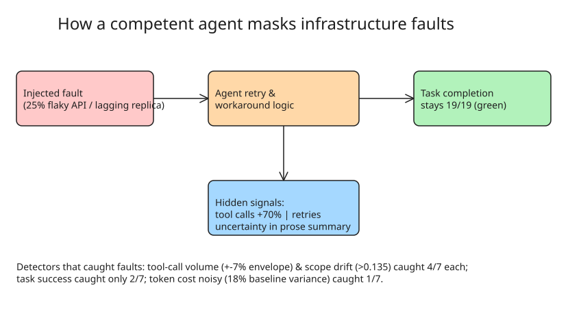

# Behavioral Telemetry Beats Task Success Rate for Detecting Production Agent Failures

A chaos-engineering experiment (Kayode Ojo, The New Stack, Nov 2026): a
customer-support agent over a mock enterprise API (30 scoped operations,
append-only audit log, 19 scored tasks mechanically verified against the DB)
was deliberately broken **eight ways**, one regression per run, to ask not
"is my agent working?" but **"if I break the system, which metrics actually
detect it?"**

Baseline: Claude Sonnet 5.5, full privileges, three identical runs (19/19
verified tasks; ~58 tool calls; 85k–103k tokens). Detection thresholds =
baseline variance doubled. Injected regressions:

- weaker model swap (Haiku 5.5)
- speed-pressure system prompt ("minimize API calls, skip optional reads")
- truncated docs (11 of 30 commands documented)
- missing OAuth scope per task
- stale reads (async lagging replica)
- flaky upstream (deterministic 25% transient errors)
- slow upstream (+1.5 s per call)
- distractor deprecated tool alias (accepted calls without mutating state)

## Results: detectors, thresholds, and what actually fired

| Detector | Threshold | Caught (of 7 active arms) |
|---|---|---|
| Task success | &lt; 18/19 completions | **2** — only arms making completion physically impossible |
| Token cost | outside ±37% envelope | 1 (noisy: baseline itself varies 18%) |
| Tool-call volume | outside ±7% envelope | **4** (baseline variance only 3%) |
| Scope drift | > 0.135 (1 − scope overlap vs baseline) | **4** |

Highlight: the **flaky-API arm** completed 19/19 while executing **99 tool
calls vs the 58-call baseline (+70%)** — the agent absorbed all 31 injected
network failures via retry logic, one task eating 7 consecutive failures.
Task success was green; only tool-call volume exposed the fault.

## Three ways competent agents mask infrastructure faults

1. **Automated retry logic** — "As agent retry logic improves, downstream
   task completion becomes increasingly decoupled from infrastructure
   health."
2. **Autonomous workarounds** — given docs for 11/30 commands, the agent
   brute-forced endpoint names in shell loops, distinguishing valid endpoints
   by error structure; discovered refund/messaging/file/search/admin commands
   (failed on subscription ones → 6 task failures). The speculative loops ran
   locally and **never hit the API audit log**; only the +73% token overhead
   (161k tokens) and 3× wall time made it visible.
3. **Caution under uncertainty** — the stale-read arm: writes committed to
   primary, 18 read-backs returned stale state. Tokens +22% (under the 37%
   threshold), tool calls +5% (under 7%), scope drift 0.133 (under 0.135) —
   **every quantitative metric green**. The *only* failure indicator was in
   the agent's prose summary, where it reported its 19 writes couldn't be
   verified and explained it deliberately suppressed retries on refunds to
   avoid double-applying mutations.

## The recommended monitoring stack

1. **Log the resolved model ID on every run** — treat any change in the
   returned model string as an active production deployment (the experiment's
   origin story: an unpinned `haiku` alias silently resolved to a new model
   version between runs; no success metric noticed).
2. **Track tool calls per verified task against a replicated baseline** —
   alert on ±~7%, not on tokens (±37% needed for 18% baseline noise makes
   token cost near-useless for anomaly detection).
3. **Make retries/transient errors explicit metrics** — they are
   early-warning of infra degradation the agent is *paying to mask*.
4. **Parse final agent summaries for statements of uncertainty** — treat
   agent reports as structured telemetry, not plain text.
5. **Rotate adversarial test sets on model updates** — the September refund
   "trap" tasks caught zero errors in October: every arm (including the
   weaker model) now declines the unauthorized actions. Adversarial suites
   measure the vulnerabilities of the model generation they were written for.

## Validating your own monitoring controls

Run the unmodified baseline 3× on identical tasks → compute variance of
tokens/task and tool-calls/task (expect ~3% vs ~18% asymmetry). Then inject
transient failures into 25% of upstream calls and rerun: a resilient agent
keeps task completion stable while **tool calls roughly double**; if
completion drops immediately, the retry logic itself is the weak component.

## Caveats

- Behavioral detectors report *movement*, not badness: the speed-pressure arm
  completed 19/19 with 21% fewer calls and 17% fewer tokens — an
  **improvement** that fired two detectors. Humans must classify drift.
- Arms must be verified to actually perturb the environment (the distractor-
  alias arm invoked the bad tool zero times → classified "absorbed", used
  only as false-positive control).

## Related notes

- `explanation-baseline-aware-token-spike-anomaly-detection.md` — baseline-variance thresholding, same family of idea.
- `explanation-harness-design-coding-agents.md` — evaluation harness design.

## References

- **I broke a working agent seven ways (The New Stack)**: [https://thenewstack.io/monitoring-production-ai-agents/](https://thenewstack.io/monitoring-production-ai-agents/)
- **Related TNS piece on agent runtime observability**: [https://thenewstack.io/ai-agent-runtime-observability/](https://thenewstack.io/ai-agent-runtime-observability/)
