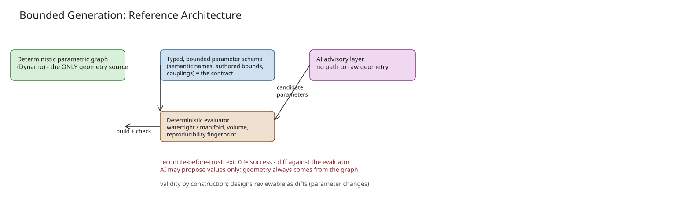

# Bounded Generation: A Reference Architecture for Constrained AI-Assisted Design

Most attempts to put AI into design tooling adopt a **generate-then-fix** flow: the model produces an artifact and
downstream steps try to repair it into something valid. For anything that must be manufactured or coordinated, that
is backward — if a generative model emits geometry directly, correctness is a post-hoc hope: validate, repair,
re-prompt, and you still cannot guarantee the next output is buildable, reproducible, or reviewable. The failure
surface is unbounded because the output space is unbounded; the safeguards bolted on afterward (mesh repair,
constraint checking, human rework) are all clawing back a property the system never had.

**Bounded generation inverts the flow**: define a bounded, *valid* space first, then let the AI operate only inside
it. An expert authors a parametric model in which every parameter combination yields a valid object; the AI selects
parameter values; a deterministic engine renders geometry. Correctness moves from a runtime check to a structural
property of the system — the same instinct as type systems: make invalid states *unrepresentable*. The parametric
model is the grammar; the parameter bounds are its production rules.

## The four components

Exactly four parts. Only one is allowed to be non-deterministic — deliberately the part with the least authority.

| Component | Role | Deterministic? |
|---|---|---|
| **Authority (the model)** | A deterministic parametric model — in this architecture an Autodesk Dynamo graph — is the *only* source of geometry. Nothing else may produce a vertex; it is the only component that touches a geometry kernel. | yes |
| **Contract (the parameters)** | The model's exposed inputs, extracted into a small, typed, bounded schema. The *only* surface the AI and orchestration code read and write. | yes |
| **Evaluator (the truth)** | Headless execution for a given parameter vector, followed by a metrics harness that turns exported geometry into objective numbers. | yes |
| **Advisory layer (the AI)** | The only non-deterministic component. Proposes parameter vectors and interprets metrics, with **no path to raw geometry**. At worst it picks a suboptimal point inside an already-valid space. | no |

## The parameter schema as a contract

The schema is a load-bearing interface; three properties make it work:

- **Semantic naming**: a parameter is `wall_thickness_mm`, not `slider_7`, so the AI and any reviewer know what they
  are changing.
- **Authored bounds**: the ranges come from a human who understands the design, so an out-of-range value is not
  rejected later — it is *unrepresentable*.
- **Declared couplings**: when two parameters must move together to stay manufacturable, the contract records it so
  an edit to one propagates instead of silently breaking the part.

Extraction is mechanical: a Dynamo `.dyn` file is JSON and the exposed sliders already carry their bounds.

```yaml
parameters:
  - name: wall_thickness_mm   # semantic name, not an opaque id
    type: float
    min: 1.5
    max: 4.0
    couples_with: [rib_height_mm]   # constraint stitching
  - name: base_radius_mm
    type: float
    min: 20.0
    max: 60.0
```

## The evaluator: turning geometry into evidence

Running the model headlessly is only half of it; the other half measures what came out. A stdlib metrics harness
parses each exported mesh (STL or OBJ) and computes objective properties, so a candidate is judged on *measurements*
rather than how it looks in a render:

- **Export success** — was a mesh actually written? A run can report success and still produce nothing.
- **Watertight and manifold** — weld coincident vertices and count triangles per edge: a solid is watertight when
  every edge is shared by exactly two triangles; any boundary or non-manifold edge is a concrete defect.
- **Geometry metrics** — enclosed volume, surface area, bounding box, so variants compare quantitatively against
  targets.
- **Reproducibility fingerprint** — a hash of the welded triangles confirms the same vector reproduces the same mesh
  to tolerance.

Because these checks are deterministic, the *valid fraction of a whole parameter sweep* can be reported as a number
rather than asserted.

## Anatomy of a request (five stages)

1. Resolve intent to a parameter vector within the contract.
2. Execute the engine headlessly with that vector.
3. **Reconcile**: a zero exit code only means the file loaded — missing package nodes can silently return null, so
   check the actual file on disk and the evaluation log before trusting the run. (Treating exit-code zero as proof of
   success is exactly how a pipeline ends up quietly shipping empty results.)
4. Measure the artifact and return metrics to the advisory layer.
5. The advisory layer iterates or ranks; **a human approves**.

Inside the boundary, the AI maps intent to parameters, runs guided search, learns a surrogate, and ranks candidates.
Outside it there is a single thing — producing geometry — which stays with the deterministic engine permanently.
Keeping the line there lets you adopt more capable models without adding risk.

## What you gain, and the trade-offs

- **Validity by construction** — the buildable-space guarantee removes the largest class of failures.
- **Reproducibility and auditability** — a design is a vector: verifiable by fingerprint, reviewable as a diff of
  named parameters, not an opaque mesh.
- **Confidentiality** — the advisory layer touches only abstract parameters and metrics, so proprietary internals
  stay in-house.
- **The cost**: someone must author the model and its bounds, parameters must be named meaningfully, and large
  spaces need surrogate models rather than exhaustive sweeps. If you need open-ended novel form, this pattern
  constrains you *on purpose*.

Status: the deterministic substrate, parameter extraction, headless execution, sweeps, and metrics evaluator are
implemented and running on generic models; the AI advisory layer is architecture and roadmap, not benchmarked
results. The value of the pattern is that it makes those AI roles *safe to add* on a foundation that already
guarantees validity.

## References

- [Bounded Generation: Let AI Choose Within a Space Where a Deterministic Engine Guarantees Validity (DZone AI Architecture Design)](https://dzone.com/articles/constrained-ai-design)
- Related: [Rate Limits Are Not Quality Gates: The Guardrail Stack Behind an AI Agent](explanation-agent-guardrail-stack.md)
- Related: [Sandboxed Execution and Runtime Engineering for AI Agents](explanation-sandboxed-execution-runtime-engineering-for-ai-agents.md)

## Diagram

