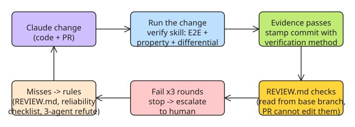

# How the Claude Code Team Builds a Verification Layer for Coding Agents

## Why verification is the scaling knob
On the Claude Code team ~90% of code is written and reviewed by Claude. Verification loops are what let you delegate: without them you can run one or two agents because you must check everything yourself; with them you run dozens or hundreds in parallel. Internal testing on structured file generation: a **separate grader checking work against a rubric improved task success by up to 10 points** over a standard prompting loop, largest gains on the hardest problems. Tests/benchmarks/specs are now cheap to generate, and once generated they run as software without burning many tokens.

## The three tests worth investing in
- **E2E first.** Real user flows; hard to fool (feature works or it doesn't), definitive done-criteria, and a failed E2E gives screenshot + trace + "what step failed" where a unit test gives "Timeout after 30s". Give the agent hands and eyes on the running system: CDP, simulators, API harnesses; a feature map doubles as rubric.
- **Property tests: constraints that can't break.** Write a statement you believe can't fail; let a fuzzer generate thousands of counterexample inputs — fast-check (JS/TS), Hypothesis (Python), proptest (Rust). Classic properties: round-trip encode/decode, invariants ("balance never negative"), idempotency (migration/retry applied twice == once), equivalence (optimized == naive). Edge cases generated *outside* the coding agent's own bias; ideal for rewrites when the spec has drifted from production.
- **Differential tests: the old system is the oracle.** For migrations, run old and new on the same (random or production-sampled) inputs; any difference is a bug unless whitelisted; normalize irrelevant factors like whitespace.
- Failure modes to avoid: **flaky** tests train the agent to re-run instead of fixing; **slow** tests shrink coverage per batch — heavy tests belong pre-commit.

## Team practices (keeping verifiers honest)
- **Verification means running the change**: a repo-local `.claude/skills/verify` skill boots/drives/inspects the app (Chrome extension, iOS/Android MCP, computer use, local service); invest in making it fast and rock solid — this is how nearly all changes are tested.
- **Failing tests escalate**: Claude tries to fix; after **three rounds** still failing, it stops and pulls in a human.
- **Code owners write their own checks**, and a check that pulls in a reviewer must say why.
- **Diff-triggered reliability checklist**: 39 items, each with a diff-readable trigger, a check, and the incident behind it (e.g. "--resume loads old transcripts" fires on session-storage/message-type changes); Claude evaluates only the 3-10 matching items.
- **One reviewer, multiple rounds**: tune the primary reviewer via `REVIEW.md` instead of stacking a second expensive reviewer; later rounds build on earlier context and past failures.
- **Changes can't modify their own checks**: Code Review reads `REVIEW.md` from the base/default branch, never from the PR; reviews are reserved per commit (a passing review on a stale commit means nothing); cheap checks (tests, build, lint) run before the PR opens — enforceable via a hook or a `/goal`.
- **Commit gates in off/observe/enforce modes**: commits are stamped with how they were verified (including "none", so unverified commits are queryable); the gate blocks commits whose session lacked `/code-review` or `/verify`; observe mode logs near-misses to tune false positives; after two blocks a session may pass through with an explanation (agents aren't perfect).
- **Test your checks**: track reverts and maintainer-rejected changes; replay prior incidents/reverts by restoring the repo to the review-time state with a one-sentence answer key; score raw findings, post-verification and final review **separately** to see where found bugs get lost; tag findings Important / Nit / Pre-existing; tune recall up to the edge of overfitting the eval.
- **Turn misses into rules**: extract patterns from human review comments and reverts (must recur in >=2 PRs and be diff-identifiable; three agents try to disprove; human approves in a PR) — or replay three bug finders against an incident PR: >=2 find it => detectable; all miss on a small diff => new `REVIEW.md` rule. **Flaky tests**: no skipping, sleeping or retrying — find root cause or delete the test and record why. Prune rules, checks and .md files on a routine.

## Takeaway
Treat the verification layer like any other system: keep it out of reach of the changes it judges, grade it against the bugs that mattered, convert every miss into a rule once, and prune. Your job shifts from reading every diff to defining "done" and reviewing evidence — that's what lets you run many agents at once.

## References
- Original: [How the Claude Code team thinks about verification](https://claude.dev/blog/how-the-claude-code-team-thinks-about-verification/) (Addy Osmani, Nov 16 2026)
- Related: [How the Claude Code team does code review](https://claude.dev/blog/solving-code-review-at-anthropic/)
- Related notes: [[explanation-sandboxed-execution-runtime-engineering-for-ai-agents]], [[explanation-tool-descriptions-are-the-contract]]
