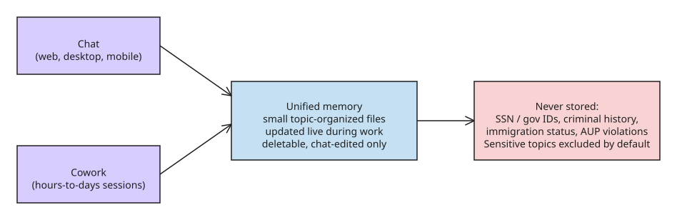

# Claude's Unified Memory Across Chat and Cowork

On 2026-08-25 Anthropic merged Claude's memory across **chat** and **Cowork**
into a single memory that bridges both surfaces. Previously Cowork's memory
was bound to individual projects and was independent of what Claude knew from
chat. Architecturally, the update changes three things:

## What changed

1. **Scope: per-project → account-wide.** Context built over months of
   conversations (e.g. Q3 priorities, project status) is available the moment
   you hand Cowork a task, and what happens in Cowork carries back to chat.
2. **Update timing: end-of-session → live.** Memory was previously only
   updated after a chat ended; now it updates while you work. This matters
   because Cowork sessions run for hours or days.
3. **Storage model: topic files.** Memory is stored as **small files
   organized by topic**. Users can read, edit, or delete each file directly in
   Settings → Memory (a correction to the original reporting — Anthropic's own
   announcement states users "can see everything Claude remembers, topic by
   topic, and edit or delete any of it"); memory can also be paused or reset at
   any time.

## Sensitive-data handling

By default Claude does **not** store information it considers sensitive —
health data, religious beliefs, race, ethnicity, gender identity. There is a
settings option to include sensitive topics, but it is currently all-or-nothing
(no per-topic tuning). Some categories never enter memory regardless of
settings: sensitive identification numbers (SSN, government ID numbers),
criminal history, immigration status, and anything violating Anthropic's
Acceptable Use Policy.

## Defaults by plan (verified 2026-09-28)

- **Free / Pro / Max**: unified memory **on by default** across web, desktop,
  and mobile (Cowork itself is not offered on the Free tier).
- **Enterprise / Teams**: all memory features **off by default**; admins control
  availability for their organization.
- **Claude Code keeps its own separate memory** — it was *not* folded into this
  merge (confirmed in follow-up reporting).
- Anthropic states memory is not used for ad targeting (Claude is ad-free).
- When the sensitive-topics toggle is on, Claude shows a **notice each time it
  saves something in a sensitive category**, and the opt-in is prospective only —
  nothing from before the toggle is saved retroactively.

## Takeaways for agent architects

- **Shared memory scope is a product decision with a privacy surface.** The
  all-or-nothing sensitive-topic toggle is a coarse control; per-topic
  granularity is the obvious next step.
- **Live memory updates** change the consistency model: the memory an agent
  relies on mid-session can change during that session.
- The **topic-file storage model** (readable, editable, deletable) is a practical
  pattern worth copying for agent memory stores: it gives users full visibility and
  correction rights without exposing the internal write path that would risk
  corrupting the memory format.

## References

- [The New Stack: Anthropic gives chat and Cowork one memory](https://thenewstack.io/claude-memory-chat-cowork/)
- [TechCrunch: Claude Cowork finally remembers what you told the app in chat](https://techcrunch.com/2026/08/25/claude-cowork-finally-remembers-what-you-told-the-app-in-chat/)
- [Anthropic Help Center: Claude Cowork architecture overview](https://support.claude.com/en/articles/14479288-claude-cowork-architecture-overview)
- [Claude blog: Claude's memory works everywhere, and you decide what's in it (primary announcement)](https://claude.com/blog/claudes-memory-works-everywhere-and-you-decide-whats-in-it)

## Related
- [[explanation-lemmalog-datalog-memory-for-llm-agents]]
- [[explanation-agent-guardrail-stack]]
- [[howto-agentic-rag-pipeline-with-real-time-web-search]]
