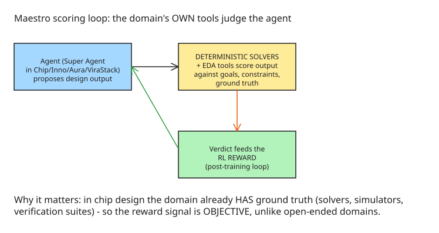

# Cadence Maestro: Domain-Specialized Models and a Solver-Scoring RL Loop for Chip Design

Cadence announced **Maestro** on 26 October 2026 (same day as its Q3 earnings, revenue $1.633B) — a **portfolio of domain-specialized models** for chip and system design, with the first models in early access in Q4 2026. The architecture is the interesting part.

## What Maestro actually is

Not one model — a **portfolio**:

- **post-trained LLMs**,
- **trained decision models**,
- **self-improving agent skills**,

wired into Cadence's **AuraStack, ChipStack, InnoStack and ViraStack** AI Super Agents (analog, digital front-end, implementation, verification), which in turn **call EDA and system-design tools**. Named models include **NVIDIA Nemotron** (per Tim Costa: Nemotron + OpenShell + engineering expertise).

**Deployment is customer-controlled**: Cadence cloud, public cloud, **or on-prem** — customers can post-train on their own designs and workflows, which is the answer to the "where does my design data live" question that every EDA buyer asks.

## The core architectural idea: a scoring loop

The claim that makes this more than "LLM + tools" is how the models get judged:

**Deterministic solvers and EDA tools judge agent output** against engineering goals, constraints, and ground truth, and the verdict feeds the **reinforcement-learning reward**. In a domain where the tools *already compute the answer* (timing, power, verification results), you can post-train against an objective reward signal — which is exactly what's missing in open-ended domains. That's the architectural bet: **the domain's own solvers as the reward signal**.

## Claimed results

- **Up to 30% quality improvement** and **up to 5× token efficiency** over general-purpose foundation models — the announcement doesn't break down by metric or benchmark, so treat as directional.

## Customer signals (same announcement)

- **Socionext** — InnoStack in production, up to **5× productivity** gains.
- **Silicon Labs** — faster root-cause analysis with Verisium Debug in ChipStack.

## The competitive frame

**Synopsys and OpenAI** announced **GPT-Synopsys** on 30 September 2026 (OpenAI-hosted infrastructure). Against that, Maestro's placement — customer-controlled deployment and post-training — is the live difference, and the one buyers should probe:

1. **Benchmarks** — which metric, which workload, which "up to" is load-bearing?
2. **Data placement** — on-prem post-training: what leaves the building, what doesn't?
3. **Post-training governance** — who approves a customer's own post-trained variant, and what regression gate applies?

## Practical implications

| If you... | Watch... |
| --- | --- |
| Buy EDA with AI features | Whether the AI layer's reward signal is objective (solver-verified) or vibes-based |
| Have proprietary design data | Deployment placement (on-prem vs cloud) and post-train governance before piloting |
| Architect domain AI systems in a "verifiable" domain (EDA, finance risk, compliance) | The Maestro pattern: deterministic ground truth → RL reward → domain-specialized portfolio, not a general LLM wrapper |

## Related notes

- [Single vs Multi-Agent: Coordination Costs](../multiagentsystems/explanation-single-vs-multi-agent-coordination-costs.md) — the portfolio economics from the other side: why one domain-specialized model can beat an N-agent swarm on the same task.
- [Certified Execution Harness: Petri Net Supervisor](explanation-certified-execution-harness-petri-net-supervisor.md) — the same design principle, formalized: a deterministic verifier (here a solver score, there a net model) gating agent transitions.

## References

- [Cadence Maestro makes chip design models a portfolio you post-train (DEV.to)](https://dev.to/echakiri/cadence-maestro-makes-chip-design-models-a-portfolio-you-post-train-3747)
- [Cadence Introduces Maestro, a Domain-Specialized AI Model (official press release, 2026-10-26)](https://www.cadence.com/en_US/home/company/newsroom/press-releases/pr/2026/cadence-introduces-maestro-a-domain-specialized-ai-model.html) — the ~30% quality-improvement and ~5× token-efficiency figures, and the on-premises/air-gapped deployment model.
- [OpenAI and Synopsys Announce GPT-Synopsys (official newsroom, 2026-09-30)](https://news.synopsys.com/2026-09-30-OpenAI-and-Synopsys-Announce-GPT-Synopsys-Frontier-Intelligence-to-Revolutionize-Chip-Design)
