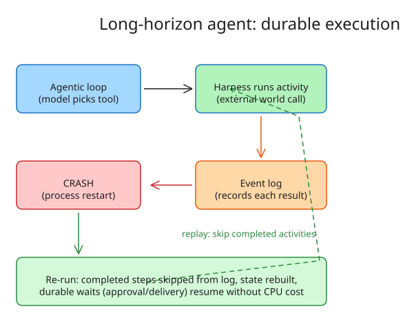

# Long-Horizon Agents and Durable Execution: Event-Logged Recovery for Week-Long Workflows

Long-horizon agents automate tasks that take **days or weeks** — chasing a procurement approval, waiting three weeks for a supplier delivery, shepherding a deal through sales/legal/procurement. Their economics unlock work previously uneconomical because it required sustained human attention. The failure modes over that timescale are ordinary distributed-systems failures: process restarts, network partitions, delayed/duplicated/missing messages, and unanticipated real-world behaviour. **Durable execution** is the emerging pattern that lets agents recover.

## The agentic loop

Nearly every agent (Claude Code, OpenClaw, a stock-replenishment agent) runs the same four-part loop:

- **Goal** — the outcome to achieve (part kept in stock, program written)
- **Tools** — how the agent acts in the world (`get_quotes`, `place_order`, `read_file`, `bash`)
- **State** — everything known about progress toward the goal
- **Model** — at each turn, reads state and picks the next tool + arguments

The code around the loop that executes tools and updates state is the **harness** (Claude Code is a harness around Claude). Long-horizon runs are mostly *waits* — for a manager's approval, a supplier reply, a delivery — punctuated by short bursts of agent work.

## Making the loop durable

The runtime keeps a **record (event log) of the result of every step that touches the outside world**. On crash, the program simply runs again: completed steps are skipped (their results are replayed from the log), and state is rebuilt from the record. In Temporal-style pseudocode:

```python
class Replenish:
    async def run(self, stock: StockLevel) -> ReplenishmentResult:
        state = State(stock.sku, stock.on_hand, stock.safety_stock)
        # each activity result is recorded; on replay it is skipped
        quotes = await execute_activity(GetQuotes(), stock.sku, ...)
        best   = choose_supplier(quotes)   # pure code — replayed deterministically
        await execute_activity(RequestApproval(), best, ...)
        await wait_condition(...)          # durable wait — costs no CPU
        await execute_activity(PlaceOrder(), best, ...)
```

Key properties:

- **Entity vs workflow split** — the long-lived business entity (the purchase order) outlives any single workflow run; workflows are the recoverable step-slices around it.
- **Durable waits** — `waitForApproval` is a runtime primitive, not a busy loop. Measured by the author on Cloudflare Workers and a local Temporal server: a waiting workflow uses **zero CPU**; waking an in-memory workflow took 14 ms (Temporal) / ~0.1 s (Cloudflare); rebuilding from the log ~0.1 s (Temporal) / ~2 s (Cloudflare), growing with log size.
- **At-least-once retries** — failed external calls are retried by the runtime; side-effecting activities must therefore be **idempotent** (cf. the idempotency-keys note in this folder). Cloudflare's equivalents of the primitives: `step.do` for `execute_activity`, `step.waitForEvent` for `wait_condition`; Restate, Inngest and DBOS have equivalents too.

## Durable is not the same as correct

Durability recovers the *program*; it does not guarantee the *world* still matches the agent's beliefs:

1. **Outcomes the agent doesn't see** — a human fulfils the order out-of-band; the durable log records no such event, so the agent re-does it.
2. **The world moves on while you wait** — a supplier raises the price after the order was placed; stale decisions must be revalidated, not replayed blindly.
3. **Code change under a running task** — replaying an event log with new code changes semantics; workflow code needs versioning discipline (Temporal's patch/versioning APIs exist for this).
4. **Memory: what the agent keeps vs what the model sees** — the durable log is not the same as the model's context window; what gets folded back into prompts is a separate design decision.
5. **Text that steers the agent** — replies arriving over sockets/emails are untrusted input that can steer the agent (prompt injection); durability records the injection faithfully.

## Architectural takeaways

- Long-horizon agents are **distributed systems** plus non-determinism; classic integration patterns still apply.
- Most real effort goes into **untangling systems of record** (e.g. an ERP that won't let an agent write) — "tactical fixes and vibe coding" make this worse.
- Decision quality depends on **clean context**: representing domain information as governed **data products** makes agents effective.
- The durable-execution runtime handles *accidental* complexity (retries, recovery); the *essential* complexity (what the order means, when to revalidate) stays with the architect.



## Cross-links

- `howto-durable-genkit-flows-with-temporal.md` — hands-on Temporal wrapping of Genkit agent flows
- `howto-idempotency-keys-ai-agent-tool-execution.md` — the idempotency that at-least-once durable retries demand
- `explanation-reconciling-agent-plans-with-completed-temporal-activities.md` — the "world moves on while you wait" failure class
- `howto-step-functions-waitfortasktoken-agent-approvals.md` — durable waits for human approvals in AWS Step Functions

## References

- Kiran Prakash (Thoughtworks), *Long-horizon agents and durable execution*, martinfowler.com, 10 Nov 2026: [martinfowler.com/articles/durable-execution-agents.html](https://martinfowler.com/articles/durable-execution-agents.html)
- Cloudflare Workers durable objects / `step.do` API: [developers.cloudflare.com](https://developers.cloudflare.com/workers/)
- Temporal (durable execution platform): [temporal.io](https://temporal.io)
- Related Fowler article on data products: [martinfowler.com/articles/designing-data-products.html](https://martinfowler.com/articles/designing-data-products.html)
