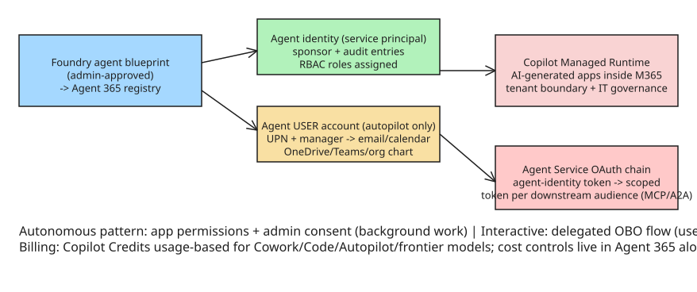

# Microsoft's Copilot Agent Infrastructure — Entra Agent ID, Autopilot, and the Managed Runtime

Microsoft's September 2026 "biggest Copilot update to date" (Nadella: "a new OS for work") is
less about the chat UI than about moving the **agent runtime into the enterprise infrastructure
layer**: persistent identity, state, execution boundaries, and organizational context built
into Microsoft 365. Four components ship together — Home (merged Chat + Cowork), Code
(natural-language app generation), Autopilot (persistent background agents, formerly "Scout"),
and the underlying runtime/identity platform. The architecturally significant pieces:

## Every agent gets a first-class identity

- **Agent identity** = a service principal in Microsoft Entra ID with enforced sponsorship,
  distinct audit-log entries, and blueprint-managed credentials. Foundry provisions it
  automatically; RBAC roles are assigned to it exactly like any service principal.
- **Autopilot adds an agent *user account*** — a real user object (UPN, display name, manager)
  paired 1:1 with the agent identity. This gives the agent its own email, calendar, OneDrive,
  Teams presence, and org-chart placement, so it performs Microsoft 365 actions **as itself**
  rather than on behalf of a signed-in user. That kills two failure modes at once: agents no
  longer need shared service accounts or borrowed user credentials, and they can act when no
  user is present (triggers, background work).
- Shape difference: a regular Foundry agent is **one-to-one** (agent ↔ identity); an autopilot
  is **one-to-many** — one *blueprint* (approved by an admin into the Agent 365 registry), and
  employees "hire" instances of it in Teams, each instance getting its own identity + user
  account. Admins control per-instance resource/data access with the same policies used for
  human employees.

Microsoft is explicit that **service principals and regular user accounts are not recommended**
for agents: plain app registrations lack sponsor/audit/lifecycle governance; routing agent
traffic through human-shaped user accounts breaks Conditional Access (compliant-device, MFA),
degrades ID Protection's human-behavior ML, confuses JML/access-review workflows, and pollutes
the Global Address List. The correct object type is `#Microsoft.Graph.AgentIdentity`, created
through an **agent identity blueprint** — not via `az ad app create` / Graph `/applications`.

## Two token patterns (autonomous vs interactive)

| | Autonomous | Interactive |
| --- | --- | --- |
| User context | none present | user signed in |
| Permissions | application permissions | delegated permissions |
| Consent | admin consent required | user or admin consent |
| Token subject | agent identity | user (agent as actor) |
| Typical use | background/scheduled/system-to-system | chat assistants, acting on user data |

Under the hood: Foundry's Agent Service performs a two-step OAuth exchange — Entra issues an
**agent-identity token**, which is exchanged for a **scoped access token** targeting the
downstream service audience (e.g. `https://storage.azure.com`), then passed to MCP servers or
A2A endpoints that validate it against RBAC role assignments. Blueprints can use **federated
credentials** tied to the project's managed identity, eliminating stored secrets entirely; each
layer (managed identity → agent identity → downstream resource) carries independent
least-privilege roles.

## Agent 365 as the control plane

Agent 365 is Microsoft's enterprise control plane: a **registry** inventorying every agent in
the tenant (Foundry, Copilot Studio, admin-registered, and *shadow agents discovered in the
tenant*), with ownership tracking for governance/attestation. Foundry agents sync into it
automatically on publish; activity data flows from the Azure-region-resident Foundry resource
into the Entra-tenant-resident Agent 365 store (per-resource opt-out via `agent365Config`
for residency-sensitive workloads). Governance workflows: periodic access reviews, lifecycle
provisioning/deprovisioning policies, owner attestation for high-impact agents.

## Copilot Managed Runtime — hosting AI-generated apps

Code (built on the same technology as GitHub Copilot) generates apps/dashboards/workflows that
run on **Copilot Managed Runtime** (public preview): code hosted *inside the customer's M365
tenant boundary* under IT governance, with Microsoft managing the runtime and a controlled
test/deploy path. It also accepts apps from Copilot Studio and Cowork, and is opening to outside
tools via an SDK + CLI with Git-tracked source/versions (Lovable already integrated). The
analogy: serverless for AI-generated enterprise software, but tied directly to identity, tenant
boundaries, and organizational data.

## Economics and lock-in

- Standard subscription covers the assistant; **Cowork, Code, Autopilot, and frontier models
  (Fable, Astra) bill by usage via Copilot Credits** — a license is still required for model
  access. Agent 365 cost management extends to Code and the Managed Runtime (Copilot Studio
  agents planned October). Once an agent runs unattended for hours/days, compute spend becomes
  part of the governance problem, hence cost controls in the same admin framework as access.
- Models are not locked in (OpenAI + Anthropic today, more labs/open-weight promised), and the
  Agent 365 SDK adds **governed MCP access** to M365 workloads regardless of agent framework.
  But those open interfaces cover only part of the architecture: the deeper an agent depends on
  M365 for identity, permissions, and context, the harder it is to move elsewhere.

## Design takeaways (vendor-neutral)

1. **Agents need their own identity objects**, not borrowed user credentials or generic app
   registrations — sponsorship, distinct audit entries, and lifecycle governance are what make
   them governable. Microsoft's blueprint → agent-identity → optional user-account layering is
   a concrete template for that.
2. **One-to-many blueprints** (admin-approved templates + hired instances) map well to how
   enterprises actually deploy agents: define the role once, instantiate per team, scope each
   instance with existing access policies.
3. **Registry + shadow-agent discovery** is the missing piece most agent deployments lack — an
   inventory that includes agents nobody registered.
4. **Usage-based billing changes governance**: unattended long-running agents make cost a
   first-class control alongside permissions; budget caps belong in the same admin surface as
   RBAC.
5. **Identity coupling is the real lock-in**, not model choice — MCP/SDK openness at the edges
  doesn't offset dependence on the platform's identity, permission, and context layers.

## References

- [The New Stack: Microsoft's new Copilot agents get their own email, calendar — and a place in the org chart](https://thenewstack.io/copilot-agents-identity-runtime/)
- [Microsoft Foundry: What is an autopilot? (agent identity vs agent user account)](https://learn.microsoft.com/en-us/azure/foundry/agents/concepts/autopilot-overview)
- [Microsoft Learn: Agent 365 integration with Foundry](https://learn.microsoft.com/en-us/azure/foundry/agents/concepts/agent-365-integration)
- [Microsoft Learn: Plan your agent identity architecture (Entra Agent ID)](https://learn.microsoft.com/en-us/entra/agent-id/how-to-plan-agent-identity-architecture)

## Related

- [[explanation-sandboxed-execution-runtime-engineering-for-ai-agents]]
- [[howto-mcp-security-hardening]]
- [[explanation-human-in-the-loop-approval-gates]]
