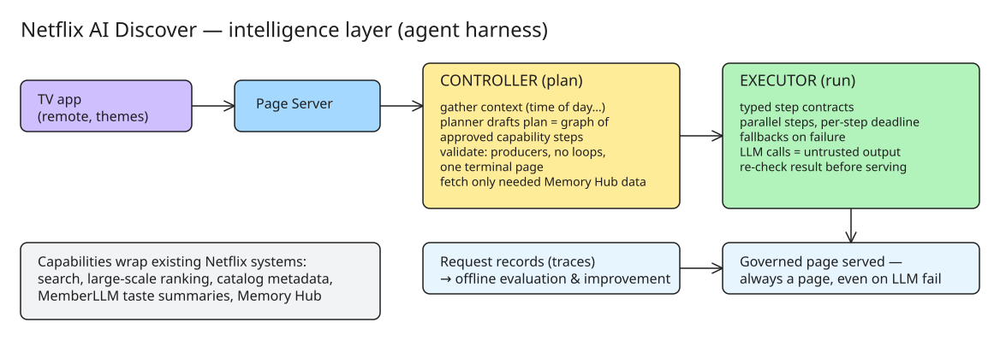

# Netflix AI Discover: A Governed Agent Harness for Production Recommendations

Netflix's **AI Discover** is a TV-app tab where members steer discovery through themes ("Quick Watches") instead of silent ranking. The engineering post details its **intelligence layer** — an *agent harness* that decides, per request, how to combine LLMs with Netflix's existing recommendation systems. It is a rare production account of **harness engineering**: the code around the model that provides planning, governance, latency, and safety guarantees, in the same design space as [[explanation-anatomy-of-an-agent-harness]].

## The core stance: LLM output is untrusted input

Handing the whole request to an LLM (pick titles, write labels, decide next steps) yields *probabilistic output where governed results are needed* — every turn lands on a living-room screen, and at Netflix scale even rare failures happen many times a day. Seven constraints shaped the design: grounding every pick in the real, eligible catalog; slow/expensive LLM calls with spiky tails; fast-changing models and prompts; TV UX (remote-only, slow app releases, heterogeneous hardware); a reliability floor ("members always get a page"); and learning from explicit member feedback on top of viewing behavior.

## Architecture: controller + executor

A theme press goes from the TV app to the **Page Server** (builds pages for all Netflix apps), which hands off asynchronously to the intelligence layer:

- **Controller (plan).** Gathers context (including real-time signals like time of day), settles on a **plan — a graph of approved steps**, either pre-tested or drafted on the fly by an LLM planner. It validates the graph *before execution*: every step approved, every input has a producer, nothing loops, exactly one terminal page. Then it fetches from **Memory Hub** (per-member persistent memory store) only the member details that plan declares — e.g. taste summaries pre-generated by **MemberLLM** from viewing history, or explicit member feedback.
- **Executor (run).** Steps are **capabilities**: named units of work with versions, a family (retrieval, ranking, generation, packaging), declared inputs/outputs, permitted context, and declared failure behavior. Steps pass typed outputs through the declared contracts; independent steps run in parallel, each with its own deadline and fallback. Some steps are single-task optimized LLM calls (write row titles, suggest next themes) that act only within the validated plan. Both halves write **request records** — structured traces (plan, steps, outcomes, rules applied) used for offline evaluation and replay.

Key properties this buys: plans drafted on the fly still stay grounded because capabilities only wrap approved Netflix systems (search, large-scale ranking, catalog metadata); safety rules are enforced **in code, not prompts** (maturity standards, access limits, member "don't recommend" choices); and the planner fills step parameters via **typed placeholders** resolved by the controller post-validation — the planner never writes values directly, which also blunts prompt injection.

## Plan-first beats the reason-act loop here

The familiar tool loop (reason → call tool → read result → reason again) can't bound step count or detect wrong paths up front. AI Discover is a **plan-and-execute agent**: an LLM may propose the path, but code decides whether it runs. A router picks pre-tested vs drafted plans; a slow or invalid planner falls back to a tested plan. Adaptive planning lets them balance cost/latency/quality per request, from a lean single-call plan to a richer multi-step one.

## Other decisions worth stealing

- **Composability is the hard part.** Existing services were reshaped into capabilities with semantic interfaces — each must work in combinations no one designed, called by something that decides at runtime. Granularity trade-off: too fine and the planner has more ways to go wrong; too coarse and it can't compose richer plans.
- **Model/capability agnosticism.** All LLMs sit behind one common interface; per-task model assignment is a live-overridable setting. Every candidate swap is scored on the same tasks with automated checks + LLM judges — swaps are measured, not vibes. Most behavior lives in server-side prompts/config, so nothing requires a TV app release.
- **Asynchronous serving as first-class.** Multi-second generation never holds a request open: the press gets an immediate ack + a "thinking" state, the executor runs in background, and the TV fetches the result when notified. The synchronous serving path stays healthy however long a turn takes.
- **Memory that members steer.** MemberLLM pre-computes taste summaries off the request path; explicit member choices ("tune this", "don't recommend") apply immediately and persist in Memory Hub alongside summaries — a new signal blended with behavioral personalization.
- **Narrow input surface by design.** No free-text chat — members pick themes with the remote, which keeps the LLM's job narrow and pre-launch safety evals tractable (theme labels, row titles, explanations were all tested).

The stated endgame: a self-improving loop over request records — replay past requests against new prompts/models/rules, judge with automated checks + LLM judges + humans, and eventually let the system propose and safely test its own improvements.

## Related

- [[explanation-anatomy-of-an-agent-harness]] — the same harness decisions formalized as testable invariants
- [[explanation-agent-guardrail-stack]] — governed execution / guardrail layering

## References

- Original post: [Engineering AI Discover — Netflix TechBlog](https://netflixtechblog.com/engineering-ai-discover-e244944cdc38)
- Product context: [Introducing AI Discover — about.netflix.com](https://about.netflix.com/en/news/introducing-ai-discover)
