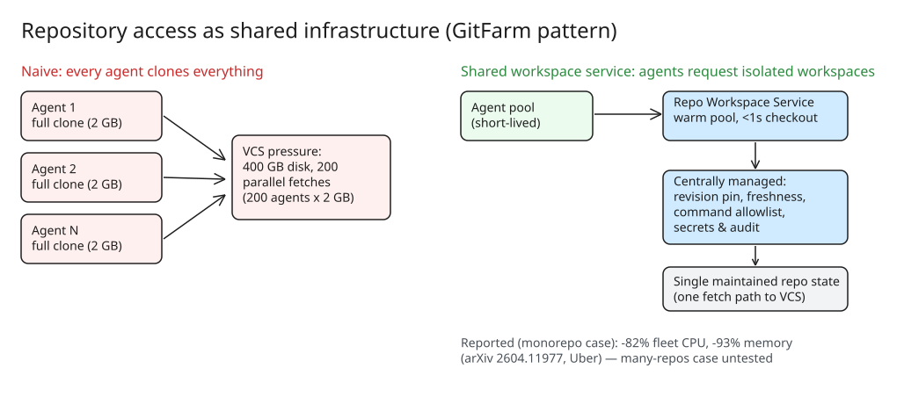

# Repository Access as Shared Infrastructure for AI Agents

When coding/exploratory agents multiply inside an organization, **source access becomes an infrastructure problem** in its own right — not just model capacity, orchestration, or task queues.

## The multiplication problem

An agent investigating a codebase needs to search files, inspect history, and produce reports. In a large organization "the codebase" means hundreds or thousands of repositories. A naive design — each agent clones and maintains its own copy — multiplies cost linearly with agent count:

- 200 concurrent agents × a 2 GB repo = **400 GB of disk and 200 simultaneous fetches** against the VCS before any investigation starts.
- Clones consume compute, memory, disk; repeated fetch traffic hits the version control system; large repos delay "start task" → "begin investigating".
- Existing mitigations (shallow/partial clones, sparse checkout, shared object stores, copy-on-write snapshots) reduce per-clone cost but leave **each client responsible for keeping its state current**, and answer nothing about isolation, scoped access, or scheduling of many short-lived agents.
- The opposite extreme — centralizing all exploration in one system — creates a bottleneck and couples repository access to one service's business logic.

## The middle ground: a repository workspace service

Make repository access a **shared infrastructure capability**: agents request isolated workspaces on demand, run a bounded set of operations, and return results without each keeping a permanent copy of the organization's repositories. A concrete datapoint comes from the paper **"GitFarm: Git as a Service for Large-Scale Monorepos"** (arXiv 2604.11977, Uber Technologies): a gRPC service that centrally maintains repository state and executes Git workflows in isolated sandboxes backed by ready-to-use repositories.

Reported results (for a service that frequently reads repo data):

| Metric | Improvement |
| --- | --- |
| Fleet CPU use | **−82%** (removing local checkouts) |
| Fleet memory use | **−93%** |
| Checkout availability | **&lt; 1 second** via warm pooling |

Caveat: GitFarm targets large **monorepos**; the many-separate-repositories agent scenario is not evaluated in the paper. The warm-pool idea plausibly transfers, but it is untested there. GitFarm also does **not** demonstrate agents editing code, running arbitrary dev tools, or full build/test cycles remotely — it evaluates Git operations and automation (auditing changes, updating PR base branches, inspecting code-ownership files).

## Requirements checklist for a repository workspace service

The article's most actionable output — what such a service must be explicit about:

1. **Revision** — which commit an agent sees, and whether it can be pinned.
2. **Freshness** — how stale the state may be for a given task.
3. **Commands** — which operations are allowed, with what resource limits.
4. **Scope** — which repositories an agent may access, using short-lived credentials.
5. **Safety** — isolation between agents, handling of secrets in source, defenses against malicious instructions embedded in repository content.
6. **Audit** — a record of what each agent accessed and ran.

## Architectural takeaway

The transferable idea is the **separation of repository maintenance from repository work**: clients no longer own checkout lifecycle; a service manages warm state and provides isolated execution when requested. It *moves* the bottleneck question rather than eliminating it — the shared service must itself scale, stay available, and limit blast radius if compromised. Leadership question: not only "how many agents can we run" but "can the systems agents depend on — especially source access — serve them without multiplying the same setup work thousands of times".

## References

- DZone article: [As AI Agents Multiply, Repository Access Could Become an Infrastructure Problem](https://dzone.com/articles/repository-access-agent-workspaces)
- GitFarm paper: [GitFarm: Git as a Service for Large-Scale Monorepos (arXiv 2604.11977)](https://arxiv.org/abs/2604.11977)
- Related in KB: [[explanation-agent-substrate-stateful-runtime]] (compute-side analogue: agents as schedulable isolated runtimes), MCP notes in `developer-tools-practices/mcp/`
