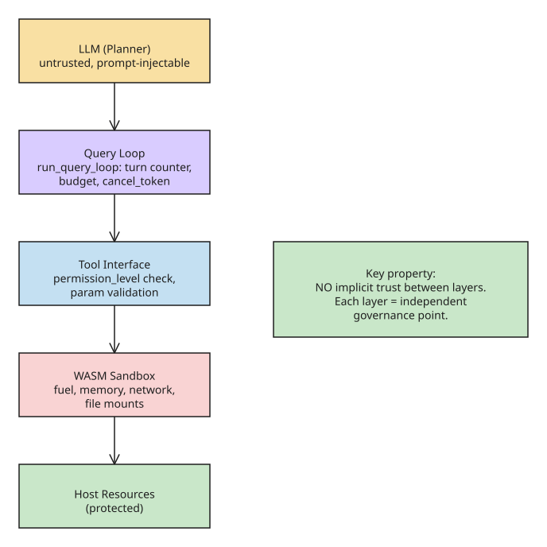

# Sandboxed Execution and Runtime Engineering: What BoxAgnts Teaches About Agent Infrastructure

**TL;DR:** As AI agents gain operational authority (running commands, modifying repos, deploying infrastructure), the decisive challenge shifts from model intelligence to **execution safety**. The BoxAgnts runtime (Rust + WASM) treats the sandbox not as an optional feature but as the foundational architectural layer, and inserts a governance loop between planner and executor. The emerging discipline this points to is **runtime engineering**: execution boundaries, capability systems, resource governance, fault containment.

## The architectural paradox

Most agent architectures boil down to:

```
LLM → Tool Call → Python Runtime → Shell Command → Host System
```

The model decides what to execute, what to access, and when to stop — but the model itself is exposed to prompt injection, adversarial documents, and untrusted content. This creates the paradox: **"untrusted planner → trusted execution."**

The fix is to insert runtime boundaries between planner and executor. BoxAgnts' pipeline:

```
LLM (Planner)
    ↓
Query Loop (run_query_loop — execution governance)
    ↓
Tool Interface (permission_level check)
    ↓
WASM Sandbox (hard constraints)
    ↓
Host Resources (protected)
```

Each layer is an independent governance point; **no implicit trust exists between layers.**

## Hard constraints, not prompt suggestions

In `boxagnts/query/src/query.rs`, the query loop enforces runtime-level hard constraints (not prompt-level "suggestions"):

- turn counter (prevents infinite loops)
- max_tokens recovery mechanism (prevents token-exhaustion deadlock)
- budget checking (prevents cost runaway)
- cancel_token signal (interruptible at any time)

## Workflow vs runtime: two different layers

A common confusion is conflating workflow engines with runtime engines:

- **Workflow engines** (chains, graphs, planners) decide *what should happen*.
- **Runtime engines** decide *what is allowed to happen*.

BoxAgnts separates three explicit layers:

1. **Query Layer** (`boxagnts/query/`) — workflow orchestration: conversation loops, auto-compaction, context management.
2. **Tool Layer** (`boxagnts/tools/` + `boxagnts/wasm-tools/`) — tool interface: permission checks, parameter validation.
3. **Sandbox Layer** (`boxagnts/wasm-sandbox/`) — execution constraints: memory limits, network allowlists, timeout control.

Workflow coordinates; runtime governs. Both are necessary, but only the runtime provides security guarantees. The sandbox is the lowest infrastructure component (`boxagnts/wasm-sandbox/`), sitting beneath tools and gateway — so no matter how upper layers change, execution constraints remain in effect.

## Resource governance via the WASM runtime

System-level resource control across all executors:

| Governance dimension | Implementation |
| --- | --- |
| CPU usage | `wasm_fuel` (instruction-level fuel) + `wasm_timeout` |
| Memory usage | `wasm_max_memory_size` + `wasm_max_wasm_stack` |
| Network access | `allowed_outbound_hosts` + `block_networks` + `block_url` |
| File access | `work_dir` + `map_dirs` (precise directory mounts) |
| Token budget | `total_budget_usd` (Managed Agent mode) |
| Concurrency | `max_concurrent_executors` |

## Multi-agent: process-level isolation

In Managed Agent mode, parallel Executors each run in independent sandboxes. Without proper isolation, malicious outputs propagate, context contamination spreads, and capability escalation becomes possible. BoxAgnts applies **process-level thinking** — each Executor gets independent capabilities, isolated resources, independent context, and optional Git worktree isolation — mirroring the process isolation model of modern operating systems.

## The operating-system analogy

When agents become autonomous execution units, managing them requires OS-level thinking:

| Operating system | BoxAgnts |
| --- | --- |
| Process scheduling | Query loop (`run_query_loop`) |
| Process isolation | WASM sandbox |
| File permissions | `PermissionLevel` + `RunOption` |
| Network filtering | `allowed_outbound_hosts` + `block_networks` |
| Memory management | `wasm_max_memory_size` |
| Timeout control | `wasm_timeout` + `wasm_fuel` |
| Task scheduling | Cron scheduler (`gateway/cron/`) |
| State management | Workspace persistence (`workspace/`) |



## Key takeaways

- **The "model is correct → system is correct" assumption does not hold in production.** Agents need runtime guarantees, not hopes about model behavior.
- **Sandbox as first-class primitive:** making the sandbox the lowest layer means security is not a bolt-on; upper-layer changes cannot bypass it.
- **Runtime engineering is the emerging discipline:** execution boundaries, capability systems, resource governance, fault containment, sandboxed tooling, orchestration safety. Prompt engineering is user-space; the security guarantees come from the kernel-space runtime.
- **The future of agent infrastructure resembles an operating system** — scheduling, isolation, permissions, process management, resource governance — because autonomous execution units are, functionally, processes.

## References

- [BoxAgnts Runtime (7) — Sandboxed Execution, Rebuilding Agent Infrastructure (DEV.to — guyoung)](https://dev.to/guyoung/boxagnts-runtime-7-sandboxed-execution-rebuilding-agent-infrastructure-4kj3)
- [BoxAgnts source (GitHub — guyoung)](https://github.com/guyoung/boxagnts)
