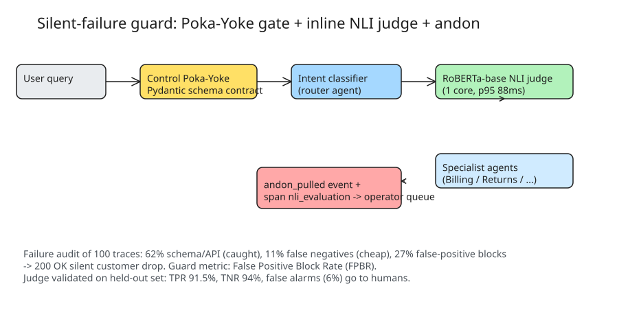

# Beyond 200 OK: Inline NLI Judges, Poka-Yoke Gates, and Andon for Silent Agent Failures

An AI agent that returns a clean `200 OK` may still have silently failed a user. A production case study (customer-support agent, router-specialist multi-agent topology) audited 100 manual traces and bucketed the failures:

- **62 %** explicit schema violations / API timeouts — already caught by error boundaries or fallbacks
- **11 %** false negatives — spam/out-of-scope queries let through, wasting LLM tokens
- **27 %** **false-positive blocks** — valid customer inquiries misclassified `OUT_OF_SCOPE` and refused

The asymmetry is the whole point: a false negative costs cents in tokens; a schema crash raises a `500` and pages on-call; but a false-positive block **drops a real customer while reporting perfect health**. That audit defines the metric to guard — the **False Positive Block Rate (FPBR)** — and exposes `200 OK` as a useless health signal for agents.

## Why the intent classifier is the blast-radius bottleneck

In a router-specialist topology the triage router agent short-circuits anything it deems `OUT_OF_SCOPE`. A false-positive block there means downstream specialists are never invoked: tokens are saved, the system "succeeds", and every downstream observability signal is clean. The component with the *highest cascading blast radius* is therefore the front-door classifier, and it is the first component that deserves an independent quality gate.

## The judge: a fine-tuned encoder NLI cross-encoder, not LLM-as-a-judge

Judging an intent label is a strict classification task (evaluate context, verify constraints, output a label) — not free-form generation. A fine-tuned **RoBERTa-base NLI cross-encoder** was chosen over LLM-as-a-judge because encoders are: faster, entirely **deterministic**, free of token-generation overhead, and natively suited to semantic entailment. Footprint ~1.5 GB RAM, co-hosted on existing `c7i.xlarge` nodes at **$0.00 added cloud cost**. If queries routinely exceed 256 tokens, **DeBERTa-v3-base** buys 1–2 % semantic-entailment accuracy at a heavier CPU profile (needs thread pinning when co-hosted).

Guardrails that make an inline judge safe on the hot path:

- Pin to exactly one core *before* model init: `torch.set_num_threads(1)`, `torch.set_num_interop_threads(1)`, `OMP_NUM_THREADS=1`, `MKL_NUM_THREADS=1`
- Warm-up dummy inference at container start to avoid cold-start penalties
- Measured budget: p50 = 42 ms, p95 = 88 ms per judgment at ~256 tokens; ceiling ~480 inferences/min (≈8/s) on one modern Intel core
- **Validate the judge itself** on a held-out set (they used 40 hand-labeled traces: TPR 91.5 %, TNR 94 %, false-alarm 6 % routed to an operator queue). An evaluator is a second opinion, not ground truth.

## Jidoka and Poka-Yoke: the manufacturing pattern transfers

- **Control Poka-Yoke** (limit switch at the station boundary): a Pydantic `IntentResult` schema contract (`selected_intent` enum + `confidence` bounded 0–1) rejects malformed classifier output *before* any downstream LLM tokens are spent.
- **Andon cord**: tracing is structured as a parent `intent_agent_turn` span wrapping `primary_agent_interaction` and children (`context_retrieval`, `prompt_render`, `llm_inference`), followed synchronously by `nli_evaluation`. A detected semantic mismatch emits an `andon_pulled` event — the digital emergency stop.
- **Prompt version provenance**: treat prompt text like compiled bytecode — every revision hashed into deployment manifests, with release notes logging every semantic instruction modifier, preventing unannounced semantic drift.

## Setting the andon page floor, and what happened when it fired

The judge's error profile derives the trip condition mathematically: **below a 0.9 confidence score the evaluator's false-alarm rate spikes above 18 %**, causing operator fatigue — so the andon page floor is set at 0.9. The alert lands in a `#andon-agent-alerts` Slack channel carrying the trace ID, prompt version tag, candidate classification, and the evaluator's confidence verdict.

The pattern paid for itself on prompt `v1.2.0`, which accidentally flagged product sizing swaps as out-of-scope: the inline judge caught the regression at t=0, the Slack webhook fired at t+2 s, and a full rollback to `v1.1.0` completed in 2 min 36 s. The host instance was a co-hosted `c7i.xlarge` (4 vCPUs, 8 GB RAM) already serving ~100 requests/min baseline.

## Known limitations (stated by the author, Boris Chabeda)

1. **Correlated failure blind spot** — if the primary LLM agent and the RoBERTa judge misinterpret a novel phrase identically, no alert fires.
2. **Cold-start vulnerability** — the first 30 requests of a new prompt version run unguarded by monitoring thresholds to avoid small-sample noise trips.
3. **Operator dependency** — pulling an andon cord with no human operators on duty creates queue backlogs without resolving customer friction.

## Key takeaways

1. HTTP-level health signals are blind to semantic failure; instrument *intent outcomes*, not transport status.
2. Audit real traces and bucket failure modes first — the failure class that returns `200 OK` is the one nobody alerts on.
3. A small deterministic encoder judge inline beats an LLM-as-a-judge on latency, cost, and reproducibility for classification-shaped checks.
4. Borrow from Lean manufacturing: Poka-Yoke gate before expensive stages, andon + span on failure, operator queue for judge false alarms.

## References

- [200 OK is dead as an AI agent health signal. Here's what comes next. — The New Stack](https://thenewstack.io/silent-ai-agent-failures/)
- [Revisiting NLI: Towards Cost-Effective and Human-Aligned Metrics — arXiv 2511.07659](https://arxiv.org/html/2511.07659v1)
- [How to Evaluate AI Agents: LLM-as-Judge Tutorial — DEV/AWS](https://dev.to/aws/how-to-evaluate-ai-agents-llm-as-judge-tutorial-4a6h)
