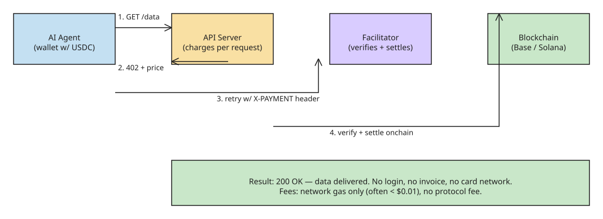

# x402: The HTTP Payment Standard Built for AI Agents

**TL;DR:** x402 is an open standard (launched by Coinbase, May 2025) that reactivates the long-unused HTTP `402 Payment Required` status code so that software — especially AI agents — can pay for APIs, data, and services directly over HTTP with stablecoins (USDC). No accounts, no API keys, no human checkout. It is chain-agnostic, with most volume settling on Base and Solana.

## Why this exists

Every payment system on the web assumes a person is present: someone to fill the checkout form, pass KYC, approve the charge. An AI agent can read docs, call APIs, and chain tools without a human — but it cannot pull out a credit card. The old workaround (prepaid API keys and accounts) requires a human to register for every service in advance, which defeats the point of an autonomous agent. x402 closes that gap: an agent that discovers a useful API at 3 a.m. can pay for a single call and move on.

Three properties make it different from every previous payment rail:

- **No accounts** — the payer needs a crypto wallet, not a login, API key, or subscription.
- **HTTP-native** — the payment happens inside the request/response cycle. No redirect to a checkout page.
- **Machine-first** — designed for software paying software; agents are the primary customer.

## The payment flow, step by step

The whole cycle is four HTTP messages plus one onchain settlement:

1. **Request** — the agent calls an API endpoint (e.g. a market data service) as a normal HTTP request.
2. **402 response** — the server replies with status `402 Payment Required`, and the body contains the price, the accepted stablecoin, the network, and the pay-to address.
3. **Signed payment** — the agent's wallet signs a stablecoin transfer authorization for the quoted amount and retries the request with the payment proof attached in an `X-PAYMENT` header.
4. **Verify and serve** — a **facilitator** (a service that verifies and settles the payment onchain, so the API server never runs blockchain infrastructure itself) confirms the transfer, and the server returns the data with a normal `200`.

The entire cycle takes seconds. Coinbase runs a public facilitator that anyone can use, and Cloudflare offers x402 support in its agent tooling. **Production adoption update (Nov 2026)**: the Brave Search API now accepts x402 per-request — see [x402 and the Brave Search API](../../apidesign/agentpayments/explanation-x402-agentic-payments-brave-search-api.md) in this KB.

## Old way vs x402

| | API keys and subscriptions | x402 |
| --- | --- | --- |
| Setup | Human signs up, verifies, adds card | None — wallet pays on first request |
| Pricing | Monthly tiers, often overpaying | Per request, pay for exactly what you use |
| Minimum payment | Usually dollars per month | Fractions of a cent |
| Who can pay | Humans with cards | Any software with a wallet |
| Settlement | Days, via card networks | Seconds, onchain |
| Fees | 2–3% plus fixed costs | Network gas only, no protocol fee |

## Adoption (as of April 2026)

- **Volume:** over 119 million transactions on Base and ~35 million on Solana, with roughly **$600 million in annualized payment volume**.
- **Governance:** Coinbase and Cloudflare launched the **x402 Foundation** in late 2025 to govern the standard as neutral infrastructure. Members include **Google, Visa, AWS, Circle, Anthropic, and Vercel**; Google, Microsoft, and AWS publicly backed the foundation in April 2026.
- **Ecosystem:** Google wired x402 into its Agent Payments Protocol, so agents built on Google's stack can settle over x402 rails. The standard is open source and chain-agnostic; support is expanding to networks like Stellar.
- **Agentic.market (April 2026):** Coinbase launched a discovery layer for the agent economy — a marketplace where AI agents can find, compare, and use x402-enabled services ("thousands of services, zero API keys"). It has two surfaces: a web interface for humans to browse and evaluate services, and a programming layer that lets agents search, filter, and integrate new capabilities autonomously at runtime. The platform provides each agent with "skills" (code describing how to use a service) plus a wallet that can both buy and sell services; listed integrations include CoinGecko, Google Flights, and X. It addresses the discovery gap — before it, agents relied on fragmented sources and word-of-mouth to find compatible x402 endpoints.

## What x402 does NOT solve

x402 answers "how does an agent pay?" It deliberately leaves the harder questions to other layers:

- **Trust** — paying for an API does not mean the API is honest; verifying what an agent bought is a separate problem.
- **Guardrails** — a wallet that spends autonomously needs spending limits, allowlists, and kill switches. Those live in the wallet layer, not in x402.
- **Identity** — knowing *which* agent paid, and who is accountable for it, is still early territory.

## Practical implications

- **Buyer side:** a research agent with a $5 daily allowance can buy exactly the data calls it needs from whichever service answers best, and receipts are all onchain.
- **Seller side:** anyone publishing an API, dataset, or premium content can charge per request without building billing infrastructure — add a 402 response, point at a facilitator, done.
- **Strategic:** the business-model assumption that "the customer is a person" is under pressure. As one analysis puts it: the question is no longer *whether* agents will spend money (they already have, 100M+ transactions), but what happens to every business model that assumed the customer is a person.

## References

- [What Is x402? The HTTP Payment Standard Built for AI Agents, Explained (DEV.to — Ribhav Modi)](https://dev.to/ribhavmodi/what-is-x402-the-http-payment-standard-built-for-ai-agents-explained-gie)
- [x402 whitepaper (x402.org)](https://www.x402.org/x402-whitepaper.pdf)
- [Coinbase x402 documentation](https://docs.cdp.coinbase.com/x402/welcome)
- [Cloudflare: x402 Foundation announcement](https://blog.cloudflare.com/x402/)
- [Coinbase's x402 Launches Marketplace Platform for AI Agents (Cointelegraph, Apr 2026)](https://cointelegraph.com/news/coinbase-ai-payments-protocol-x402-launches-ai-agent-app-store)
