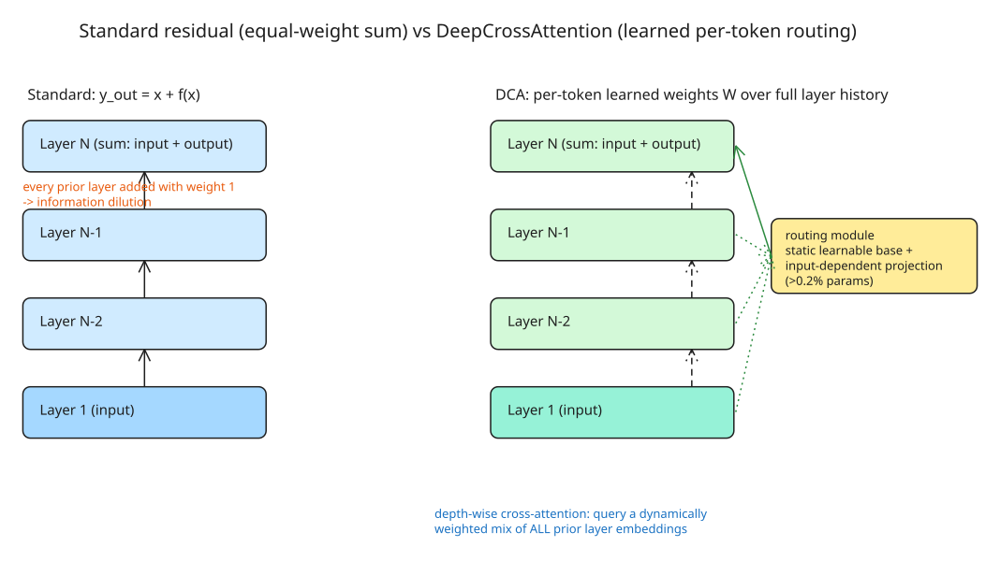

# DeepCrossAttention: Rethinking Residual Connections as Learned Layer Routing

The question: why do standard transformer residual connections — the `y = x + f(x)`
skip connection that makes deep networks trainable — throttle training efficiency,
and what happens when you replace fixed addition with **learned, per-token routing
over the full layer history**?

## The problem: information dilution in fixed-sum residuals

A standard residual connection is a **point-wise summation** of a layer's output
with its input. It is computationally free and solves the vanishing-gradient
problem, but it treats *all prior representations with equal weight*. As features
propagate through dozens of layers, high-resolution details from early layers get
averaged out or distorted. The network cannot selectively retrieve them later, so
it must **recompute** them — burning training steps and parameters to re-derive
information that already existed upstream.

## The mechanism: residual learning as dynamic routing

DeepCrossAttention (DCA), from Google Research's ICML 2025 paper
([arXiv 2502.06785](https://arxiv.org/abs/2502.06785)), generalizes the residual
connection into a lightweight layer-wise module with two mechanisms:

1. **Dynamic layer routing.** For every token, DCA computes a unique set of mixing
   weights over the history of preceding layers — a *static learnable base* combined
   with an *input-dependent projection*. The effective computation graph can shift
   per token from purely sequential to fully parallel.
2. **Depth-wise cross-attention (split Q/K/V).** Standard attention operates across
   *tokens* in a sequence; DCA applies the attention idea across *layers* in depth.
   Each token queries a dynamically weighted mix of all prior layer embeddings,
   recovering full historical context without the cost of scaling token attention.

Cost: **&lt;0.2% added parameters**. The trade is memory *bandwidth* — prior-layer
representations are kept intact rather than blended into a running sum.

## Measured results

| Result | Number |
|---|---|
| Speed to match standard-transformer quality | up to **3×** faster (blog headline), up to **5× fewer** training steps on C4/LM1B |
| LM1B perplexity &lt;14 | standard transformer: 42 layers; DCA: **30 layers** with lower ppl → **29% reduction** in depth and parameter count |
| Parameter reduction vs equivalent-quality baseline | **30–40%** |
| Added routing parameters | **&lt;0.2%** of model size |
| Ablation: active routing connections k = 1 → 24 | perplexity 15.14 → **14.35** (more history = better) |
| Retrofit onto a pretrained transformer (brief continued training) | −0.19 ppl on LM1B vs −0.02 for continued standard training |

The retrofit result matters practically: DCA **initializes to behave identically to
a standard residual network**, so it does not require training from scratch — you can
graft it onto an existing checkpoint and continue training briefly.

Baselines beaten at matched parameter/training budgets: standard Transformer,
LAUREL-PA, 1x1-DenseFormer, Hyper-Connections.

## The wider trend: dynamic residual routing

DCA sits in a fast-moving cluster of "unbundle the residual sum" work:

- **Attention residuals (Moonshot AI)** — replace fixed addition with a learnable
  softmax attention and a layer-specific pseudo-query over earlier depths; prevents
  unbounded hidden-state growth, improves gradient stability on reasoning-heavy
  tasks (coding, math). A **Block AttnRes** variant partitions layers into blocks to
  recover most of the benefit at much lower memory.
- **Hyper-Connections** (ICLR 2025) — widen/exploit the residual stream with learned
  depth-wise connections at negligible parameter cost.
- **Inkling 2 (Thinking Machines)** — adopted attention residuals *in addition to*
  DCA's cross-attention Q/K/V split.

The conceptual shift: stop treating the residual stream as a rigid additive pipeline
and treat **which earlier layer to listen to** as a learned, input-dependent decision.

## When to care

- Training small/medium LMs from scratch where convergence speed and depth reduction
  directly cut cost (the 42→30 layer result).
- Retrofitting an existing checkpoint when continued training is on the table.
- Watch the memory-bandwidth cost: routing requires prior-layer embeddings to stay
  resident and unblended — relevant at large widths and on inference-constrained hardware.

## References

- Google Research blog: [Supercharging transformer residual connections](https://research.google/blog/supercharging-transformer-residual-connections/) (Nov 23, 2026)
- Paper: [DeepCrossAttention: Supercharging Transformer Residual Connections (arXiv 2502.06785)](https://arxiv.org/abs/2502.06785)
- Related: [Hyper-Connections (ICLR 2025)](https://proceedings.iclr.cc/paper_files/paper/2025/file/f1e8ff97057e0c3f6bcb7018c78d4df1-Paper-Conference.pdf), Moonshot attention residuals (arXiv 2603.15031)
- Related KB note: [Mixture-of-Loops Transformer](explanation-mixture-of-loops-transformer.md), [Latent Lattice Language Models](explanation-latent-lattice-language-models.md)
