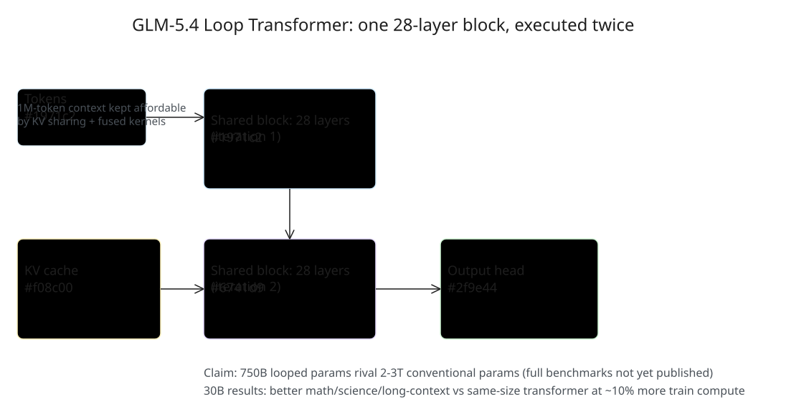

# GLM-5.4 and the Loop Transformer: Reusing 28 Layers Twice for Depth Without Parameters

On 2026-11-23, **Z.ai released GLM-5.4**, its "first Loop Transformer": a **shared block of 28 layers that is executed twice during inference**, adding *computational depth without adding parameters*. Z.ai claims the **750B-parameter** model matches the reasoning performance of **2–3 trillion-parameter** systems — while acknowledging that **full-scale benchmarks supporting that comparison are not published**. The architecture targets coding and agentic workloads ("Generalized Coding").

## Why loop layers instead of more layers

Looped/recurrent-depth transformers have a research lineage (Universal Transformers; Recurrent Looped Transformers). The catch Z.ai hit empirically: **loop transformers trained from scratch underperform conventional transformers at the same pretraining compute**. So GLM-5.4 instead **continues training a pretrained GLM-5** ([arXiv 2602.15763](https://arxiv.org/abs/2602.15763)) into the looped configuration — reusing existing weights and adding the loop at mid/continued-training time.

## The three engineering problems of looping at 750B scale

1. **Activation stability.** Passing the same block twice can blow up residual-stream norms on the second iteration. Fix: **per-token gates** that regulate updates to the residual stream, preventing activation norms from growing across iterations.
2. **Attention caching cost.** Duplicating the full attention history for pass 2 would double KV-cache memory at long context. Fix: **share the first iteration's KV cache** and keep only a **separate sliding window** for the second pass — keeping **1M-token context** affordable. The model also **reuses sparse attention indices between iterations** (negligible quality impact in their testing).
3. **Memory traffic.** Repeated layer execution multiplies reads/writes of intermediate activations. Fix: **fused inference kernels** that keep intermediates in registers/SRAM across the repeated execution.

## What the benchmarks actually show (and don't)

- The architecture was tested at **1B, 4B, 30B, and 750B**, but the detailed published results come from the **30B** model.
- At 30B, the looped model **outperforms a conventional transformer of the same size on math, scientific reasoning, and long-context tasks**, at **~10% more training compute**.
- It also **generates 10–14% fewer output tokens** on MMLU-Pro and GPQA-Diamond — Z.ai attributes this to reasoning happening *inside* the repeated layers rather than as extra generated tokens ("thinking in the layers instead of in the tokens").
- The headline claim (750B ≈ 2–3T) **lacks published full-scale benchmarks**; head-to-head inference latency/cost comparisons are also unavailable.
- Reported serving behavior varies: claimed **up to 200 tok/s off-peak, 70–80 tok/s at peak**; developers reported 150–170 tok/s initially, later degrading to **40–50 tok/s with traffic errors**.
- Known failure mode: **overthinking** — the model can spend excessive time reasoning; Z.ai is exploring **adaptive computation** to restrict the extra loop to tokens that need it (a learned-exit idea from the Universal Transformer lineage).

## Availability

GLM Coding Plan, ZCode, and Z.ai Chat; vision support and a **1M-token context window**. Demonstrations ("Generalized Coding") include games with physics/combat systems, 3D environments with GLSL shaders, and a six-axis robotic arm designed in FreeCAD. Improvements over GLM-5.3 are claimed for test writing, code QA, feature development, bug fixing, and terminal tasks — underlying evaluations not published.

## Takeaway

GLM-5.4 is the strongest production signal yet that **depth is a scaling axis partially orthogonal to parameter count** — but the economics hinge entirely on inference: if the second pass costs near-zero extra memory bandwidth (shared KV cache + fused kernels) and modest FLOPs, "loop twice" beats "add layers" for reasoning-heavy workloads. Watch for: (a) published 750B-scale benchmarks, (b) adaptive/conditional looping, and (c) whether the KV-cache-sharing trick generalizes to other long-context serving stacks.

## References

- [The New Stack: Z.ai ran the same 28 layers twice](https://thenewstack.io/zai-glm54-loop-transformer/) (2026-11-23, Amanda Caswell)
- [Z.ai blog: GLM-5.4 — Toward Generalized Coding with Our First Loop Transformer](https://z.ai/blog/glm-5.4)
- [GLM-5 technical report (arXiv 2602.15763)](https://arxiv.org/abs/2602.15763)
- Background: [Sebastian Raschka — Looped Transformer (depth sharing)](https://sebastianraschka.com/llm-architecture-gallery/looped-depth-sharing/), [Yifan Zhang — Recurrent Looped Transformer slides](https://yifzhang.com/slides-rlt/)
