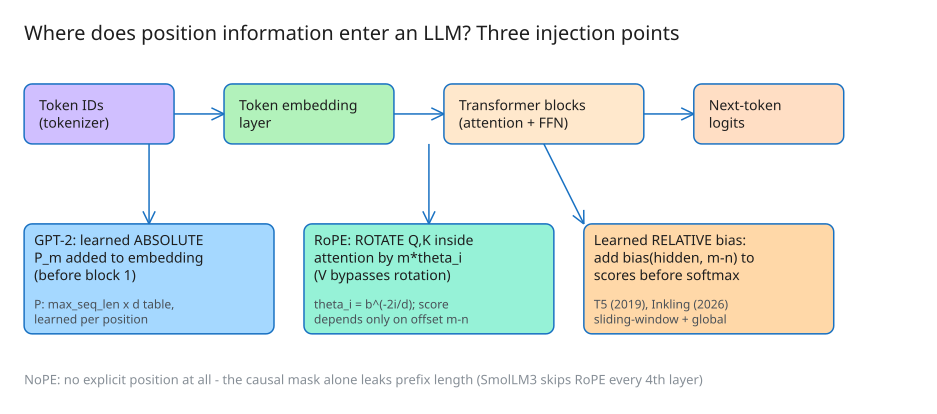

# Positional Embeddings in Modern LLMs: RoPE, NoPE, and Partial Rotation

Attention is permutation-invariant: "the red fox jumps over the gray fox" and "the gray fox jumps over the red fox" produce identical token sets. Position information must be injected somewhere. This note covers **where** it enters, **how RoPE works** (with code), and **what 2026 open-weight models actually use**.



## Where position enters

| Method | Injection point | Used by |
|---|---|---|
| Learned absolute embeddings | Add vector `P_m` to token embedding **before block 1** | GPT-2 |
| Fixed sinusoidal | Add sin/cos-computed vector before the stacks | Original 2017 Transformer |
| RoPE (rotary) | Rotate Q and K **inside every attention layer** | LLaMA and most open-weight LLMs |
| Learned relative bias | Add bias(hidden state, m−n) to scores **before softmax** | T5 (2019), Inkling (2026) |
| NoPE | Nothing explicit — causal mask alone | Some layers of SmolLM3, recurrent hybrids |

Key architectural difference: GPT-2 injects position once at the input; MiniMax-M3 injects per-block via RoPE (with QK-Norm normalizing Q/K before rotation).

## How RoPE works

RoPE (Su et al., RoFormer, 2021) uses each token's position `m` to **rotate pairs of features** in the query and key before their dot product. Value vectors bypass rotation entirely.

The core property: rotating Q by `mθ` and K by `nθ` means their dot product depends only on the **relative offset** `m−n`. Shifting both positions by the same amount preserves every attention score — this is the relative-position invariance RoPE buys you.

Per pair *i*, the angular frequency follows the sinusoidal-style schedule:

```
θ_i = b^(-2i/d)        # b = base (often 10,000), d = head_dim
```

Minimal PyTorch implementation (split-half convention):

```python
import torch

def rope_params(head_dim, positions, base=10_000):
    assert head_dim % 2 == 0
    indices = torch.arange(0, head_dim, 2, device=positions.device)
    inv_freq = base ** (-indices.float() / head_dim)
    angles = positions.float()[:, None] * inv_freq[None, :]
    return angles.cos(), angles.sin()

def rope_split_half(x, cos, sin):
    first, second = x.float().chunk(2, dim=-1)
    return torch.cat((
        first * cos - second * sin,
        first * sin + second * cos,
    ), dim=-1).to(x.dtype)
```

Inside attention, only `q` and `k` pass through `rope_split_half`; the cos/sin tables have shape `(seq_len, head_dim/2)` and broadcast across batch and heads — precompute once per model. The original RoFormer paper uses the **interleaved** pairing convention; most modern implementations use **split-halves** (the two layouts give different scores if applied to the same vector, so they are not interchangeable).

## Modern variants (2025→2026 trends)

- **Partial RoPE** — rotate only a subset of each head's dims. MiniMax-M3 rotates 64 of 128 dims per head (32 pairs), halving the precomputed cos/sin tables (~128 MiB saved for 1M-token context in BF16). The KV cache is *not* reduced — keys/values still store full vectors. A 2026 paper ("Fractional Rotation, Full Potential?", arXiv:2603.11611) found rotating ~10% of head features often matches full RoPE on loss/accuracy for 1–8B models, though full RoPE won some evaluations. Raschka's verdict: marginal benefit.
- **NoPE layers** — no explicit encoding; the causal mask leaks position implicitly (under uniform attention, the average contribution of a unique early token equals 1/prefix-length — a usable position signal). The NoPE paper (arXiv:2305.19466) found NoPE beat RoPE on length generalization in 107M ablations; a 1.3B code model held up beyond training length but degraded at the longest contexts. **SmolLM3-3B** applies RoPE in 3 of every 4 layers — the authors report this improved long-context performance.
- **Learned relative position bias** — T5's idea revived in Thinking Machines' **Inkling** (975B): add a learned function of (query hidden state, distance) to the scaled dot product before softmax, in both sliding-window and global attention layers.

Survey of the 2026 LLM Architecture Gallery: full RoPE in every attention layer is still the most common choice but declined from 2025 to late 2026; mixed RoPE/NoPE stacks are growing, and among RoPE models, **partial RoPE went from minority (2025) to majority (2026)**. Prediction: RoPE remains dominant into 2027, with Inkling-style learned-bias designs as the challenger.

## Practical takeaways

- When reading a new model's config, check: `rotary_dim` vs `head_dim` (partial RoPE fraction), which layers skip RoPE, and any relative-bias config.
- RoPE tables are trivially cheap to recompute — never a checkpoint-size concern.
- Position method is a major lever for **length generalization**, which is why NoPE/mixed stacks keep appearing in long-context models.

## References

- [Understanding Positional Embeddings in Modern LLMs — Sebastian Raschka, Ahead of AI](https://magazine.sebastianraschka.com/p/understanding-positional-embeddings) (original source)
- [RoFormer paper (Su et al., 2021)](https://arxiv.org/abs/2104.09864)
- [NoPE: The Impact of Positional Encoding on Length Generalization in Transformers](https://arxiv.org/abs/2305.19466)
- [LLMs-from-scratch Qwen3 standalone implementation](https://github.com/rasbt/LLMs-from-scratch/blob/main/ch05/11_qwen3/standalone-qwen3.ipynb)
- [SmolLM3 architecture and training details](https://huggingface.co/blog/smollm3#architecture-and-training-details)

Related: [[explanation-cnn-rnn-vs-transformer-for-sequential-data]]
