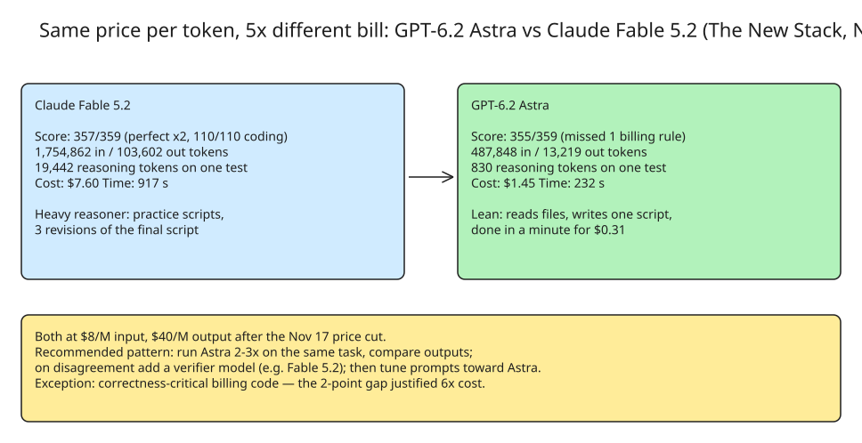

# Reasoning Effort Dominates Cost: GPT-6.2 Astra vs Claude Fable 5.2 on Production Billing Tasks

The New Stack's November 2026 evaluation (Khamiatov & Wachtel) ran both frontier models against a real production billing system. The headline result isn't the 2-point score gap — it's that **identical per-token pricing produced a 5x cost difference**, because the models differ radically in how much they think.

## Benchmark setup (reproducible, not vibes)

Two suites against an invoice engine with 150+ rules; both models received the *same* prompts and scoring rubric:

- **Invoice engine**: 390 real production tests across six scenarios — tiered plans (Starter $49 / Professional $149 / Enterprise $499 with volume discounts), usage-based billing (10K requests free, then $2.50/1K), proration (2+1 day cycles, 15/16 mid-month switch), failed-payment retry (3 attempts, 72h, 3-day grace), dunning + cancellation. **100% pass required**: the suite was hardened until GPT-5 — stronger than the models on some rules — could pass.
- **Billing simulator**: 360 adversarial edge cases (zero/negative quantities, overflow, NaN, division by zero, malformed input, duplicate events), **90% pass** required; all 10 tests had to reach a consistent outcome.
- Full harness and per-test scoring published on GitHub.

## Results

| Metric | Claude Fable 5.2 | GPT-6.2 Astra |
|---|---|---|
| Invoice engine | **110/110** (perfect) | 108/110 (missed one billing rule) |
| Billing simulator | 110/110 (perfect) | 109/110 (one edge case) |
| **Total** | **357/359** | **355/359** |
| Total input tokens | 1,754,862 | 487,848 |
| Total output tokens | 103,602 | 13,219 |
| Total cost | **$7.60** | **$1.45** |
| Total time | 15m 17s | 3m 52s |
| Peak per-test cost | $3.08 | $0.93 |
| Reasoning tokens (test 2) | 19,442 | 830 |

Both models sit at $8/M input, $40/M output after the Nov 17 price cut. Fable's higher list price explains only a fraction of the gap: it consumed ~3.6x input and ~8x output tokens — drafting practice scripts, running them, rewriting, iterating — while Astra read the files, wrote one script, and executed it. "Token economics matter as much as the rate card."

## The behavioral difference: reasoning effort

On the proration test (15-day cycle + 16-day new plan, same-day switch — a classic double-charge edge case), Fable spent **19,442 reasoning tokens vs Astra's 830** and still produced *the same* output and score. Astra hit the same answer directly; no amount of extra thinking changed Fable's result. Fable's edge in the benchmark came not from thinking more but from **knowing better** — it wrote production-grade code on the first pass, while Astra leaned on self-correction (costlier than it looks, though still 5x cheaper overall).

## Operational takeaways

1. **Benchmark your workload, not the leaderboard.** Astra's 2-point loss occurred in the *correctness-critical* billing suite — where the authors deliberately paid 6x more for Fable ("the stakes justify it"). For the edge-case suite, Astra at ~4x lower cost was equally trustworthy.
2. **Multi-run sampling replaces one-shot comparison**: run Astra 2–3 times on the same task and compare outputs; if all runs agree, accept the cheap model.
3. **Verifier pattern**: on disagreement between runs, add a stronger model (e.g. Fable 5.2) as verifier, then tune prompts so Astra handles more of the load.
4. **Watch reasoning tokens as a cost dial** — the single largest variance driver between models at equal rates, and often the one with least observable quality payoff.
5. **Hardening the suite against a third model (GPT-5) before benchmarking** guards against tests that flatter one model family.

## References

- [GPT-6.2 Astra vs. Claude Fable 5.2 (The New Stack)](https://thenewstack.io/gpt-6-2-astra-vs-claude-fable-5-2/)
- [OpenAI model pricing](https://openai.com/api/pricing/)
- [Anthropic pricing](https://www.anthropic.com/pricing)
