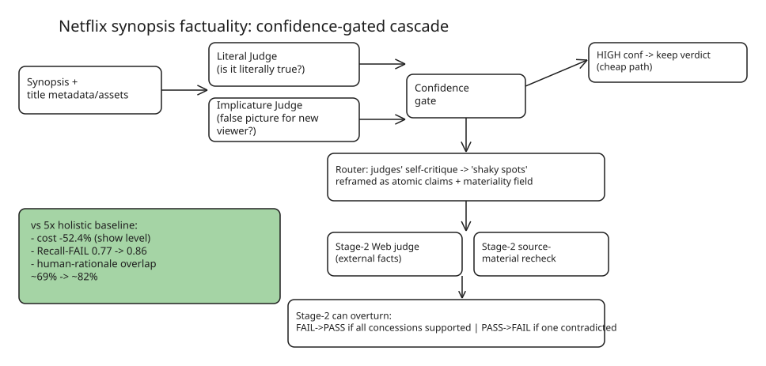

# Netflix Synopsis Factuality: Confidence-Gated Cascade of Specialized LLM Judges

How Netflix replaced an expensive "5× holistic reasoning-model call" fact-checker for show/episode synopses with a **tiered cascade** — cutting cost 52.4% while *improving* both verdict quality and alignment with human annotator reasoning. A transferable blueprint for any LLM-as-judge QA pipeline.

## The problem

A synopsis must be *factual*, and factuality has four failure tiers (illustrated with Bridgerton):

1. **Blatant falsehoods** — wrong genre/plot ("Detective Daphne Bridgerton hunts a serial killer").
2. **Technically-true-but-misleading framing (implicature)** — a synopsis about Lady Whistledown's gossip sheet is all-true yet misrepresents whose show it is.
3. **Misleading phrasing** — "the two begin a passionate love affair" erases that the relationship starts as a fake arrangement.
4. Nitpicky over-flagging — failing "wonderful magic" because no character literally says "wonderful".

Baseline pipeline: feed a reasoning model everything known about the title (100k+ token contexts) + a rubric, run **five identical calls**, fail if any run fails. Two failure modes: cost explodes across titles × episodes × languages × style variants, and rationales diverge from human annotators (~69% overlap), making them useless for downstream auto-correction.

## Three insights → three architecture changes

**Insight 1 — easy cases don't need five calls.** On blatant cases all runs agree near-verbatim; only nuanced cases disagree with themselves. Fix: have the model emit **confidence** with verdict+rationale; only low-confidence ("hard") synopses escalate. (Airport-security model: most bags walk through, alarms get extra screening.)

**Insight 2 — five identical judges add no new information.** Repeated sampling only fights *sampling noise*, not systematic reasoning errors: same flawed rationale ⇒ same wrong verdict five times. Fix: replace the generic prompt with two **specialized judges** — a *Literal Judge* ("is it literally true?") and an *Implicature Judge* ("does it give a false picture to a viewer who hasn't seen it?"). Targeted error-hunting beats hoping stochastic sampling surfaces nuance.

**Insight 3 — the rationale hides mistakes the verdict buried.** The model often spots a real issue in its reasoning, then waves it off. Fix: judges additionally **self-critique** — surface "shaky spots" (assumptions made, doubts the evidence can't resolve, dismissed contradictions). A **router** reframes each concession into a self-contained **atomic claim** with a *materiality* field (what evidence would settle it) and dispatches it to Stage-2: a **web judge** for external facts (quotes, citations) or a **source-material recheck** targeted at that exact claim.

## The cascade and verdict-override rules

Every synopsis hits both Stage-1 judges. High-confidence verdicts are final; low-confidence cases escalate. Stage 2 can overturn:

- **FAIL → PASS** only if *all* concessions (including the original failure reasons) are supported by secondary checking.
- **PASS → FAIL** if *at least one* concession is contradicted.

## Results (custom human-labeled benchmark, show- and episode-level)

| Metric | Baseline (5× holistic) | Cascade |
| --- | --- | --- |
| Cost per synopsis | — | **−52.4%** (show level); 15% cheaper even vs. no-summary holistic on episodes |
| Recall-Fail (catch rate of truly non-factual) | 0.77 | **0.86** |
| Human-rationale overlap | ~69% | **~82%** (LLM-as-judge RSS score: 0/0.5/1 similarity) |

Secondary takeaways:

- **Simple ablations fail**: more reasoning effort made the checker too *lenient*; a smaller/cheaper model made it too *strict*. Structure, not model dial, fixed the problem.
- **Summary context matters for episodes**: without a full-show summary the judge over-fails episode details that are fine in the broader storyline.
- P50 latency rises with escalation but stays within a practical band — latency was explicitly *not* the primary target (avg LLM calls and end-to-end cost were).

## When to reuse this pattern

Any offline (non-interactive) LLM judging/labeling at scale where: (a) most items are easy, (b) errors come from reasoning biases not sampling noise, and (c) rationales feed downstream automation. The ingredients — confidence gating, heterogeneous specialized judges, self-critique → atomic claims → routed verification with asymmetric override rules — are domain-independent.

## Cross-references in this KB

- [Harbor coding-agent evaluation: Oracle/NOP proofs](../../../tutorials/aimachinelearning/llmevaluation/tutorial-harbor-coding-agent-evaluation-oracle-nop.md) — same discipline: judges must be adversarially validated
- [Agent guardrail stack](../agentarchitecture/explanation-agent-guardrail-stack.md)

## References

- [Fact-Checking at Scale: Building a More Accurate and Efficient Synopsis Factuality System — Netflix TechBlog (2026-11-09)](https://netflixtechblog.com/fact-checking-at-scale-building-a-more-accurate-and-efficient-synopsis-factuality-system-d7d85859d808)

## Further Reading

- [FrugalGPT: How to Use Large Language Models While Reducing Cost and Improving Performance (arXiv 2305.05176)](https://arxiv.org/abs/2305.05176) — the original LLM-cascade formulation: sequential cheap→expensive model invocation under a budget; Netflix's confidence-gated cascade is the judge-side instantiation of its "LLM cascade" strategy.
- [RouteLLM: Learning to Route LLMs from Preference Data (Ong et al., ICLR 2025; OpenReview)](https://openreview.net/forum?id=8sSqNntaMr) — the complementary *router* approach (predict before execution instead of gating after), from LMSYS; contrasts with Netflix's post-hoc confidence gating and explains when a router beats a cascade (fixed routing distribution, no first-stage latency floor). Code: [github.com/lm-sys/RouteLLM](https://github.com/lm-sys/RouteLLM).
- [LLM Routing and Model Cascades: RouteLLM, FrugalGPT and the cost/quality trade-off (2026 overview)](https://iotdigitaltwinplm.com/llm-routing-model-cascades-routellm-frugalgpt-cost-quality-tradeoff-2026/) — practitioner's map of the cascade-vs-router design space with current benchmarks.
