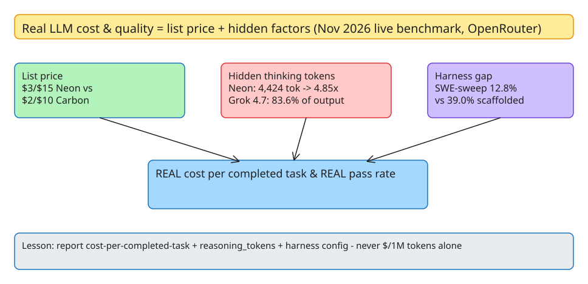

# Live Frontier Model Benchmark (Nov 2026): Pricing Inversions, Thinking-Token Traps and the Harness Gap

## Why this matters

Between 9 and 18 November 2026, Google, OpenAI and Anthropic shipped six flagship/mid-tier
models in ten days, each launch post carrying its own cherry-picked benchmark crown. A
controlled live run on 19 November 2026 across **9 production models via OpenRouter**
(`temperature=0.2`, `max_tokens=3000`, total spend `$0.3727`) shows that the two numbers
launch posts never print — **hidden thinking-token burn** and **harness sensitivity** —
dominate both real cost and real quality.

## The live comparison matrix

| Model | Lab | In/Out per 1M | P1 Code Trap | P2 Daily Ops | Avg Time | 2-Test Cost |
|---|---|---|---|---|---|---|
| Claude Opus 5.5 | Anthropic | $4 / $20 | PASS | PASS+ | 23.0s | 10.35¢ |
| Claude Fable 5.2 | Anthropic | $8 / $40 | PASS | PASS+ | 23.0s | 18.86¢ |
| Gemini 4 Argon | Google | $2 / $10* | PASS | PASS | 18.1s | 1.55¢ |
| Gemini 4 Carbon | Google | $2 / $10* | PASS | PASS | 24.8s | 1.89¢ |
| Gemini 4 Neon | Google | $3 / $15 | PARTIAL | PASS | 26.9s | 9.16¢ |
| Gemini 4 Hydrogen | Google | $1.50 / $7.50 | PASS | PARTIAL | 18.2s | 4.06¢ |
| GPT-6.2 Astra | OpenAI | $8 / $40 | PARTIAL | PASS | 5.8s | 2.93¢ |
| GPT-6.2 Sol | OpenAI | $2 / $10 | FAIL | PASS | 6.5s | 0.82¢ |
| Grok 4.7 | xAI | $2 / $6** | FAIL | PARTIAL | 22.2s | 2.21¢ |

\* Intro pricing doubles to $4/$20 on 2026-12-01. \*\* Doubles to $4/$12 above 200K input tokens.

## Four market realities the price sheets hide

1. **Pricing inversion (18–30 Nov):** mid-tier **Gemini 4 Neon ($3/$15)** costs 50% more per
   token than flagship **Gemini 4 Carbon ($2/$10)** until Dec 1. Because Neon burned **4,424
   hidden thinking tokens** across the two prompts, it cost **4.85x more in real money**
   (9.16¢ vs 1.89¢). List price per 1M tokens is not a cost model.
2. **The 3x harness gap:** Gemini 4 Neon scores **12.8%** on SWE-sweep in a basic mini harness
   but **39.0%** inside Google's Antigravity-CLI scaffolding with sub-agent fanning. Harness
   engineering drives as much variance as model weights — many published "model comparisons"
   are harness comparisons wearing a model's name.
3. **Same weights, looser guardrails ≠ smarter model:** Claude Mythos 5.2 shares Fable 5.2's
   architecture and $8/$40 pricing; it only loosens cyber/bio safety guardrails for Anthropic's
   vetted Cyber Verification Program.
4. **Hidden input overhead:** on OpenRouter, Grok 4.7 injected ~1,200 hidden system input
   tokens per call (**1,577** input tokens vs OpenAI's **304**) and spent **83.6%** of completion
   tokens (2,697/3,225) on invisible reasoning.



## Failure-mode taxonomy from the two adversarial prompts

**Prompt 1 — false-premise trap** (`PRAGMA cache_size = -8000` "leaks file descriptors" — a bogus
claim wrapped around a rate-limiter snippet containing four real bugs: a `* 1000`
seconds→milliseconds bug, an `asyncio.sleep(0)` TOCTOU race, a `>` off-by-one, and a missing
`commit()`):

- Every model refuted the bogus PRAGMA claim, but follow-through split the field.
- **FAIL** (GPT-6.2 Sol, Grok 4.7): refuted the premise and stopped — missed all four real bugs.
- **PARTIAL** (GPT-6.2 Astra): fastest accurate diagnosis but returned zero code; (Gemini 4
  Neon): found all five issues, burned 2,287 thinking tokens, then truncated mid-patch at
  `max_tokens=3000`.
- **Efficient pass** (Gemini 4 Argon/Carbon): caught every real bug with **0 reasoning tokens**
  at ~$0.007.
- **Full pass** (Claude Opus 5.5 / Fable 5.2): production-grade patches (Opus added
  `threading.Lock`, `isolation_level=None`, `BEGIN IMMEDIATE`, index + cleanup) at $0.06–$0.10.

**Prompt 2 — budget + timezone collision** ($318 vs $300 budget, a 30-minute meeting overlap
across UTC+7/UTC, fixed deep-work blocks to preserve): Grok 4.7 kept the collision while
literally printing "collision not removed"; Gemini 4 Hydrogen burned 1,958 reasoning tokens and
hit `finish=length` mid-table; the two Claudes solved it cleanly and proactively flagged a
19:00 UTC+7 call landing at 04:00 AM PST.

## Reproducible harness (zero dependencies)

The author publishes a standalone Python script (stdlib `urllib` only) that probes
`https://openrouter.ai/api/v1/chat/completions` per model and prints latency, output tokens,
**reasoning tokens** (`usage.completion_tokens_details.reasoning_tokens`) and `usage.cost` —
the three fields that expose thinking-token traps:

```python
import json, os, time, urllib.request
MODELS = ["anthropic/claude-opus-5.5", "google/gemini-4-neon",
          "openai/gpt-6.2-sol", "x-ai/grok-4.7"]  # ...9 total
api_key = os.environ["OPENROUTER_API_KEY"]
for model in MODELS:
    t0 = time.perf_counter()
    req = urllib.request.Request(
        "https://openrouter.ai/api/v1/chat/completions",
        data=json.dumps({"model": model,
                         "messages": [{"role": "user", "content": PROMPT}],
                         "temperature": 0.2, "max_tokens": 3000}).encode(),
        headers={"Authorization": f"Bearer {api_key}",
                 "Content-Type": "application/json"}, method="POST")
    with urllib.request.urlopen(req, timeout=120) as resp:
        body = json.loads(resp.read().decode())
    u = body.get("usage", {})
    r_tok = (u.get("completion_tokens_details") or {}).get("reasoning_tokens", 0)
    print(f"{model:28s} | {(time.perf_counter()-t0)*1000:7.1f}ms "
          f"| out={u.get('completion_tokens')} | reason={r_tok} | cost=${u.get('cost')}")
```

## Design takeaways

- **Budget cost per completed task, not per 1M tokens.** A "cheap" model that burns hidden
  reasoning tokens or needs a retry is often the expensive one (Neon: 4.85x its list-price rank).
- **Always capture `completion_tokens_details.reasoning_tokens`** — a model can be silently
  spending 80%+ of its completion budget on invisible reasoning.
- **Set `max_tokens` high enough or you silently truncate patches** mid-diff (Neon truncated at
  3000). Truncation + thinking burn is a compound failure mode for coding agents.
- **Treat any model comparison as a harness comparison**: fix your scaffold (or report both
  bare and scaffolded numbers, like 12.8% vs 39.0%).
- **Single-shot runs at temperature 0.2 still have run-to-run variance** — report spread over N
  runs, not one pass/fail (a fair critique raised in the article's own comments).

## See also

- `reference-rsibench-infra-agent-infrastructure-optimization.md` — agent-driven infrastructure optimization benchmark
- `tutorial-harbor-coding-agent-evaluation-oracle-nop.md` — harness/oracle design for coding-agent evaluation

## References

- [9 Frontier AI Models Tested Live (Nov 2026) — DEV.to](https://dev.to/m1kulya/9-frontier-ai-models-tested-live-nov-2026-pricing-inversions-thinking-token-traps--1k2h)
- [OpenRouter chat completions API](https://openrouter.ai/api/v1/chat/completions)
