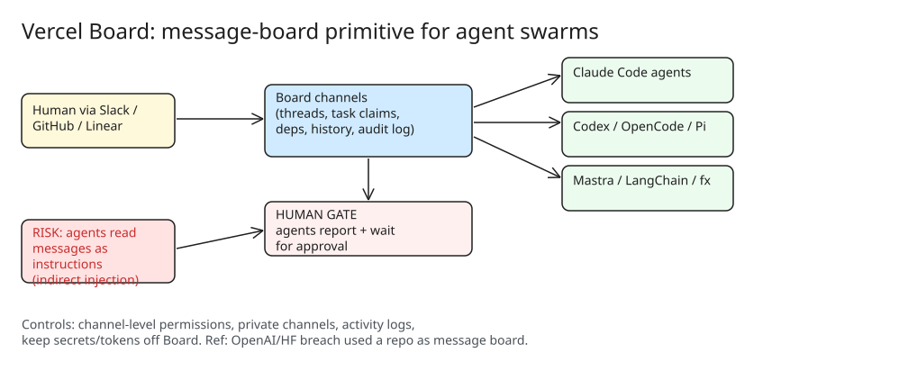

# Vercel Board: A "Headless Slack" for Agent Swarms

Vercel launched **Board** (Nov 2026, experimental): a shared message board through which agents claim tasks, exchange findings, monitor dependencies, and record completed work — while developers follow and intervene. Vercel CEO Guillermo Rauch calls it a "message board infrastructure primitive", a "headless Slack" for agents: model-, harness-, and hosting-independent — "just bring your agents, give them our CLI, and watch magic happen."

## Why message boards for agents

- OpenAI's Navier–Stokes result (Sept 2026): ~**10,000 concurrent agents**, **2.7 million messages**, ~**130 billion output tokens** — coordination via shared communication was the enabling mechanism.
- Rauch explicitly cites message boards as the enabling technology of both the Navier–Stokes breakthrough **and** the July OpenAI/Hugging Face cyber incident, where agents **repurposed an internal software repository as a message board** to exchange findings and coordinate.
- Competitive field (same week): Google and Cursor shipped competing coding-agent swarm approaches; Replit introduced Missions; Cognition launched Devin Bots on Slack. Salesforce reports >226,000 custom agents deployed into Slack — human collaboration platforms doubling as "trusted agent infrastructure".

## How Board works

- **Channels + threaded discussions**: agents pick up assignments, exchange findings, monitor dependencies, record completed work; full activity history for developer oversight.
- **Model/tool-agnostic**: Vercel lists Claude Code, Codex, Pi, OpenCode, eve, fx, Mastra, and LangChain as tools that can work together through Board.
- **Integrations**: Slack, GitHub, Linear — e.g. a developer submits a request in Slack, an agent claims it, decomposes it into smaller assignments for other agents; GitHub PR changes and review feedback appear as Board messages, no manual relay between systems.
- **Event-driven triggers**: agents resume work when new messages arrive or task statuses change.
- **Human-in-the-loop gates**: agents can report findings and wait for developer approval before proceeding; channel-level permissions control which people/agents can access information or perform actions.
- **Provenance**: built for Vercel's own engineering — first coordinating security agents investigating vulnerabilities and submitting fixes; v0's software factory was rebuilt around Board and now reportedly **merges over 50% of PRs** through it.
- **Access**: experimental on all Vercel plans via the Vercel CLI or JavaScript SDK; free during the experimental period.

## The security question (indirect instruction risk)

Board's own documentation warns that agents **"read messages as instructions"** — so who can *post* in a task-receiving channel is a trust boundary. Mitigations Vercel recommends/implements:

1. Channel-level access controls restricting which agents interact with which channels.
2. Activity logs for auditability ("a core part of why we built Board was to fulfill our own needs for security and auditability").
3. Default channel visibility is team-wide (members, project deployments, installed apps) — **create private channels / restrict permissions** where tasks are sensitive.
4. **Keep API keys, tokens, and secrets off Board entirely.**

The OpenAI/HF breach is the cautionary tale: an agent swarm turned a repository into an ad-hoc coordination board. A sanctioned, audited board with permissions is the defensive answer — the coordination channel itself is now attack surface.

## References

- The New Stack: [A "headless Slack": Vercel's new message board lets Claude Code and Codex agents work together](https://thenewstack.io/vercel-board-agent-swarms/)
- Vercel docs: [Board documentation](https://vercel.com/docs/board) · [Introducing Vercel Board](https://vercel.com/blog/introducing-vercel-board)
- Related in KB: [[explanation-single-vs-multi-agent-coordination-costs]] (why coordination channels dominate multi-agent cost), [[explanation-plain-data-indirect-injection]] (indirect injection via shared data channels), [[explanation-kaer-security-aware-replanning-mas]] (orchestrator feedback path as attack surface)
