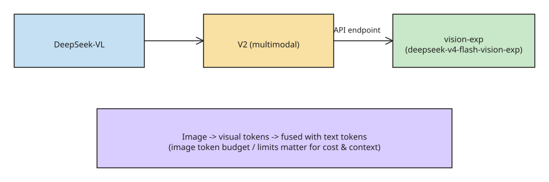

# DeepSeek's Vision Lineage: From DeepSeek-VL to Vision-Exp

When `deepseek-v4-flash-vision-exp` arrived, the headline was "a text model
gained native image input." The more useful story is the years of visual
research behind it. (Independent analysis; not an official DeepSeek statement.)

## DeepSeek-VL — real-world visual data

Combined a DeepSeek language model with a vision encoder. The team built a
taxonomy from real user scenarios (recognition, transcription, conversion,
analysis, commonsense and logical reasoning, multi-image comparison, safety) to
drive instruction-tuning data.

The training recipe was **three-stage**:

1. Pretrain the vision encoder on image-text pairs.
2. **Joint pretraining** of LM + adaptor on text-only *and* multimodal data,
   keeping the main vision encoder frozen.
3. Supervised fine-tuning on multimodal instructions and text conversations.

The final pretraining mix was roughly **70% text / 30% multimodal**, with a
modality warm-up that gradually introduces images. Lesson: adding an encoder is
not enough — training must preserve the LM's reasoning and instruction-following.
~1.3B and 7B variants shipped with code and weights.

## DeepSeek-VL2 — detail + efficient inference

- **Dynamic tiling** for varied aspect ratios and higher resolutions (a fixed
  resize erases the detail a document/screenshot task needs). Precisely: for
  an input of size (H, W) it builds candidate resolutions
  `CR = {(m×384, n×384) | m,n ∈ N, 1 ≤ m,n, m×n ≤ 9}`, picks the one with the
  **minimum padding area**, then splits the resized image into `m×n` local
  **384×384 tiles plus one global tile** for context. Each tile passes
  through a shared **SigLIP-SO400M-384** encoder, yielding up to
  **729 embeddings of 1152 dimensions** per tile — fine detail without the
  compute blowup of naive resolution scaling.
- A **Mixture-of-Experts** language component (DeepSeekMoE) with
  **Multi-head Latent Attention**, which compresses the Key-Value cache into
  latent vectors for efficient inference and high throughput.
- Shipped as three variants by activated parameters: **Tiny (1.0B), Small
  (2.8B), and full (4.5B activated)** — competitive or SOTA with similar or
  fewer activated parameters than dense and MoE open-source peers, per the
  paper ([arXiv:2412.10302](https://arxiv.org/abs/2412.10302)).
- **Three-stage training recipe**: (1) *vision-language alignment* warmup on
  image-caption pairs (e.g. ShareGPT4V); (2) *pretraining* on a ~70%
  vision-language / 30% text-only mix to push cross-modal reasoning; (3)
  *supervised fine-tuning* on in-house QA and structured data (OCR, VQA,
  charts, documents). Reported strengths span visual question answering, OCR,
  document/table/chart understanding, and visual grounding.

## Janus / Janus-Pro — a distinct thread

Explored one autoregressive framework for *both* visual understanding and
image generation (a discrete visual-token path for generation). Relevant to the
broader visual ambition but **not** the same as the current API model — do not
conflate the research line with `DeepSeek-Vision-Exp`.

## What the current Vision-Exp API adds

- Accepts image input alongside text. Supports **JPEG, PNG, GIF, WebP** via
  public image URLs or Files API references.
- Available through DeepSeek's **OpenAI-compatible** Chat Completions and
  Responses APIs, and an **Anthropic-compatible** Messages endpoint.
- Documented limits: **max 384 tokens per image** after resizing, **up to 600
  images per request**, with different limits for external/base64 inputs vs.
  Files API references. These are API contract details, not evidence that
  training data is fully documented.

## What is traceable

The research lineage is visible; the complete training-data provenance of the
newest API model is not. Public material does not establish a full image list,
a complete licensing chain, a dedup/contamination report, or a one-to-one
mapping from model behavior to a named training example. Architecture docs answer
"how do I call it," not "where did every training example come from" — a
distinction that matters for legal/procurement due diligence.

## References

- [DeepSeek's Vision Lineage (dev.to)](https://dev.to/forestlioooooo/deepseeks-vision-lineage-from-deepseek-vl-to-vision-exp-45ki)
- [DeepSeek-VL2 paper (arXiv:2412.10302)](https://arxiv.org/abs/2412.10302)
- [DeepSeek-VL2 repository (deepseek-ai)](https://github.com/deepseek-ai/DeepSeek-VL2)
- [Janus-Pro-7B model card (Hugging Face)](https://huggingface.co/deepseek-ai/Janus-Pro-7B)

## Related
- [[explanation-netflix-maps-multimodal-asset-personalization]]
- [[tutorial-commit-conversation-voice-turn-context]]
- [[explanation-agent-guardrail-stack]]
