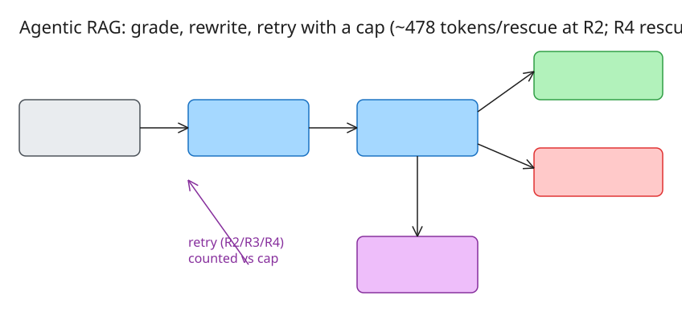

# Agentic RAG: Grade, Rewrite, Retry with a Cost Cap

Agentic RAG lets an agent decide **when and how** to retrieve while preparing an answer. This article tests one specific design — **grade → rewrite → retry with a cap** — and quantifies the returns. The headline: a single BM25 search found 20/40 questions; cap 2 got 32/40; cap 4 got 38/40 — but **round 4 rescued nothing** while spending 593 tokens.

## Why one search misses

Vocabulary mismatch: "Why does the site keep forgetting that I signed in?" never shares a word with the answer page titled "Session cookie expiry". The article's earlier lab measured BM25 at 29/30 on same-word questions but only 4/30 on reworded ones. Embeddings narrow the gap without closing it.

## The three-part design

1. **Grader**: reads question + top results, answers yes/no (does the known answer page rank top-3?)
2. **Rewriter**: generates a new query in technical vocabulary; rounds stack — R2 adds dictionary synonyms, R3 expands technical terms, R4 drops terms appearing in >4% of docs
3. **Cap**: stops the loop after N searches

## Simulation results

`node measure-agentic-search-retries.mjs`: 200 synthetic tech pages, 40 questions (20 technical, 20 everyday wording), plain BM25 (k1=1.2, b=0.75), Node 22, seed 33.

| Setting | Found | Everyday | Avg rounds | Tokens/q | Modeled s/q |
|---|---|---|---|---|---|
| one-shot | 20/40 | 0/20 | 1.00 | 0 | 0.03 |
| agentic, cap 2 | 32/40 | 12/20 | 1.50 | 321 | 1.17 |
| agentic, cap 4 | 38/40 | 18/20 | 1.75 | 396 | 1.46 |

Round-by-round for cap 4: R1 found 20, R2 rescued 12 (478 tokens/rescue), R3 rescued 6 (405 tokens/rescue), R4 rescued 0 (593 tokens spent for nothing). Technical questions all hit on round 1 and never paid for a retry.

## When to stop

**Set the cap from your logs.** R3 still found 6 of 8 remaining; R4 found 0 of 2 — both unrecoverable because the rewriter had drifted ("query slower reboot orm eager join" drifted into database terms for a memory-leak question). Two additional guards:

- **Repeated-query stop**: if the rewriter produces a query it already tried, a retry round cannot return anything new — skip it.
- **First-grade overhead**: 7,081 of 15,843 cap-4 tokens graded the first search of all 40 questions, *including the 20 already correct*. If most of your traffic hits first try, the first grade can cost more than the rescues are worth.

## Related research

- **CRAG** (Yan et al., Jan 2024, arXiv 2401.15884): lightweight evaluator scores retrieved docs, triggers different retrieval actions on low confidence.
- **Self-RAG** (Asai et al., Oct 2023, arXiv 2310.11511): trains one model to retrieve on demand and critique passages with reflection tokens.
- **Anthropic multi-agent research system** (Jun 13 2025): subagents "evaluate quality, identify gaps, and refine their next query"; effort heuristic — simple fact-finding needs one agent with 3–10 tool calls.

## References

- [Agentic RAG: grade the search, rewrite, retry with a cap (DEV.to)](https://dev.to/systemdesignsimple/agentic-rag-grade-the-search-rewrite-retry-with-a-cap-4ne3)
- [CRAG paper (arXiv 2401.15884)](https://arxiv.org/abs/2401.15884)
- [Self-RAG paper (arXiv 2310.11511)](https://arxiv.org/abs/2310.11511)
- [Anthropic Engineering: multi-agent research system](https://www.anthropic.com/engineering/multi-agent-research-system)
