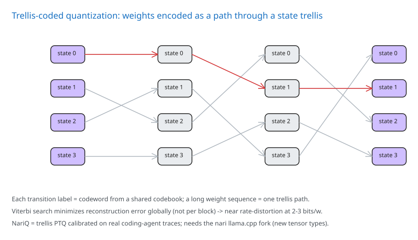

# NariQ: Trellis-Coded Post-Training Quantization Down to 2.5 Bits per Weight

NariQ (Nov 2026, nari-labs) releases GGUF quantizations of Qwen3.8-27B at **3, 2.5 and 2 bits per
weight**, with the 3-bit and 2.5-bit files reported to **match BF16 on long-horizon agent tasks**,
math and image understanding. It is a *post-training quantization* (PTQ) method — no retraining —
built on **trellis-coded quantization** (the QTIP lineage, arXiv 2406.11235) but with two twists:
calibration on **real coding-agent traces** instead of generic text, and a tensor layout that runs
on a single GPU via a dedicated llama.cpp fork.

## Why trellis-coded quantization

Standard GGUF quantization (Q4_K, IQ3, etc.) codes each weight block independently. Trellis-coded
quantization instead treats a long sequence of weights as a **path through a trellis**: each step
picks a state transition whose label is a codeword from a shared codebook, so a whole weight
sequence is encoded as a sequence of transitions. This achieves much higher effective
dimensionality per bit — approaching rate-distortion limits at 2–3 bits — where independent block
quantizers degrade sharply. QTIP established this as the state-of-the-art 2-bit PTQ frontier;
NariQ applies it to a modern dense hybrid-attention model (Qwen3.8-27B) with agent-trace calibration.

## The benchmark pattern that matters

The headline result (Claude Code CLI driving the local model, 262K context):

| Model | DeepSWE (113 tasks ×3) | Terminal-Bench 2.1 | AIME 25+26 | File size |
| --- | --- | --- | --- | --- |
| BF16 | 39.8 | 62.6 | 97.7 | 53.8 GB |
| NariQ 3-bit | 41.0 | 63.8 | 98.3 | 10.1 GB |
| NariQ 2.5-bit | 41.9 | 60.2 | 96.5 | 8.4 GB |
| NariQ 2-bit | 28.6 | 52.4 | 86.0 | 6.8 GB |

Three conceptual takeaways:

1. **Agentic scores can exceed the BF16 baseline at lower precision.** Quantization noise acts
   like mild regularization/sampling diversity; mean pass@1 on multi-step SWE tasks is noisy
   enough (and exploration-diverse enough) that a slightly different policy can solve more tasks.
   KL divergence from BF16 on held-out coding-agent traces — not perplexity on text — is the
   quality metric they optimize and report against file size.
2. **There is a cliff below 2.5 bits** for this model class: 2-bit collapses on agentic/math
   (28.6 vs ~40 DeepSWE) while staying acceptable on short-answer benchmarks (MGSM 90.6 vs 94.0).
   Short-task benchmarks hide the agentic degradation — evaluate on long-horizon tasks.
3. **Calibration distribution is a design decision.** Calibrating on coding-agent traces optimizes
   the weight codebooks for the token/activation distribution actually seen at inference in agent
   harnesses, which is what the eval then measures.

## Deployment constraints (the honest limits)

- **Requires a NariQ-aware runtime**: the nari-labs llama.cpp fork. Stock llama.cpp, Ollama and LM
  Studio cannot load the new tensor types yet.
- Fork performance is focused on **SM120 (RTX PRO 6000/Blackwell)**; Ampere/Ada/Hopper and Apple
  M-series are slower than comparable GGUFs (M-series needs a source build — ~3.8 tok/s 3-bit on
  an M3 Pro 18 GB); pre-Ampere falls back to CPU; AMD/Intel unsupported. Tested GPUs: RTX PRO 6000,
  H100, L4, A10 (GeForce untested).
- **Vision tower stays BF16** (separate 0.93 GB mmproj); MTP module not yet quantized.
- **KV cache and activations remain BF16** — quantizing those is the stated next step, which is
  what would let long contexts fit on 16 GB consumer GPUs (cf. the BF16-KV cache work in
  [Fast 4-bit KV-cache decoding](../../../how-to/cloudinfrastructure/gpucompute/how-to-fast-4bit-kv-cache-decoding-hopper-gpus.md)).
- Decode speed (RTX PRO 6000, 512 greedy tokens): 3-bit ≈ 88.9 tok/s @4K down to 70.7 @64K;
  2.5-bit ≈ 99.2 @4K; 2-bit ≈ 111.7 @4K. The size-matched third-party baseline is Unsloth's
  UD-IQ3_XXS (10.9 GB) at 94.7 tok/s @4K — so at like-for-like ~10 GB size, NariQ 3-bit decodes
  *slower* than UD-IQ3_XXS; its speed advantage only appears at the smaller 2.5/2-bit files.
  &lt;!-- zookeeper 2026-11-24: corrected an earlier "2-bit faster than similarly sized UD-IQ3_XXS"
       phrasing — the card's comparison pairs the 10.1 GB 3-bit file with the 10.9 GB UD-IQ3_XXS. -->

## Quickstart (from the model card)

```bash
hf download nari-labs/Qwen3.8-27B-NariQ-GGUF \
    Qwen3.8-27B-NariQ-3.0bpw.gguf Qwen3.8-27B-NariQ-mmproj-BF16.gguf --local-dir .
llama-server -m Qwen3.8-27B-NariQ-3.0bpw.gguf --mmproj Qwen3.8-27B-NariQ-mmproj-BF16.gguf \
    -ngl 99 -c 131072 --jinja --port 8080 \
    --temp 1.0 --top-p 0.95 --top-k 20 --min-p 0
```

`-c 131072` fits a 24 GB GPU (≈135K context for 3-bit); use `-c 262144` on 32 GB+. The sampling
flags are the thinking-mode settings the reported scores used — changing them invalidates
comparison against the published tables.

## Trellis-coded quantization intuition



## Related

- [Fast 4-bit KV-Cache Decoding on Hopper GPUs](../../../how-to/cloudinfrastructure/gpucompute/how-to-fast-4bit-kv-cache-decoding-hopper-gpus.md)
- [Certisum: MXFP4 Bitwise-Reproducible Training](../mlreproducibility/explanation-certisum-mxfp4-bitwise-training.md)

## References

- Model card: [nari-labs/Qwen3.8-27B-NariQ-GGUF on Hugging Face](https://huggingface.co/nari-labs/Qwen3.8-27B-NariQ-GGUF)
- NariQ tech report: [arXiv 2611.26157](https://arxiv.org/abs/2611.26157)
- QTIP (trellis-coded quantization foundation): [arXiv 2406.11235](https://arxiv.org/abs/2406.11235)
- Runtime fork: [nari-labs/nari-llama.cpp on GitHub](https://github.com/nari-labs/nari-llama.cpp)
